# 数据分析报告

> 项目：基于多源数据融合的跨境电商智能选品决策系统
> 生成日期：2026-11-03；数据快照：`data/processed/clean_data.csv` 等现有产物

## 一、结论摘要

1. 数据基础：205920 条周粒度清洗数据、104 周、132 品类 × 15 市场 1980 组合，预测产物 356400 行（90 天 × 2 模型）。
2. 模型精度：LightGBM 进阶 MAPE 2.33%，较 Prophet 基线 nan% 相对下降 nan%。
3. 推荐 Top1：阿胶糕 × 东南亚，综合评分 61.8。
4. 季节性：销量峰值集中在第 39 周（约 9 月），低点约在 4 月。
5. 贸易决策：1980 组合中高风险 242 个，平均利润冲击 -8.5%，平均融资就绪评分 77.8。
6. 业务指标：回测方向命中率 57.89%（随机基准 50%），校准偏差 -2.91%，Top-N 后验收益 90 天合计 $74607.59。

> 说明：行业数据以“已检索 / 待核实”双口径登记，来源表见附录 A；项目自身统计全部可由
> `scripts/run_data_analysis.py` 复现。

## 二、行业与市场数据分析

### 2.1 市场规模与增长

2025 年中国跨境电商进出口规模达到 2.75 万亿元，较 2020 年增长 69.7%（国新办 2026-01-28
发布会引用海关初步统计）。项目既有材料写作“同比增长 69.7%”，本报告按官方口径修正为
“较 2020 年增长”。行业企业数量超过 12 万家，商务部（gov.cn 转载）与海关总署口径均已检索，
来源见附录 A。

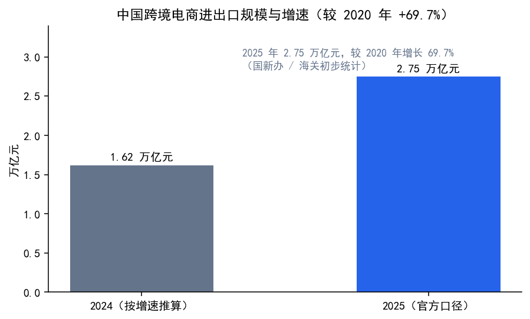

### 2.2 政策时间线

- 2025-05-02：美国对华 / 对港取消 de minimis（120% 或最低 100 美元）（美国）
- 2025-08-29：美国 EO 14324 全面取消 800 美元以下免税（美国）
- 2026-07-01：欧盟取消 150 欧元低值包裹免税额度（欧盟）

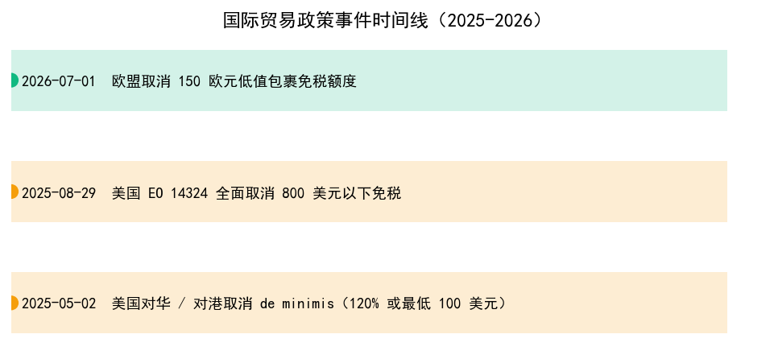

政策含义：美国市场小额包裹免税取消后，单件关税与到岸成本大幅上升；欧盟 2026-07-01 起取消
150 欧元低值包裹免税额度，正式清关、海外仓与 IOSS 合规成为卖家决策变量。这与系统
“政策风险 → 到岸成本 → 利润冲击”的决策链路直接对应。

### 2.3 海关出口信号（真实数据接入）

海关出口数据优先来自 UN Comtrade 免 Key 预览接口（来源 `comtrade`，
口径为中国按 HS4 品类汇总出口、最新可用年度 2024）。真实请求失败时
回退 Open Trade Statistics 或项目合成数据，并在来源表标注回退状态。

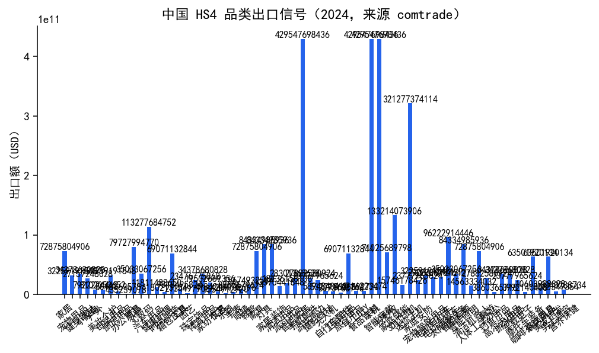

| 品类 | HS4 | 中国出口额（USD） | 年度 | 来源 |
| --- | ---: | ---: | ---: | --- |
| 家居 | 9403 | 72,875,804,906 | 2024 | comtrade |
| 宠物用品 | 3924 | 32,259,191,548 | 2024 | comtrade |
| 健身器材 | 9506 | 34,378,680,828 | 2024 | comtrade |
| 小家电 | 8509 | 27,157,248,028 | 2024 | comtrade |
| 户外 | 6306 | 7,922,224,412 | 2024 | comtrade |
| 美妆个护 | 3304 | 8,102,059,652 | 2024 | comtrade |
| 母婴用品 | 3924 | 32,259,191,548 | 2024 | comtrade |
| 厨房用品 | 8215 | 5,018,069,578 | 2024 | comtrade |
| 办公用品 | 8304 | 435,239,078 | 2024 | comtrade |
| 玩具 | 9503 | 79,727,994,770 | 2024 | comtrade |
| 3C数码 | 8518 | 35,033,067,256 | 2024 | comtrade |
| 汽车用品 | 8708 | 113,277,684,752 | 2024 | comtrade |
| 健康护理 | 9019 | 11,811,488,650 | 2024 | comtrade |
| 时尚服饰 | 6117 | 4,180,213,154 | 2024 | comtrade |
| 箱包皮具 | 4202 | 69,071,132,844 | 2024 | comtrade |
| 工具 | 8205 | 9,318,495,824 | 2024 | comtrade |
| 园艺 | 8201 | 2,134,497,908 | 2024 | comtrade |
| 珠宝饰品 | 7113 | 23,476,775,868 | 2024 | comtrade |
| 体育用品 | 9506 | 34,378,680,828 | 2024 | comtrade |
| 家纺布艺 | 6302 | 19,532,669,356 | 2024 | comtrade |

## 三、项目数据总览

| 指标 | 数值 |
| --- | --- |
| 历史数据条数 | 205920 条 |
| 时间粒度 / 周期 | 周粒度，2024-10-01 至 2026-09-22 |
| 覆盖范围 | 132 品类 × 15 市场 = 1980 组合 |
| 预测条数 / 范围 | 356400 条，2026-09-23 至 2026-12-21 |
| 推荐结果 | 1980 条 |
| 基线模型 MAPE | nan% |
| 进阶模型 MAPE | 2.33%（相对提升 nan%） |

## 四、探索性数据分析

### 4.1 品类 × 市场对比

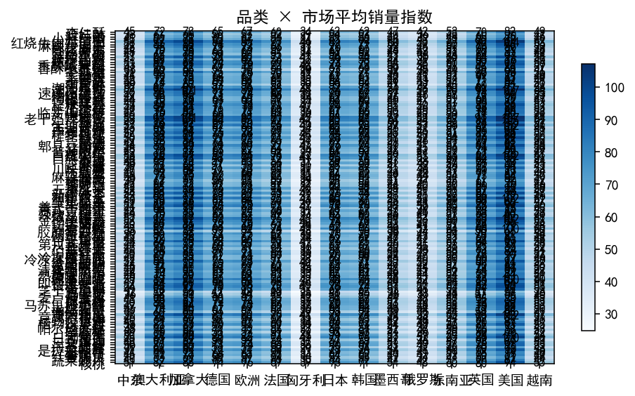

品类维度（全周期均值）：

| 品类 | 平均销量 | 平均搜索热度 | 平均出口（万美元） | 平均竞争度 | 平均价格（美元） | 近12周销量 | 12周增长 |
| --- | ---: | ---: | ---: | ---: | ---: | ---: | ---: |
| 速冻水饺 | 78.2 | 73.2 | 915.0 | 65.4 | 14.4 | 84.0 | +26.6% |
| 老干妈辣椒酱 | 77.6 | 72.3 | 453.5 | 68.7 | 7.2 | 83.4 | +26.6% |
| 辣条 | 75.9 | 72.5 | 253.1 | 69.8 | 4.1 | 81.0 | +25.3% |
| 红烧牛肉方便面 | 75.8 | 73.2 | 316.5 | 61.5 | 5.1 | 81.2 | +25.1% |
| 自热火锅 | 74.4 | 72.4 | 1117.8 | 65.4 | 18.5 | 80.2 | +26.5% |
| 生抽酱油 | 74.3 | 72.9 | 372.5 | 55.9 | 6.2 | 79.6 | +26.3% |
| 金枪鱼罐头 | 74.3 | 72.0 | 497.1 | 58.9 | 8.2 | 79.7 | +26.5% |
| 巴旦木 | 74.3 | 73.2 | 870.0 | 59.9 | 14.4 | 79.5 | +25.8% |
| 意大利面 | 74.3 | 73.1 | 433.2 | 58.5 | 7.2 | 79.7 | +27.5% |
| 速溶咖啡 | 72.7 | 72.6 | 546.5 | 65.6 | 9.3 | 77.5 | +25.5% |
| 美式牛肉干 | 72.7 | 73.9 | 851.2 | 62.0 | 14.4 | 78.0 | +27.9% |
| 日式拉面 | 72.7 | 72.4 | 730.3 | 62.9 | 12.4 | 77.9 | +25.9% |
| 蚝油 | 72.5 | 72.8 | 364.2 | 52.1 | 6.2 | 78.2 | +26.5% |
| 巧克力棒 | 72.5 | 72.9 | 362.4 | 67.8 | 6.2 | 78.0 | +26.9% |
| 新疆红枣 | 71.0 | 73.0 | 534.5 | 53.6 | 9.3 | 76.5 | +27.1% |
| 长沙米粉 | 70.9 | 73.7 | 533.7 | 61.6 | 9.3 | 75.7 | +25.5% |
| 郫县豆瓣酱 | 70.9 | 73.2 | 474.8 | 57.8 | 8.2 | 76.1 | +26.8% |
| 番茄酱 | 70.9 | 74.3 | 237.6 | 51.8 | 4.1 | 76.1 | +27.1% |
| 自热米饭 | 70.9 | 72.4 | 591.8 | 62.8 | 10.3 | 76.4 | +26.9% |
| 日式杯面 | 70.8 | 72.2 | 236.9 | 59.4 | 4.1 | 76.3 | +26.7% |
| 重庆酸辣粉 | 69.5 | 73.1 | 465.2 | 59.4 | 8.2 | 74.9 | +27.2% |
| 桂林米粉 | 69.5 | 74.0 | 522.4 | 60.2 | 9.3 | 74.8 | +26.9% |
| 腰果 | 69.4 | 72.6 | 927.0 | 57.8 | 16.5 | 74.5 | +26.2% |
| 宁夏枸杞 | 69.4 | 73.2 | 812.4 | 56.1 | 14.4 | 74.5 | +26.5% |
| 日本酱油 | 69.3 | 72.6 | 464.6 | 53.4 | 8.2 | 74.2 | +26.3% |
| 五香瓜子 | 69.2 | 73.5 | 405.1 | 59.0 | 7.2 | 74.5 | +26.6% |
| 冷冻披萨 | 69.1 | 73.1 | 635.7 | 63.6 | 11.3 | 74.0 | +26.0% |
| 干辣椒 | 67.8 | 76.7 | 565.5 | 51.5 | 10.3 | 74.3 | +28.0% |
| 潮汕鱼丸 | 67.7 | 72.6 | 791.8 | 56.4 | 14.4 | 72.7 | +26.5% |
| 爆米花 | 67.7 | 73.4 | 282.4 | 55.9 | 5.2 | 72.5 | +27.4% |
| 核桃 | 67.6 | 73.1 | 847.2 | 55.9 | 15.4 | 73.0 | +27.5% |
| 麻辣牛肉干 | 67.6 | 72.8 | 903.5 | 65.3 | 16.5 | 72.8 | +26.2% |
| 是拉差辣酱 | 67.6 | 72.7 | 338.8 | 57.4 | 6.2 | 72.5 | +26.3% |
| 镇江香醋 | 67.5 | 74.5 | 394.3 | 52.6 | 7.2 | 72.1 | +26.0% |
| 牛油果 | 67.4 | 79.9 | 787.0 | 59.9 | 14.4 | 72.9 | +28.1% |
| 曲奇礼盒 | 66.1 | 73.0 | 607.1 | 58.1 | 11.3 | 70.6 | +24.8% |
| 肉干棒 | 66.0 | 73.6 | 495.7 | 59.0 | 9.3 | 70.9 | +26.1% |
| 切达奶酪 | 66.0 | 73.5 | 991.5 | 60.0 | 18.5 | 70.7 | +25.4% |
| 葡萄干 | 65.9 | 72.4 | 385.7 | 53.9 | 7.2 | 70.6 | +25.6% |
| 海苔脆片 | 65.9 | 72.4 | 330.4 | 53.9 | 6.2 | 70.2 | +25.6% |
| 速冻小馄饨 | 65.8 | 72.9 | 494.8 | 57.7 | 9.3 | 70.5 | +25.2% |
| 硬豆腐 | 65.4 | 78.0 | 272.8 | 51.5 | 5.2 | 71.0 | +27.6% |
| 涪陵榨菜 | 64.6 | 75.9 | 269.6 | 51.0 | 5.2 | 71.1 | +28.6% |
| 酸菜 | 64.5 | 76.1 | 376.9 | 49.8 | 7.2 | 70.7 | +27.4% |
| 川味香肠 | 64.5 | 73.1 | 807.6 | 61.9 | 15.4 | 69.0 | +26.9% |
| 芝麻酱 | 64.4 | 73.1 | 538.4 | 54.1 | 10.3 | 69.5 | +27.4% |
| 黑芝麻丸 | 64.4 | 73.1 | 859.2 | 57.9 | 16.5 | 69.0 | +26.8% |
| 马苏里拉奶酪 | 64.4 | 72.9 | 861.5 | 60.1 | 16.5 | 69.1 | +25.8% |
| 芝士通心粉 | 64.4 | 72.6 | 430.6 | 58.1 | 8.2 | 69.2 | +26.7% |
| 手工挂面 | 64.3 | 77.3 | 429.8 | 55.5 | 8.2 | 69.0 | +27.5% |
| 南瓜籽 | 64.3 | 72.5 | 430.7 | 55.8 | 8.2 | 69.3 | +27.1% |
| 三文鱼柳 | 64.3 | 72.7 | 1286.4 | 63.8 | 24.7 | 68.9 | +26.0% |
| 怪味豆 | 64.2 | 72.3 | 323.6 | 55.5 | 6.2 | 68.9 | +26.1% |
| 广式月饼 | 64.2 | 78.6 | 962.3 | 60.7 | 18.5 | 68.8 | +27.6% |
| 蓝莓 | 64.1 | 80.0 | 639.7 | 57.3 | 12.3 | 69.0 | +27.5% |
| 抹茶粉 | 64.1 | 80.3 | 1070.7 | 60.6 | 20.6 | 68.7 | +27.5% |
| 伯爵红茶 | 62.8 | 72.2 | 736.1 | 55.6 | 14.4 | 67.3 | +26.5% |
| 香酥小黄鱼 | 62.8 | 72.4 | 630.4 | 53.5 | 12.4 | 67.8 | +27.1% |
| 山楂片 | 62.7 | 73.0 | 419.6 | 53.8 | 8.2 | 67.4 | +26.2% |
| 猪肉松 | 62.7 | 73.2 | 630.2 | 53.3 | 12.4 | 67.5 | +27.2% |
| 临安山核桃 | 62.7 | 72.5 | 1153.8 | 58.1 | 22.7 | 67.5 | +26.0% |
| 凉皮 | 62.7 | 80.9 | 313.4 | 55.4 | 6.2 | 67.4 | +27.2% |
| 清真牛肉干 | 62.7 | 72.6 | 629.6 | 56.9 | 12.3 | 67.4 | +26.6% |
| 芒果干 | 62.6 | 72.0 | 471.6 | 57.0 | 9.3 | 67.1 | +25.9% |
| 即食燕麦粥 | 61.4 | 75.9 | 358.8 | 54.7 | 7.2 | 67.3 | +28.1% |
| 燕麦片 | 61.4 | 76.1 | 408.7 | 53.9 | 8.2 | 67.2 | +27.8% |
| 热巧克力粉 | 61.2 | 73.0 | 409.1 | 59.8 | 8.2 | 65.9 | +26.1% |
| 橄榄罐装 | 61.1 | 73.5 | 358.3 | 54.7 | 7.2 | 65.7 | +26.4% |
| 麻辣面筋 | 61.1 | 72.1 | 358.7 | 58.2 | 7.2 | 65.2 | +26.4% |
| 意式萨拉米 | 61.1 | 72.9 | 612.3 | 57.4 | 12.4 | 65.3 | +25.6% |
| 蛋黄酥 | 61.0 | 77.2 | 712.8 | 59.9 | 14.4 | 65.3 | +26.7% |
| 小熊软糖 | 61.0 | 73.0 | 255.0 | 60.9 | 5.2 | 65.7 | +27.0% |
| 鹰嘴豆泥 | 60.8 | 79.7 | 304.6 | 54.7 | 6.2 | 64.9 | +26.6% |
| 桂花乌龙 | 60.6 | 79.6 | 809.9 | 57.4 | 16.5 | 65.5 | +27.6% |
| 银耳 | 59.8 | 76.0 | 449.8 | 51.4 | 9.3 | 65.4 | +27.4% |
| 干香菇 | 59.8 | 75.9 | 598.7 | 50.9 | 12.4 | 65.3 | +26.8% |
| 紫菜干 | 59.7 | 76.4 | 399.1 | 49.0 | 8.2 | 65.4 | +28.1% |
| 速食粥 | 59.7 | 76.5 | 299.7 | 53.7 | 6.2 | 65.5 | +27.7% |
| 浓汤罐头 | 59.5 | 72.1 | 346.9 | 54.9 | 7.2 | 64.0 | +26.4% |
| 蔬菜脆片 | 59.5 | 72.3 | 397.6 | 56.7 | 8.2 | 63.9 | +26.0% |
| 普洱熟茶 | 59.5 | 72.3 | 1293.4 | 63.6 | 26.8 | 63.8 | +26.6% |
| 蟹柳 | 59.4 | 72.7 | 397.7 | 54.9 | 8.2 | 63.8 | +26.7% |
| 素肉 | 59.4 | 72.5 | 495.6 | 57.9 | 10.3 | 64.1 | +26.8% |
| 八宝粥 | 59.4 | 72.3 | 496.6 | 52.0 | 10.3 | 63.8 | +26.4% |
| 杏仁酥 | 59.3 | 73.4 | 595.5 | 55.5 | 12.4 | 63.8 | +26.7% |
| 金丝蜜枣 | 59.3 | 73.2 | 494.3 | 51.6 | 10.3 | 63.9 | +26.8% |
| 植物汉堡排 | 59.3 | 80.1 | 691.6 | 59.6 | 14.4 | 63.8 | +26.8% |
| 红薯脆片 | 59.3 | 72.6 | 396.5 | 55.5 | 8.2 | 63.4 | +24.7% |
| 希腊酸奶 | 58.8 | 77.7 | 294.5 | 57.6 | 6.2 | 63.8 | +28.0% |
| 牛角包 | 58.2 | 76.2 | 292.0 | 57.5 | 6.2 | 64.0 | +27.9% |
| 松子 | 58.0 | 72.7 | 1356.2 | 55.9 | 28.8 | 61.9 | +25.4% |
| 洛神花茶 | 57.8 | 73.1 | 484.9 | 55.6 | 10.3 | 61.9 | +25.8% |
| 枸杞蜂蜜 | 57.8 | 73.3 | 727.8 | 53.6 | 15.5 | 61.8 | +25.4% |
| 第戎芥末酱 | 57.8 | 73.5 | 289.7 | 51.7 | 6.2 | 62.0 | +26.8% |
| 红烧面筋 | 57.8 | 72.2 | 435.0 | 55.6 | 9.3 | 61.8 | +25.9% |
| 辣椒豆罐头 | 57.7 | 72.8 | 338.6 | 55.7 | 7.2 | 62.1 | +26.9% |
| 鳀鱼脆条 | 57.7 | 73.1 | 481.9 | 57.9 | 10.3 | 61.7 | +27.0% |
| 柿饼 | 57.7 | 73.1 | 673.8 | 49.7 | 14.4 | 61.5 | +25.1% |
| 绿豆糕 | 57.6 | 79.5 | 480.5 | 53.9 | 10.3 | 61.8 | +27.7% |
| 番茄干 | 57.6 | 80.9 | 479.8 | 51.8 | 10.3 | 61.7 | +27.0% |
| 奇亚籽 | 57.6 | 72.7 | 578.2 | 54.1 | 12.4 | 61.5 | +25.9% |
| 西湖龙井 | 57.3 | 79.2 | 1336.0 | 64.8 | 28.8 | 61.9 | +28.3% |
| 咸鸭蛋 | 57.0 | 76.7 | 238.0 | 51.7 | 5.2 | 62.1 | +28.2% |
| 小米粥 | 56.6 | 75.9 | 377.6 | 49.4 | 8.2 | 62.1 | +27.5% |
| 油炸馓子 | 56.2 | 72.3 | 281.7 | 52.1 | 6.2 | 60.5 | +27.2% |
| 冷冻可颂面团 | 56.1 | 72.7 | 421.8 | 55.8 | 9.3 | 60.2 | +26.5% |
| 冷冻西兰花 | 55.9 | 80.7 | 326.2 | 50.8 | 7.2 | 59.9 | +26.3% |
| 铁观音 | 55.8 | 79.2 | 1117.3 | 59.5 | 24.7 | 59.8 | +26.8% |
| 茶叶蛋 | 55.6 | 77.5 | 139.4 | 53.4 | 3.1 | 60.1 | +27.0% |
| 铁棍山药 | 55.0 | 75.9 | 503.6 | 51.6 | 11.3 | 60.1 | +27.0% |
| 麦卢卡蜂蜜 | 54.5 | 71.8 | 1549.7 | 61.6 | 35.0 | 58.1 | +26.1% |
| 小瓶白酒 | 54.4 | 73.1 | 819.1 | 59.5 | 18.5 | 58.1 | +26.1% |
| 意式杏仁饼 | 54.4 | 73.0 | 546.6 | 51.5 | 12.4 | 58.5 | +26.1% |
| 松花蛋 | 53.7 | 77.2 | 268.7 | 47.5 | 6.2 | 58.3 | +27.4% |
| 干虾米 | 53.6 | 78.0 | 626.4 | 53.6 | 14.4 | 58.5 | +27.8% |
| 麻球 | 53.6 | 77.1 | 358.7 | 52.1 | 8.2 | 58.4 | +27.3% |
| 吊瓜子 | 53.3 | 76.3 | 532.3 | 52.7 | 12.3 | 58.5 | +27.6% |
| 清酒 | 52.8 | 73.3 | 795.8 | 58.0 | 18.5 | 56.5 | +26.0% |
| 天贝 | 52.7 | 79.7 | 395.5 | 50.7 | 9.3 | 56.7 | +28.1% |
| 青酱 | 52.6 | 79.3 | 525.7 | 53.4 | 12.3 | 56.7 | +27.6% |
| 虾酱 | 51.7 | 75.6 | 389.2 | 50.2 | 9.3 | 56.9 | +28.8% |
| 阿胶糕 | 51.2 | 72.8 | 1285.7 | 59.4 | 30.9 | 54.9 | +25.9% |
| 帕尔玛火腿 | 51.2 | 72.5 | 941.5 | 58.1 | 22.7 | 55.2 | +26.5% |
| 糖葫芦 | 51.1 | 73.2 | 341.9 | 50.7 | 8.2 | 55.1 | +27.2% |
| 素肉筋 | 51.1 | 80.2 | 425.9 | 52.7 | 10.3 | 55.1 | +27.5% |
| 藜麦 | 50.6 | 78.1 | 507.2 | 50.7 | 12.3 | 55.0 | +27.8% |
| 娃娃菜 | 50.6 | 78.9 | 253.2 | 46.9 | 6.2 | 55.1 | +28.9% |
| 冬瓜糖 | 49.5 | 72.8 | 289.9 | 48.1 | 7.2 | 52.9 | +26.2% |
| 潘纳托尼 | 49.5 | 73.5 | 826.9 | 55.5 | 20.6 | 53.1 | +26.0% |
| 马卡龙 | 47.9 | 72.3 | 640.2 | 51.9 | 16.5 | 51.1 | +25.6% |
| 胶原蛋白粉 | 47.7 | 72.8 | 1040.7 | 58.7 | 26.8 | 51.4 | +27.3% |
| 玛卡粉 | 42.9 | 72.4 | 646.1 | 52.9 | 18.5 | 46.1 | +26.5% |

市场维度（全周期均值）：

| 市场 | 平均销量 | 平均竞争度 | 平均价格（美元） | 平均出口（万美元） | 近12周销量 | 12周增长 |
| --- | ---: | ---: | ---: | ---: | ---: | ---: |
| 美国 | 85.3 | 57.8 | 11.5 | 778.4 | 92.0 | +26.7% |
| 加拿大 | 81.0 | 55.8 | 11.5 | 701.8 | 87.5 | +26.5% |
| 澳大利亚 | 75.1 | 55.5 | 11.5 | 684.3 | 81.0 | +26.5% |
| 英国 | 73.4 | 56.2 | 11.5 | 735.6 | 79.2 | +26.7% |
| 欧洲 | 70.0 | 56.2 | 11.5 | 734.8 | 75.6 | +26.4% |
| 德国 | 68.3 | 56.5 | 11.5 | 698.0 | 73.7 | +26.7% |
| 日本 | 66.5 | 56.7 | 11.5 | 637.1 | 71.8 | +26.5% |
| 韩国 | 64.8 | 57.2 | 11.5 | 561.7 | 69.9 | +26.4% |
| 法国 | 63.1 | 56.6 | 11.5 | 604.4 | 68.1 | +26.5% |
| 东南亚 | 55.1 | 55.0 | 11.5 | 452.5 | 57.3 | +29.9% |
| 越南 | 51.2 | 55.8 | 11.5 | 396.8 | 55.1 | +26.1% |
| 墨西哥 | 49.5 | 56.7 | 11.5 | 406.1 | 53.4 | +26.6% |
| 中东 | 46.9 | 56.2 | 11.5 | 448.8 | 50.7 | +26.6% |
| 俄罗斯 | 44.4 | 56.5 | 11.5 | 404.9 | 47.9 | +26.7% |
| 匈牙利 | 35.8 | 56.8 | 11.5 | 310.4 | 38.6 | +26.4% |

### 4.2 搜索与出口信号

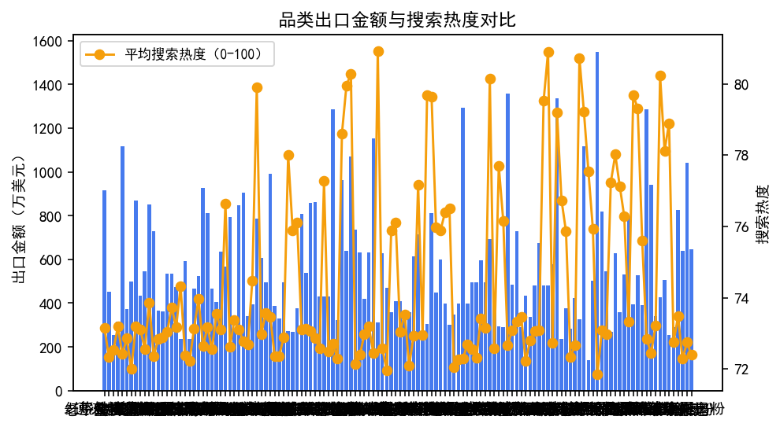

### 4.3 趋势与季节性

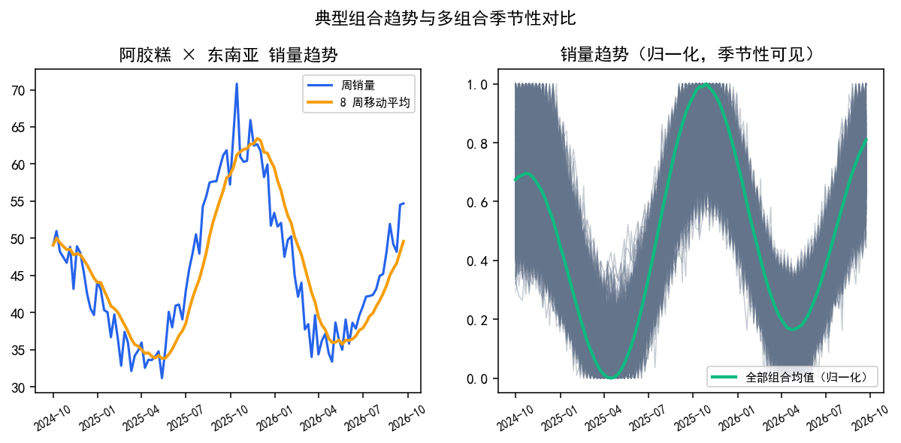

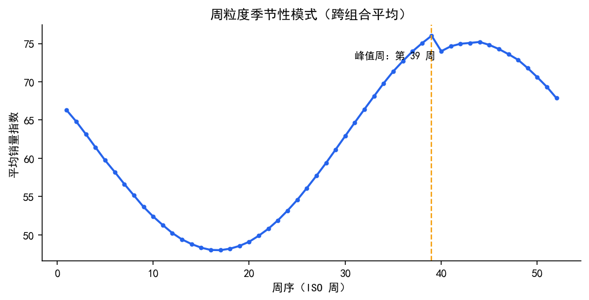

销量峰值周为第 39 周，峰值月约 9 月，
低谷月约 4 月；备货节奏应结合预测增长与季节峰值提前安排。

## 五、模型评估分析

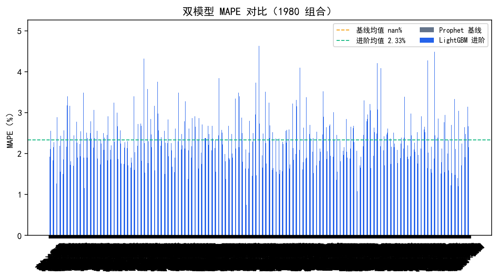

进阶模型最优组合：铁观音 × 东南亚
（MAPE 0.74%）；基线最差组合：
杏仁酥 × 中东
（MAPE nan%）。

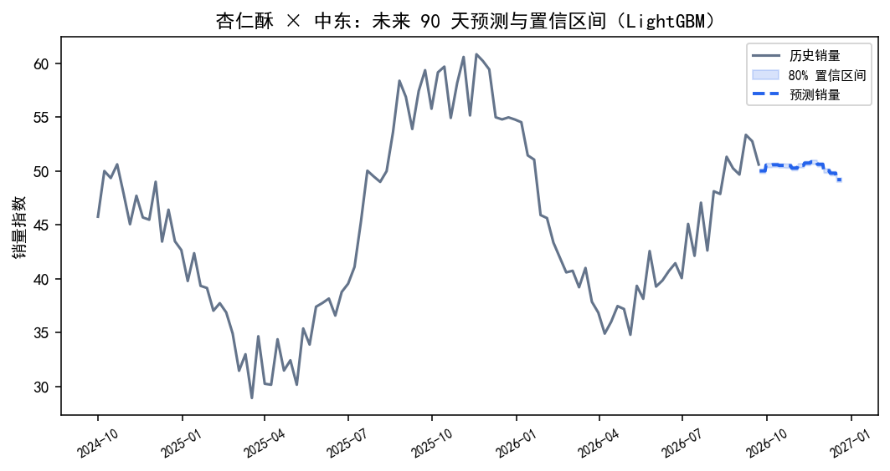

预测统一输出 80% 置信区间，历史与预测边界可追溯；区间宽度可用于备货风险的保守估计。

## 六、推荐结果分析

Top 10 推荐：

| 排名 | 品类 | 市场 | 综合评分 | 六维评分 | Go/No-Go | 预测增长 | 搜索趋势 | 竞争度 | 推荐理由 |
| ---: | --- | --- | ---: | ---: | ---: | ---: | ---: | ---: | --- |
| 1 | 阿胶糕 | 东南亚 | 61.8 | 69.7 | Conditional | +16.5% | +15.3% | 59.3 | 未来90天预测销量增长 16.5%；搜索热度环比上升 15.3%；竞争度中等（59/100） |
| 2 | 松子 | 英国 | 63.1 | 69.5 | Conditional | +19.0% | +13.6% | 56.0 | 未来90天预测销量增长 19.0%；搜索热度环比上升 13.6%；竞争度中等（56/100） |
| 3 | 西湖龙井 | 东南亚 | 61.5 | 69.4 | Conditional | +20.4% | +10.8% | 59.9 | 未来90天预测销量增长 20.4%；搜索热度环比上升 10.8%；竞争度中等（60/100） |
| 4 | 胶原蛋白粉 | 东南亚 | 61.7 | 69.4 | Conditional | +20.0% | +6.2% | 52.3 | 未来90天预测销量增长 20.0%；搜索热度环比上升 6.2%；竞争度中等（52/100）；评论增长活跃（3.7%） |
| 5 | 松子 | 加拿大 | 62.0 | 68.7 | Conditional | +16.4% | +10.5% | 52.1 | 未来90天预测销量增长 16.4%；搜索热度环比上升 10.5%；竞争度中等（52/100）；评论增长活跃（2.8%） |
| 6 | 铁观音 | 越南 | 58.6 | 68.6 | Conditional | +14.2% | +10.1% | 59.1 | 未来90天预测销量增长 14.2%；搜索热度环比上升 10.1%；竞争度中等（59/100） |
| 7 | 清酒 | 东南亚 | 63.0 | 68.1 | Conditional | +28.1% | +4.4% | 56.6 | 未来90天预测销量增长 28.1%；搜索热度环比上升 4.4%；竞争度中等（57/100）；评论增长活跃（3.0%） |
| 8 | 铁观音 | 东南亚 | 59.2 | 67.8 | Conditional | +16.5% | +8.2% | 58.1 | 未来90天预测销量增长 16.5%；搜索热度环比上升 8.2%；竞争度中等（58/100） |
| 9 | 抹茶粉 | 越南 | 58.6 | 67.3 | Conditional | +12.8% | +8.3% | 55.4 | 未来90天预测销量增长 12.8%；搜索热度环比上升 8.3%；竞争度中等（55/100）；评论增长活跃（2.6%） |
| 10 | 抹茶粉 | 东南亚 | 59.6 | 67.2 | Conditional | +14.6% | +9.6% | 54.4 | 未来90天预测销量增长 14.6%；搜索热度环比上升 9.6%；竞争度中等（54/100） |

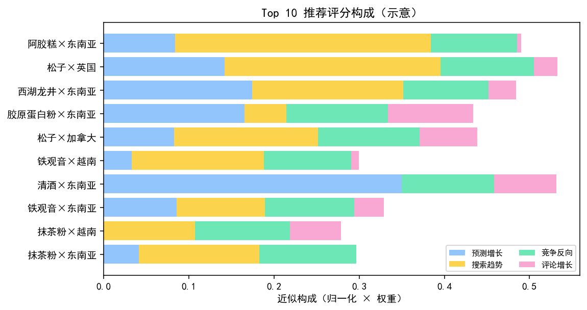

Top10 市场分布：东南亚 6 个、英国 1 个、加拿大 1 个、越南 2 个；
Top10 平均评分 60.9。东南亚市场在推荐榜中占比高，竞争度低、预测增长高是主要驱动。

## 七、贸易决策情景分析

| 品类 | 市场 | 政策风险 | 有效税率 | 到岸成本上升 | 利润率 | 融资就绪 | 冲突等级 | 最优物流 |
| --- | --- | --- | ---: | ---: | ---: | ---: | --- | --- |
| 长沙米粉 | 美国 | high | 130% | +1174.2% | -200.0% | 76.8 | high | 海外仓本地发货 |
| 长沙米粉 | 欧洲 | high | 12% | +29.2% | -23.8% | 72.7 | high | 海外仓本地发货 |
| 长沙米粉 | 东南亚 | low | 7% | +0.0% | +9.2% | 77.2 | high | 海外仓本地发货 |
| 长沙米粉 | 日本 | low | 9% | +0.0% | +7.2% | 82.1 | high | 海外仓本地发货 |
| 长沙米粉 | 加拿大 | low | 11% | +0.0% | +5.2% | 77.8 | high | 海外仓本地发货 |
| 长沙米粉 | 澳大利亚 | low | 8% | +0.0% | +8.2% | 80.2 | high | 海外仓本地发货 |
| 长沙米粉 | 英国 | low | 11% | +0.0% | +5.2% | 78.2 | high | 海外仓本地发货 |
| 长沙米粉 | 韩国 | low | 9% | +0.0% | +7.2% | 84.0 | high | 海外仓本地发货 |
| 长沙米粉 | 德国 | low | 12% | +0.0% | +4.2% | 78.4 | high | 海外仓本地发货 |
| 长沙米粉 | 法国 | low | 11% | +0.0% | +5.2% | 77.6 | high | 海外仓本地发货 |
| 长沙米粉 | 越南 | low | 7% | +0.0% | +9.2% | 74.0 | high | 海外仓本地发货 |
| 长沙米粉 | 俄罗斯 | low | 9% | +0.0% | +7.2% | 71.0 | high | 海外仓本地发货 |
| 长沙米粉 | 匈牙利 | low | 8% | +0.0% | +8.2% | 77.8 | high | 海外仓本地发货 |
| 长沙米粉 | 中东 | low | 8% | +0.0% | +8.2% | 77.0 | high | 海外仓本地发货 |
| 长沙米粉 | 墨西哥 | low | 9% | +0.0% | +7.2% | 69.8 | high | 海外仓本地发货 |
| 桂林米粉 | 美国 | high | 130% | +1174.2% | -200.0% | 76.8 | high | 海外仓本地发货 |
| 桂林米粉 | 欧洲 | high | 12% | +29.2% | -23.8% | 72.7 | high | 海外仓本地发货 |
| 桂林米粉 | 东南亚 | low | 7% | +0.0% | +9.2% | 77.2 | high | 海外仓本地发货 |
| 桂林米粉 | 日本 | low | 9% | +0.0% | +7.2% | 82.1 | high | 海外仓本地发货 |
| 桂林米粉 | 加拿大 | low | 11% | +0.0% | +5.2% | 77.8 | high | 海外仓本地发货 |
| 桂林米粉 | 澳大利亚 | low | 8% | +0.0% | +8.2% | 80.2 | high | 海外仓本地发货 |
| 桂林米粉 | 英国 | low | 11% | +0.0% | +5.2% | 78.2 | high | 海外仓本地发货 |
| 桂林米粉 | 韩国 | low | 9% | +0.0% | +7.2% | 84.0 | high | 海外仓本地发货 |
| 桂林米粉 | 德国 | low | 12% | +0.0% | +4.2% | 78.4 | high | 海外仓本地发货 |
| 桂林米粉 | 法国 | low | 11% | +0.0% | +5.2% | 77.6 | high | 海外仓本地发货 |
| 桂林米粉 | 越南 | low | 7% | +0.0% | +9.2% | 74.0 | high | 海外仓本地发货 |
| 桂林米粉 | 俄罗斯 | low | 9% | +0.0% | +7.2% | 71.0 | high | 海外仓本地发货 |
| 桂林米粉 | 匈牙利 | low | 8% | +0.0% | +8.2% | 77.8 | high | 海外仓本地发货 |
| 桂林米粉 | 中东 | low | 8% | +0.0% | +8.2% | 77.0 | high | 海外仓本地发货 |
| 桂林米粉 | 墨西哥 | low | 9% | +0.0% | +7.2% | 69.8 | high | 海外仓本地发货 |
| 手工挂面 | 美国 | high | 130% | +1243.1% | -200.0% | 76.8 | high | 海外仓本地发货 |
| 手工挂面 | 欧洲 | high | 12% | +32.4% | -34.8% | 72.7 | high | 海外仓本地发货 |
| 手工挂面 | 东南亚 | low | 7% | +0.0% | +3.2% | 75.4 | high | 海外仓本地发货 |
| 手工挂面 | 日本 | low | 9% | +0.0% | +1.2% | 82.1 | high | 海外仓本地发货 |
| 手工挂面 | 加拿大 | low | 11% | +0.0% | -0.8% | 77.8 | high | 海外仓本地发货 |
| 手工挂面 | 澳大利亚 | low | 8% | +0.0% | +2.2% | 78.4 | high | 海外仓本地发货 |
| 手工挂面 | 英国 | low | 11% | +0.0% | -0.8% | 78.2 | high | 海外仓本地发货 |
| 手工挂面 | 韩国 | low | 9% | +0.0% | +1.2% | 84.0 | high | 海外仓本地发货 |
| 手工挂面 | 德国 | low | 12% | +0.0% | -1.8% | 78.4 | high | 海外仓本地发货 |
| 手工挂面 | 法国 | low | 11% | +0.0% | -0.8% | 77.6 | high | 海外仓本地发货 |
| 手工挂面 | 越南 | low | 7% | +0.0% | +3.2% | 72.2 | high | 海外仓本地发货 |
| 手工挂面 | 俄罗斯 | low | 9% | +0.0% | +1.2% | 71.0 | high | 海外仓本地发货 |
| 手工挂面 | 匈牙利 | low | 8% | +0.0% | +2.2% | 76.0 | high | 海外仓本地发货 |
| 手工挂面 | 中东 | low | 8% | +0.0% | +2.2% | 75.2 | high | 海外仓本地发货 |
| 手工挂面 | 墨西哥 | low | 9% | +0.0% | +1.2% | 69.8 | high | 海外仓本地发货 |
| 八宝粥 | 美国 | high | 130% | +1113.6% | -200.0% | 76.8 | high | 海外仓本地发货 |
| 八宝粥 | 欧洲 | high | 12% | +26.4% | -14.9% | 72.7 | high | 海外仓本地发货 |
| 八宝粥 | 东南亚 | low | 7% | +0.0% | +14.1% | 77.2 | high | 海外仓本地发货 |
| 八宝粥 | 日本 | low | 9% | +0.0% | +12.1% | 83.9 | high | 海外仓本地发货 |
| 八宝粥 | 加拿大 | low | 11% | +0.0% | +10.1% | 79.6 | high | 海外仓本地发货 |
| 八宝粥 | 澳大利亚 | low | 8% | +0.0% | +13.1% | 80.2 | high | 海外仓本地发货 |
| 八宝粥 | 英国 | low | 11% | +0.0% | +10.1% | 80.0 | high | 海外仓本地发货 |
| 八宝粥 | 韩国 | low | 9% | +0.0% | +12.1% | 85.8 | high | 海外仓本地发货 |
| 八宝粥 | 德国 | low | 12% | +0.0% | +9.1% | 80.2 | high | 海外仓本地发货 |
| 八宝粥 | 法国 | low | 11% | +0.0% | +10.1% | 79.4 | high | 海外仓本地发货 |
| 八宝粥 | 越南 | low | 7% | +0.0% | +14.1% | 74.0 | high | 海外仓本地发货 |
| 八宝粥 | 俄罗斯 | low | 9% | +0.0% | +12.1% | 72.8 | high | 海外仓本地发货 |
| 八宝粥 | 匈牙利 | low | 8% | +0.0% | +13.1% | 77.8 | high | 海外仓本地发货 |
| 八宝粥 | 中东 | low | 8% | +0.0% | +13.1% | 77.0 | high | 海外仓本地发货 |
| 八宝粥 | 墨西哥 | low | 9% | +0.0% | +12.1% | 71.6 | high | 海外仓本地发货 |
| 小米粥 | 美国 | high | 130% | +1243.1% | -200.0% | 76.8 | high | 海外仓本地发货 |
| 小米粥 | 欧洲 | high | 12% | +32.4% | -34.8% | 72.7 | high | 海外仓本地发货 |
| 小米粥 | 东南亚 | low | 7% | +0.0% | +3.2% | 75.4 | high | 海外仓本地发货 |
| 小米粥 | 日本 | low | 9% | +0.0% | +1.2% | 82.1 | high | 海外仓本地发货 |
| 小米粥 | 加拿大 | low | 11% | +0.0% | -0.8% | 77.8 | high | 海外仓本地发货 |
| 小米粥 | 澳大利亚 | low | 8% | +0.0% | +2.2% | 78.4 | high | 海外仓本地发货 |
| 小米粥 | 英国 | low | 11% | +0.0% | -0.8% | 78.2 | high | 海外仓本地发货 |
| 小米粥 | 韩国 | low | 9% | +0.0% | +1.2% | 84.0 | high | 海外仓本地发货 |
| 小米粥 | 德国 | low | 12% | +0.0% | -1.8% | 78.4 | high | 海外仓本地发货 |
| 小米粥 | 法国 | low | 11% | +0.0% | -0.8% | 77.6 | high | 海外仓本地发货 |
| 小米粥 | 越南 | low | 7% | +0.0% | +3.2% | 72.2 | high | 海外仓本地发货 |
| 小米粥 | 俄罗斯 | low | 9% | +0.0% | +1.2% | 71.0 | high | 海外仓本地发货 |
| 小米粥 | 匈牙利 | low | 8% | +0.0% | +2.2% | 76.0 | high | 海外仓本地发货 |
| 小米粥 | 中东 | low | 8% | +0.0% | +2.2% | 75.2 | high | 海外仓本地发货 |
| 小米粥 | 墨西哥 | low | 9% | +0.0% | +1.2% | 69.8 | high | 海外仓本地发货 |
| 速冻水饺 | 美国 | high | 130% | +919.8% | -200.0% | 72.8 | high | 海外仓本地发货 |
| 速冻水饺 | 欧洲 | high | 12% | +17.4% | +7.7% | 72.0 | high | 海外仓本地发货 |
| 速冻水饺 | 东南亚 | low | 7% | +0.0% | +26.4% | 78.9 | low | 海外仓本地发货 |
| 速冻水饺 | 日本 | low | 9% | +0.0% | +24.4% | 82.2 | high | 海外仓本地发货 |
| 速冻水饺 | 加拿大 | low | 11% | +0.0% | +22.4% | 81.4 | low | 海外仓本地发货 |
| 速冻水饺 | 澳大利亚 | low | 8% | +0.0% | +25.4% | 81.9 | low | 海外仓本地发货 |
| 速冻水饺 | 英国 | low | 11% | +0.0% | +22.4% | 81.8 | low | 海外仓本地发货 |
| 速冻水饺 | 韩国 | low | 9% | +0.0% | +24.4% | 84.1 | high | 海外仓本地发货 |
| 速冻水饺 | 德国 | low | 12% | +0.0% | +21.4% | 81.0 | high | 海外仓本地发货 |
| 速冻水饺 | 法国 | low | 11% | +0.0% | +22.4% | 81.2 | high | 海外仓本地发货 |
| 速冻水饺 | 越南 | low | 7% | +0.0% | +26.4% | 75.8 | low | 海外仓本地发货 |
| 速冻水饺 | 俄罗斯 | low | 9% | +0.0% | +24.4% | 74.5 | low | 海外仓本地发货 |
| 速冻水饺 | 匈牙利 | low | 8% | +0.0% | +25.4% | 79.5 | high | 海外仓本地发货 |
| 速冻水饺 | 中东 | low | 8% | +0.0% | +25.4% | 78.8 | high | 海外仓本地发货 |
| 速冻水饺 | 墨西哥 | low | 9% | +0.0% | +24.4% | 73.4 | high | 海外仓本地发货 |
| 日式拉面 | 美国 | high | 130% | +1007.1% | -200.0% | 76.8 | high | 海外仓本地发货 |
| 日式拉面 | 欧洲 | high | 12% | +21.5% | -1.7% | 72.7 | high | 海外仓本地发货 |
| 日式拉面 | 东南亚 | low | 7% | +0.0% | +21.3% | 78.7 | low | 海外仓本地发货 |
| 日式拉面 | 日本 | low | 9% | +0.0% | +19.3% | 85.4 | high | 海外仓本地发货 |
| 日式拉面 | 加拿大 | low | 11% | +0.0% | +17.3% | 81.1 | high | 海外仓本地发货 |
| 日式拉面 | 澳大利亚 | low | 8% | +0.0% | +20.3% | 81.7 | low | 海外仓本地发货 |
| 日式拉面 | 英国 | low | 11% | +0.0% | +17.3% | 81.5 | high | 海外仓本地发货 |
| 日式拉面 | 韩国 | low | 9% | +0.0% | +19.3% | 87.3 | high | 海外仓本地发货 |
| 日式拉面 | 德国 | low | 12% | +0.0% | +16.3% | 81.7 | high | 海外仓本地发货 |
| 日式拉面 | 法国 | low | 11% | +0.0% | +17.3% | 80.9 | high | 海外仓本地发货 |
| 日式拉面 | 越南 | low | 7% | +0.0% | +21.3% | 75.5 | low | 海外仓本地发货 |
| 日式拉面 | 俄罗斯 | low | 9% | +0.0% | +19.3% | 74.3 | low | 海外仓本地发货 |
| 日式拉面 | 匈牙利 | low | 8% | +0.0% | +20.3% | 79.3 | high | 海外仓本地发货 |
| 日式拉面 | 中东 | low | 8% | +0.0% | +20.3% | 78.5 | high | 海外仓本地发货 |
| 日式拉面 | 墨西哥 | low | 9% | +0.0% | +19.3% | 73.1 | high | 海外仓本地发货 |
| 意大利面 | 美国 | high | 130% | +1318.7% | -200.0% | 76.8 | high | 海外仓本地发货 |
| 意大利面 | 欧洲 | high | 12% | +36.0% | -49.0% | 72.7 | high | 海外仓本地发货 |
| 意大利面 | 东南亚 | low | 7% | +0.0% | -4.5% | 75.4 | high | 海外仓本地发货 |
| 意大利面 | 日本 | low | 9% | +0.0% | -6.5% | 82.1 | high | 海外仓本地发货 |
| 意大利面 | 加拿大 | low | 11% | +0.0% | -8.5% | 77.8 | high | 海外仓本地发货 |
| 意大利面 | 澳大利亚 | low | 8% | +0.0% | -5.5% | 78.4 | high | 海外仓本地发货 |
| 意大利面 | 英国 | low | 11% | +0.0% | -8.5% | 78.2 | high | 海外仓本地发货 |
| 意大利面 | 韩国 | low | 9% | +0.0% | -6.5% | 84.0 | high | 海外仓本地发货 |
| 意大利面 | 德国 | low | 12% | +0.0% | -9.5% | 78.4 | high | 海外仓本地发货 |
| 意大利面 | 法国 | low | 11% | +0.0% | -8.5% | 77.6 | high | 海外仓本地发货 |
| 意大利面 | 越南 | low | 7% | +0.0% | -4.5% | 72.2 | high | 海外仓本地发货 |
| 意大利面 | 俄罗斯 | low | 9% | +0.0% | -6.5% | 71.0 | high | 海外仓本地发货 |
| 意大利面 | 匈牙利 | low | 8% | +0.0% | -5.5% | 76.0 | high | 海外仓本地发货 |
| 意大利面 | 中东 | low | 8% | +0.0% | -5.5% | 75.2 | high | 海外仓本地发货 |
| 意大利面 | 墨西哥 | low | 9% | +0.0% | -6.5% | 69.8 | high | 海外仓本地发货 |
| 燕麦片 | 美国 | high | 130% | +1243.1% | -200.0% | 76.8 | high | 海外仓本地发货 |
| 燕麦片 | 欧洲 | high | 12% | +32.4% | -34.8% | 72.7 | high | 海外仓本地发货 |
| 燕麦片 | 东南亚 | low | 7% | +0.0% | +3.2% | 75.4 | high | 海外仓本地发货 |
| 燕麦片 | 日本 | low | 9% | +0.0% | +1.2% | 82.1 | high | 海外仓本地发货 |
| 燕麦片 | 加拿大 | low | 11% | +0.0% | -0.8% | 77.8 | high | 海外仓本地发货 |
| 燕麦片 | 澳大利亚 | low | 8% | +0.0% | +2.2% | 78.4 | high | 海外仓本地发货 |
| 燕麦片 | 英国 | low | 11% | +0.0% | -0.8% | 78.2 | high | 海外仓本地发货 |
| 燕麦片 | 韩国 | low | 9% | +0.0% | +1.2% | 84.0 | high | 海外仓本地发货 |
| 燕麦片 | 德国 | low | 12% | +0.0% | -1.8% | 78.4 | high | 海外仓本地发货 |
| 燕麦片 | 法国 | low | 11% | +0.0% | -0.8% | 77.6 | high | 海外仓本地发货 |
| 燕麦片 | 越南 | low | 7% | +0.0% | +3.2% | 72.2 | high | 海外仓本地发货 |
| 燕麦片 | 俄罗斯 | low | 9% | +0.0% | +1.2% | 71.0 | high | 海外仓本地发货 |
| 燕麦片 | 匈牙利 | low | 8% | +0.0% | +2.2% | 76.0 | high | 海外仓本地发货 |
| 燕麦片 | 中东 | low | 8% | +0.0% | +2.2% | 75.2 | high | 海外仓本地发货 |
| 燕麦片 | 墨西哥 | low | 9% | +0.0% | +1.2% | 69.8 | high | 海外仓本地发货 |
| 藜麦 | 美国 | high | 130% | +1007.1% | -200.0% | 76.8 | high | 海外仓本地发货 |
| 藜麦 | 欧洲 | high | 12% | +21.5% | -1.7% | 72.7 | high | 海外仓本地发货 |
| 藜麦 | 东南亚 | low | 7% | +0.0% | +21.3% | 78.7 | low | 海外仓本地发货 |
| 藜麦 | 日本 | low | 9% | +0.0% | +19.3% | 85.4 | high | 海外仓本地发货 |
| 藜麦 | 加拿大 | low | 11% | +0.0% | +17.3% | 81.1 | high | 海外仓本地发货 |
| 藜麦 | 澳大利亚 | low | 8% | +0.0% | +20.3% | 81.7 | low | 海外仓本地发货 |
| 藜麦 | 英国 | low | 11% | +0.0% | +17.3% | 81.5 | high | 海外仓本地发货 |
| 藜麦 | 韩国 | low | 9% | +0.0% | +19.3% | 87.3 | high | 海外仓本地发货 |
| 藜麦 | 德国 | low | 12% | +0.0% | +16.3% | 81.7 | high | 海外仓本地发货 |
| 藜麦 | 法国 | low | 11% | +0.0% | +17.3% | 80.9 | high | 海外仓本地发货 |
| 藜麦 | 越南 | low | 7% | +0.0% | +21.3% | 75.5 | low | 海外仓本地发货 |
| 藜麦 | 俄罗斯 | low | 9% | +0.0% | +19.3% | 74.3 | low | 海外仓本地发货 |
| 藜麦 | 匈牙利 | low | 8% | +0.0% | +20.3% | 79.3 | high | 海外仓本地发货 |
| 藜麦 | 中东 | low | 8% | +0.0% | +20.3% | 78.5 | high | 海外仓本地发货 |
| 藜麦 | 墨西哥 | low | 9% | +0.0% | +19.3% | 73.1 | high | 海外仓本地发货 |
| 冷冻披萨 | 美国 | high | 130% | +1057.8% | -200.0% | 72.8 | high | 海外仓本地发货 |
| 冷冻披萨 | 欧洲 | high | 12% | +23.8% | -7.8% | 72.0 | high | 海外仓本地发货 |
| 冷冻披萨 | 东南亚 | low | 7% | +0.0% | +18.0% | 78.0 | high | 海外仓本地发货 |
| 冷冻披萨 | 日本 | low | 9% | +0.0% | +16.0% | 81.3 | high | 海外仓本地发货 |
| 冷冻披萨 | 加拿大 | low | 11% | +0.0% | +14.0% | 79.0 | high | 海外仓本地发货 |
| 冷冻披萨 | 澳大利亚 | low | 8% | +0.0% | +17.0% | 81.0 | high | 海外仓本地发货 |
| 冷冻披萨 | 英国 | low | 11% | +0.0% | +14.0% | 79.4 | high | 海外仓本地发货 |
| 冷冻披萨 | 韩国 | low | 9% | +0.0% | +16.0% | 83.2 | high | 海外仓本地发货 |
| 冷冻披萨 | 德国 | low | 12% | +0.0% | +13.0% | 79.5 | high | 海外仓本地发货 |
| 冷冻披萨 | 法国 | low | 11% | +0.0% | +14.0% | 78.8 | high | 海外仓本地发货 |
| 冷冻披萨 | 越南 | low | 7% | +0.0% | +18.0% | 74.9 | high | 海外仓本地发货 |
| 冷冻披萨 | 俄罗斯 | low | 9% | +0.0% | +16.0% | 73.7 | high | 海外仓本地发货 |
| 冷冻披萨 | 匈牙利 | low | 8% | +0.0% | +17.0% | 78.6 | high | 海外仓本地发货 |
| 冷冻披萨 | 中东 | low | 8% | +0.0% | +17.0% | 77.8 | high | 海外仓本地发货 |
| 冷冻披萨 | 墨西哥 | low | 9% | +0.0% | +16.0% | 72.5 | high | 海外仓本地发货 |
| 麻辣牛肉干 | 美国 | high | 132% | +820.8% | -200.0% | 76.8 | high | 海外仓本地发货 |
| 麻辣牛肉干 | 欧洲 | medium | 14% | +10.5% | +14.8% | 77.5 | high | 海外仓本地发货 |
| 麻辣牛肉干 | 东南亚 | low | 8% | +0.0% | +28.9% | 79.6 | low | 海外仓本地发货 |
| 麻辣牛肉干 | 日本 | low | 11% | +0.0% | +26.5% | 86.3 | high | 海外仓本地发货 |
| 麻辣牛肉干 | 加拿大 | low | 13% | +0.0% | +24.1% | 82.0 | low | 海外仓本地发货 |
| 麻辣牛肉干 | 澳大利亚 | low | 10% | +0.0% | +27.7% | 82.6 | low | 海外仓本地发货 |
| 麻辣牛肉干 | 英国 | low | 13% | +0.0% | +24.1% | 82.4 | low | 海外仓本地发货 |
| 麻辣牛肉干 | 韩国 | low | 11% | +0.0% | +26.5% | 88.2 | high | 海外仓本地发货 |
| 麻辣牛肉干 | 德国 | low | 14% | +0.0% | +22.9% | 82.6 | high | 海外仓本地发货 |
| 麻辣牛肉干 | 法国 | low | 13% | +0.0% | +24.1% | 81.8 | high | 海外仓本地发货 |
| 麻辣牛肉干 | 越南 | low | 8% | +0.0% | +28.9% | 76.4 | low | 海外仓本地发货 |
| 麻辣牛肉干 | 俄罗斯 | low | 11% | +0.0% | +26.5% | 75.2 | low | 海外仓本地发货 |
| 麻辣牛肉干 | 匈牙利 | low | 10% | +0.0% | +27.7% | 80.2 | high | 海外仓本地发货 |
| 麻辣牛肉干 | 中东 | low | 10% | +0.0% | +27.7% | 79.4 | high | 海外仓本地发货 |
| 麻辣牛肉干 | 墨西哥 | low | 11% | +0.0% | +26.5% | 74.0 | high | 海外仓本地发货 |
| 茶叶蛋 | 美国 | high | 132% | +1729.9% | -200.0% | 72.8 | high | 海外仓本地发货 |
| 茶叶蛋 | 欧洲 | high | 14% | +54.2% | -200.0% | 72.0 | high | 海外仓本地发货 |
| 茶叶蛋 | 东南亚 | low | 8% | +0.0% | -88.5% | 74.7 | high | 海外仓本地发货 |
| 茶叶蛋 | 日本 | low | 11% | +0.0% | -90.9% | 78.0 | high | 海外仓本地发货 |
| 茶叶蛋 | 加拿大 | low | 13% | +0.0% | -93.3% | 77.2 | high | 海外仓本地发货 |
| 茶叶蛋 | 澳大利亚 | low | 10% | +0.0% | -89.7% | 77.7 | high | 海外仓本地发货 |
| 茶叶蛋 | 英国 | low | 13% | +0.0% | -93.3% | 77.6 | high | 海外仓本地发货 |
| 茶叶蛋 | 韩国 | low | 11% | +0.0% | -90.9% | 79.9 | high | 海外仓本地发货 |
| 茶叶蛋 | 德国 | low | 14% | +0.0% | -94.5% | 77.7 | high | 海外仓本地发货 |
| 茶叶蛋 | 法国 | low | 13% | +0.0% | -93.3% | 77.0 | high | 海外仓本地发货 |
| 茶叶蛋 | 越南 | low | 8% | +0.0% | -88.5% | 71.6 | high | 海外仓本地发货 |
| 茶叶蛋 | 俄罗斯 | low | 11% | +0.0% | -90.9% | 70.3 | high | 海外仓本地发货 |
| 茶叶蛋 | 匈牙利 | low | 10% | +0.0% | -89.7% | 75.3 | high | 海外仓本地发货 |
| 茶叶蛋 | 中东 | low | 10% | +0.0% | -89.7% | 74.5 | high | 海外仓本地发货 |
| 茶叶蛋 | 墨西哥 | low | 11% | +0.0% | -90.9% | 69.2 | high | 海外仓本地发货 |
| 咸鸭蛋 | 美国 | high | 132% | +1479.2% | -200.0% | 76.8 | high | 海外仓本地发货 |
| 咸鸭蛋 | 欧洲 | high | 14% | +42.1% | -94.3% | 72.7 | high | 海外仓本地发货 |
| 咸鸭蛋 | 东南亚 | low | 8% | +0.0% | -30.7% | 75.4 | high | 海外仓本地发货 |
| 咸鸭蛋 | 日本 | low | 11% | +0.0% | -33.1% | 82.1 | high | 海外仓本地发货 |
| 咸鸭蛋 | 加拿大 | low | 13% | +0.0% | -35.5% | 77.8 | high | 海外仓本地发货 |
| 咸鸭蛋 | 澳大利亚 | low | 10% | +0.0% | -31.9% | 78.4 | high | 海外仓本地发货 |
| 咸鸭蛋 | 英国 | low | 13% | +0.0% | -35.5% | 78.2 | high | 海外仓本地发货 |
| 咸鸭蛋 | 韩国 | low | 11% | +0.0% | -33.1% | 84.0 | high | 海外仓本地发货 |
| 咸鸭蛋 | 德国 | low | 14% | +0.0% | -36.7% | 78.4 | high | 海外仓本地发货 |
| 咸鸭蛋 | 法国 | low | 13% | +0.0% | -35.5% | 77.6 | high | 海外仓本地发货 |
| 咸鸭蛋 | 越南 | low | 8% | +0.0% | -30.7% | 72.2 | high | 海外仓本地发货 |
| 咸鸭蛋 | 俄罗斯 | low | 11% | +0.0% | -33.1% | 71.0 | high | 海外仓本地发货 |
| 咸鸭蛋 | 匈牙利 | low | 10% | +0.0% | -31.9% | 76.0 | high | 海外仓本地发货 |
| 咸鸭蛋 | 中东 | low | 10% | +0.0% | -31.9% | 75.2 | high | 海外仓本地发货 |
| 咸鸭蛋 | 墨西哥 | low | 11% | +0.0% | -33.1% | 69.8 | high | 海外仓本地发货 |
| 川味香肠 | 美国 | high | 132% | +855.4% | -200.0% | 72.8 | high | 海外仓本地发货 |
| 川味香肠 | 欧洲 | medium | 14% | +12.2% | +11.5% | 76.8 | high | 海外仓本地发货 |
| 川味香肠 | 东南亚 | low | 8% | +0.0% | +27.1% | 78.9 | low | 海外仓本地发货 |
| 川味香肠 | 日本 | low | 11% | +0.0% | +24.7% | 82.2 | high | 海外仓本地发货 |
| 川味香肠 | 加拿大 | low | 13% | +0.0% | +22.3% | 81.4 | low | 海外仓本地发货 |
| 川味香肠 | 澳大利亚 | low | 10% | +0.0% | +25.9% | 81.9 | low | 海外仓本地发货 |
| 川味香肠 | 英国 | low | 13% | +0.0% | +22.3% | 81.8 | low | 海外仓本地发货 |
| 川味香肠 | 韩国 | low | 11% | +0.0% | +24.7% | 84.1 | high | 海外仓本地发货 |
| 川味香肠 | 德国 | low | 14% | +0.0% | +21.1% | 81.0 | high | 海外仓本地发货 |
| 川味香肠 | 法国 | low | 13% | +0.0% | +22.3% | 81.2 | high | 海外仓本地发货 |
| 川味香肠 | 越南 | low | 8% | +0.0% | +27.1% | 75.8 | low | 海外仓本地发货 |
| 川味香肠 | 俄罗斯 | low | 11% | +0.0% | +24.7% | 74.5 | low | 海外仓本地发货 |
| 川味香肠 | 匈牙利 | low | 10% | +0.0% | +25.9% | 79.5 | high | 海外仓本地发货 |
| 川味香肠 | 中东 | low | 10% | +0.0% | +25.9% | 78.8 | high | 海外仓本地发货 |
| 川味香肠 | 墨西哥 | low | 11% | +0.0% | +24.7% | 73.4 | high | 海外仓本地发货 |
| 松花蛋 | 美国 | high | 132% | +1380.8% | -200.0% | 76.8 | high | 海外仓本地发货 |
| 松花蛋 | 欧洲 | high | 14% | +37.3% | -67.9% | 72.7 | high | 海外仓本地发货 |
| 松花蛋 | 东南亚 | low | 8% | +0.0% | -16.3% | 75.4 | high | 海外仓本地发货 |
| 松花蛋 | 日本 | low | 11% | +0.0% | -18.7% | 82.1 | high | 海外仓本地发货 |
| 松花蛋 | 加拿大 | low | 13% | +0.0% | -21.1% | 77.8 | high | 海外仓本地发货 |
| 松花蛋 | 澳大利亚 | low | 10% | +0.0% | -17.5% | 78.4 | high | 海外仓本地发货 |
| 松花蛋 | 英国 | low | 13% | +0.0% | -21.1% | 78.2 | high | 海外仓本地发货 |
| 松花蛋 | 韩国 | low | 11% | +0.0% | -18.7% | 84.0 | high | 海外仓本地发货 |
| 松花蛋 | 德国 | low | 14% | +0.0% | -22.3% | 78.4 | high | 海外仓本地发货 |
| 松花蛋 | 法国 | low | 13% | +0.0% | -21.1% | 77.6 | high | 海外仓本地发货 |
| 松花蛋 | 越南 | low | 8% | +0.0% | -16.3% | 72.2 | high | 海外仓本地发货 |
| 松花蛋 | 俄罗斯 | low | 11% | +0.0% | -18.7% | 71.0 | high | 海外仓本地发货 |
| 松花蛋 | 匈牙利 | low | 10% | +0.0% | -17.5% | 76.0 | high | 海外仓本地发货 |
| 松花蛋 | 中东 | low | 10% | +0.0% | -17.5% | 75.2 | high | 海外仓本地发货 |
| 松花蛋 | 墨西哥 | low | 11% | +0.0% | -18.7% | 69.8 | high | 海外仓本地发货 |
| 美式牛肉干 | 美国 | high | 132% | +893.8% | -200.0% | 76.8 | high | 海外仓本地发货 |
| 美式牛肉干 | 欧洲 | medium | 14% | +14.0% | +7.7% | 75.7 | high | 海外仓本地发货 |
| 美式牛肉干 | 东南亚 | low | 8% | +0.0% | +25.0% | 79.6 | low | 海外仓本地发货 |
| 美式牛肉干 | 日本 | low | 11% | +0.0% | +22.6% | 86.3 | high | 海外仓本地发货 |
| 美式牛肉干 | 加拿大 | low | 13% | +0.0% | +20.2% | 81.1 | low | 海外仓本地发货 |
| 美式牛肉干 | 澳大利亚 | low | 10% | +0.0% | +23.8% | 82.6 | low | 海外仓本地发货 |
| 美式牛肉干 | 英国 | low | 13% | +0.0% | +20.2% | 81.5 | low | 海外仓本地发货 |
| 美式牛肉干 | 韩国 | low | 11% | +0.0% | +22.6% | 88.2 | high | 海外仓本地发货 |
| 美式牛肉干 | 德国 | low | 14% | +0.0% | +19.0% | 81.7 | high | 海外仓本地发货 |
| 美式牛肉干 | 法国 | low | 13% | +0.0% | +20.2% | 80.9 | high | 海外仓本地发货 |
| 美式牛肉干 | 越南 | low | 8% | +0.0% | +25.0% | 76.4 | low | 海外仓本地发货 |
| 美式牛肉干 | 俄罗斯 | low | 11% | +0.0% | +22.6% | 75.2 | low | 海外仓本地发货 |
| 美式牛肉干 | 匈牙利 | low | 10% | +0.0% | +23.8% | 80.2 | high | 海外仓本地发货 |
| 美式牛肉干 | 中东 | low | 10% | +0.0% | +23.8% | 79.4 | high | 海外仓本地发货 |
| 美式牛肉干 | 墨西哥 | low | 11% | +0.0% | +22.6% | 74.0 | high | 海外仓本地发货 |
| 意式萨拉米 | 美国 | high | 132% | +980.7% | -200.0% | 72.8 | high | 海外仓本地发货 |
| 意式萨拉米 | 欧洲 | high | 14% | +18.1% | -1.7% | 72.0 | high | 海外仓本地发货 |
| 意式萨拉米 | 东南亚 | low | 8% | +0.0% | +19.9% | 78.0 | low | 海外仓本地发货 |
| 意式萨拉米 | 日本 | low | 11% | +0.0% | +17.5% | 81.3 | high | 海外仓本地发货 |
| 意式萨拉米 | 加拿大 | low | 13% | +0.0% | +15.1% | 80.5 | high | 海外仓本地发货 |
| 意式萨拉米 | 澳大利亚 | low | 10% | +0.0% | +18.7% | 81.0 | low | 海外仓本地发货 |
| 意式萨拉米 | 英国 | low | 13% | +0.0% | +15.1% | 80.9 | high | 海外仓本地发货 |
| 意式萨拉米 | 韩国 | low | 11% | +0.0% | +17.5% | 83.2 | high | 海外仓本地发货 |
| 意式萨拉米 | 德国 | low | 14% | +0.0% | +13.9% | 79.5 | high | 海外仓本地发货 |
| 意式萨拉米 | 法国 | low | 13% | +0.0% | +15.1% | 80.3 | high | 海外仓本地发货 |
| 意式萨拉米 | 越南 | low | 8% | +0.0% | +19.9% | 74.9 | low | 海外仓本地发货 |
| 意式萨拉米 | 俄罗斯 | low | 11% | +0.0% | +17.5% | 73.7 | high | 海外仓本地发货 |
| 意式萨拉米 | 匈牙利 | low | 10% | +0.0% | +18.7% | 78.6 | high | 海外仓本地发货 |
| 意式萨拉米 | 中东 | low | 10% | +0.0% | +18.7% | 77.8 | high | 海外仓本地发货 |
| 意式萨拉米 | 墨西哥 | low | 11% | +0.0% | +17.5% | 72.5 | high | 海外仓本地发货 |
| 切达奶酪 | 美国 | high | 132% | +758.5% | -200.0% | 72.8 | high | 海外仓本地发货 |
| 切达奶酪 | 欧洲 | low | 14% | +7.6% | +20.3% | 80.7 | high | 海外仓本地发货 |
| 切达奶酪 | 东南亚 | low | 8% | +0.0% | +31.9% | 78.9 | low | 海外仓本地发货 |
| 切达奶酪 | 日本 | low | 11% | +0.0% | +29.5% | 82.2 | high | 海外仓本地发货 |
| 切达奶酪 | 加拿大 | low | 13% | +0.0% | +27.1% | 81.4 | low | 海外仓本地发货 |
| 切达奶酪 | 澳大利亚 | low | 10% | +0.0% | +30.7% | 81.9 | low | 海外仓本地发货 |
| 切达奶酪 | 英国 | low | 13% | +0.0% | +27.1% | 81.8 | low | 海外仓本地发货 |
| 切达奶酪 | 韩国 | low | 11% | +0.0% | +29.5% | 84.1 | high | 海外仓本地发货 |
| 切达奶酪 | 德国 | low | 14% | +0.0% | +25.9% | 81.9 | high | 海外仓本地发货 |
| 切达奶酪 | 法国 | low | 13% | +0.0% | +27.1% | 81.2 | high | 海外仓本地发货 |
| 切达奶酪 | 越南 | low | 8% | +0.0% | +31.9% | 75.8 | low | 海外仓本地发货 |
| 切达奶酪 | 俄罗斯 | low | 11% | +0.0% | +29.5% | 74.5 | low | 海外仓本地发货 |
| 切达奶酪 | 匈牙利 | low | 10% | +0.0% | +30.7% | 79.5 | high | 海外仓本地发货 |
| 切达奶酪 | 中东 | low | 10% | +0.0% | +30.7% | 78.8 | high | 海外仓本地发货 |
| 切达奶酪 | 墨西哥 | low | 11% | +0.0% | +29.5% | 73.4 | high | 海外仓本地发货 |
| 希腊酸奶 | 美国 | high | 132% | +1380.8% | -200.0% | 72.8 | high | 海外仓本地发货 |
| 希腊酸奶 | 欧洲 | high | 14% | +37.3% | -67.9% | 72.0 | high | 海外仓本地发货 |
| 希腊酸奶 | 东南亚 | low | 8% | +0.0% | -16.3% | 74.7 | high | 海外仓本地发货 |
| 希腊酸奶 | 日本 | low | 11% | +0.0% | -18.7% | 78.0 | high | 海外仓本地发货 |
| 希腊酸奶 | 加拿大 | low | 13% | +0.0% | -21.1% | 77.2 | high | 海外仓本地发货 |
| 希腊酸奶 | 澳大利亚 | low | 10% | +0.0% | -17.5% | 77.7 | high | 海外仓本地发货 |
| 希腊酸奶 | 英国 | low | 13% | +0.0% | -21.1% | 77.6 | high | 海外仓本地发货 |
| 希腊酸奶 | 韩国 | low | 11% | +0.0% | -18.7% | 79.9 | high | 海外仓本地发货 |
| 希腊酸奶 | 德国 | low | 14% | +0.0% | -22.3% | 77.7 | high | 海外仓本地发货 |
| 希腊酸奶 | 法国 | low | 13% | +0.0% | -21.1% | 77.0 | high | 海外仓本地发货 |
| 希腊酸奶 | 越南 | low | 8% | +0.0% | -16.3% | 71.6 | high | 海外仓本地发货 |
| 希腊酸奶 | 俄罗斯 | low | 11% | +0.0% | -18.7% | 70.3 | high | 海外仓本地发货 |
| 希腊酸奶 | 匈牙利 | low | 10% | +0.0% | -17.5% | 75.3 | high | 海外仓本地发货 |
| 希腊酸奶 | 中东 | low | 10% | +0.0% | -17.5% | 74.5 | high | 海外仓本地发货 |
| 希腊酸奶 | 墨西哥 | low | 11% | +0.0% | -18.7% | 69.2 | high | 海外仓本地发货 |
| 帕尔玛火腿 | 美国 | high | 132% | +657.4% | -200.0% | 72.8 | high | 海外仓本地发货 |
| 帕尔玛火腿 | 欧洲 | low | 14% | +2.8% | +28.3% | 81.6 | high | 海外仓本地发货 |
| 帕尔玛火腿 | 东南亚 | low | 8% | +0.0% | +36.3% | 78.9 | low | 海外仓本地发货 |
| 帕尔玛火腿 | 日本 | low | 11% | +0.0% | +33.9% | 82.2 | high | 海外仓本地发货 |
| 帕尔玛火腿 | 加拿大 | low | 13% | +0.0% | +31.5% | 81.4 | low | 海外仓本地发货 |
| 帕尔玛火腿 | 澳大利亚 | low | 10% | +0.0% | +35.1% | 81.9 | low | 海外仓本地发货 |
| 帕尔玛火腿 | 英国 | low | 13% | +0.0% | +31.5% | 81.8 | low | 海外仓本地发货 |
| 帕尔玛火腿 | 韩国 | low | 11% | +0.0% | +33.9% | 84.1 | high | 海外仓本地发货 |
| 帕尔玛火腿 | 德国 | low | 14% | +0.0% | +30.3% | 81.9 | high | 海外仓本地发货 |
| 帕尔玛火腿 | 法国 | low | 13% | +0.0% | +31.5% | 81.2 | high | 海外仓本地发货 |
| 帕尔玛火腿 | 越南 | low | 8% | +0.0% | +36.3% | 75.8 | low | 海外仓本地发货 |
| 帕尔玛火腿 | 俄罗斯 | low | 11% | +0.0% | +33.9% | 74.5 | low | 海外仓本地发货 |
| 帕尔玛火腿 | 匈牙利 | low | 10% | +0.0% | +35.1% | 79.5 | high | 海外仓本地发货 |
| 帕尔玛火腿 | 中东 | low | 10% | +0.0% | +35.1% | 78.8 | high | 海外仓本地发货 |
| 帕尔玛火腿 | 墨西哥 | low | 11% | +0.0% | +33.9% | 73.4 | high | 海外仓本地发货 |
| 马苏里拉奶酪 | 美国 | high | 132% | +820.8% | -200.0% | 72.8 | high | 海外仓本地发货 |
| 马苏里拉奶酪 | 欧洲 | medium | 14% | +10.5% | +14.8% | 76.8 | high | 海外仓本地发货 |
| 马苏里拉奶酪 | 东南亚 | low | 8% | +0.0% | +28.9% | 78.9 | low | 海外仓本地发货 |
| 马苏里拉奶酪 | 日本 | low | 11% | +0.0% | +26.5% | 82.2 | high | 海外仓本地发货 |
| 马苏里拉奶酪 | 加拿大 | low | 13% | +0.0% | +24.1% | 81.4 | low | 海外仓本地发货 |
| 马苏里拉奶酪 | 澳大利亚 | low | 10% | +0.0% | +27.7% | 81.9 | low | 海外仓本地发货 |
| 马苏里拉奶酪 | 英国 | low | 13% | +0.0% | +24.1% | 81.8 | low | 海外仓本地发货 |
| 马苏里拉奶酪 | 韩国 | low | 11% | +0.0% | +26.5% | 84.1 | high | 海外仓本地发货 |
| 马苏里拉奶酪 | 德国 | low | 14% | +0.0% | +22.9% | 81.9 | high | 海外仓本地发货 |
| 马苏里拉奶酪 | 法国 | low | 13% | +0.0% | +24.1% | 81.2 | high | 海外仓本地发货 |
| 马苏里拉奶酪 | 越南 | low | 8% | +0.0% | +28.9% | 75.8 | low | 海外仓本地发货 |
| 马苏里拉奶酪 | 俄罗斯 | low | 11% | +0.0% | +26.5% | 74.5 | low | 海外仓本地发货 |
| 马苏里拉奶酪 | 匈牙利 | low | 10% | +0.0% | +27.7% | 79.5 | high | 海外仓本地发货 |
| 马苏里拉奶酪 | 中东 | low | 10% | +0.0% | +27.7% | 78.8 | high | 海外仓本地发货 |
| 马苏里拉奶酪 | 墨西哥 | low | 11% | +0.0% | +26.5% | 73.4 | high | 海外仓本地发货 |
| 虾酱 | 美国 | high | 132% | +1147.6% | -200.0% | 76.8 | high | 海外仓本地发货 |
| 虾酱 | 欧洲 | high | 14% | +26.1% | -23.8% | 72.7 | high | 海外仓本地发货 |
| 虾酱 | 东南亚 | low | 8% | +0.0% | +7.8% | 75.4 | high | 海外仓本地发货 |
| 虾酱 | 日本 | low | 11% | +0.0% | +5.4% | 82.1 | high | 海外仓本地发货 |
| 虾酱 | 加拿大 | low | 13% | +0.0% | +3.0% | 77.8 | high | 海外仓本地发货 |
| 虾酱 | 澳大利亚 | low | 10% | +0.0% | +6.6% | 78.4 | high | 海外仓本地发货 |
| 虾酱 | 英国 | low | 13% | +0.0% | +3.0% | 78.2 | high | 海外仓本地发货 |
| 虾酱 | 韩国 | low | 11% | +0.0% | +5.4% | 84.0 | high | 海外仓本地发货 |
| 虾酱 | 德国 | low | 14% | +0.0% | +1.8% | 78.4 | high | 海外仓本地发货 |
| 虾酱 | 法国 | low | 13% | +0.0% | +3.0% | 77.6 | high | 海外仓本地发货 |
| 虾酱 | 越南 | low | 8% | +0.0% | +7.8% | 72.2 | high | 海外仓本地发货 |
| 虾酱 | 俄罗斯 | low | 11% | +0.0% | +5.4% | 71.0 | high | 海外仓本地发货 |
| 虾酱 | 匈牙利 | low | 10% | +0.0% | +6.6% | 76.0 | high | 海外仓本地发货 |
| 虾酱 | 中东 | low | 10% | +0.0% | +6.6% | 75.2 | high | 海外仓本地发货 |
| 虾酱 | 墨西哥 | low | 11% | +0.0% | +5.4% | 69.8 | high | 海外仓本地发货 |
| 紫菜干 | 美国 | high | 132% | +1216.7% | -200.0% | 76.8 | high | 海外仓本地发货 |
| 紫菜干 | 欧洲 | high | 14% | +29.4% | -34.8% | 72.7 | high | 海外仓本地发货 |
| 紫菜干 | 东南亚 | low | 8% | +0.0% | +1.8% | 75.4 | high | 海外仓本地发货 |
| 紫菜干 | 日本 | low | 11% | +0.0% | -0.6% | 82.1 | high | 海外仓本地发货 |
| 紫菜干 | 加拿大 | low | 13% | +0.0% | -3.0% | 77.8 | high | 海外仓本地发货 |
| 紫菜干 | 澳大利亚 | low | 10% | +0.0% | +0.6% | 78.4 | high | 海外仓本地发货 |
| 紫菜干 | 英国 | low | 13% | +0.0% | -3.0% | 78.2 | high | 海外仓本地发货 |
| 紫菜干 | 韩国 | low | 11% | +0.0% | -0.6% | 84.0 | high | 海外仓本地发货 |
| 紫菜干 | 德国 | low | 14% | +0.0% | -4.2% | 78.4 | high | 海外仓本地发货 |
| 紫菜干 | 法国 | low | 13% | +0.0% | -3.0% | 77.6 | high | 海外仓本地发货 |
| 紫菜干 | 越南 | low | 8% | +0.0% | +1.8% | 72.2 | high | 海外仓本地发货 |
| 紫菜干 | 俄罗斯 | low | 11% | +0.0% | -0.6% | 71.0 | high | 海外仓本地发货 |
| 紫菜干 | 匈牙利 | low | 10% | +0.0% | +0.6% | 76.0 | high | 海外仓本地发货 |
| 紫菜干 | 中东 | low | 10% | +0.0% | +0.6% | 75.2 | high | 海外仓本地发货 |
| 紫菜干 | 墨西哥 | low | 11% | +0.0% | -0.6% | 69.8 | high | 海外仓本地发货 |
| 潮汕鱼丸 | 美国 | high | 132% | +893.8% | -200.0% | 72.8 | high | 海外仓本地发货 |
| 潮汕鱼丸 | 欧洲 | medium | 14% | +14.0% | +7.7% | 75.0 | high | 海外仓本地发货 |
| 潮汕鱼丸 | 东南亚 | low | 8% | +0.0% | +25.0% | 78.9 | low | 海外仓本地发货 |
| 潮汕鱼丸 | 日本 | low | 11% | +0.0% | +22.6% | 82.2 | high | 海外仓本地发货 |
| 潮汕鱼丸 | 加拿大 | low | 13% | +0.0% | +20.2% | 80.5 | low | 海外仓本地发货 |
| 潮汕鱼丸 | 澳大利亚 | low | 10% | +0.0% | +23.8% | 81.9 | low | 海外仓本地发货 |
| 潮汕鱼丸 | 英国 | low | 13% | +0.0% | +20.2% | 80.9 | low | 海外仓本地发货 |
| 潮汕鱼丸 | 韩国 | low | 11% | +0.0% | +22.6% | 84.1 | high | 海外仓本地发货 |
| 潮汕鱼丸 | 德国 | low | 14% | +0.0% | +19.0% | 81.0 | high | 海外仓本地发货 |
| 潮汕鱼丸 | 法国 | low | 13% | +0.0% | +20.2% | 80.3 | high | 海外仓本地发货 |
| 潮汕鱼丸 | 越南 | low | 8% | +0.0% | +25.0% | 75.8 | low | 海外仓本地发货 |
| 潮汕鱼丸 | 俄罗斯 | low | 11% | +0.0% | +22.6% | 74.5 | low | 海外仓本地发货 |
| 潮汕鱼丸 | 匈牙利 | low | 10% | +0.0% | +23.8% | 79.5 | high | 海外仓本地发货 |
| 潮汕鱼丸 | 中东 | low | 10% | +0.0% | +23.8% | 78.8 | high | 海外仓本地发货 |
| 潮汕鱼丸 | 墨西哥 | low | 11% | +0.0% | +22.6% | 73.4 | high | 海外仓本地发货 |
| 香酥小黄鱼 | 美国 | high | 132% | +980.7% | -200.0% | 76.8 | high | 海外仓本地发货 |
| 香酥小黄鱼 | 欧洲 | high | 14% | +18.1% | -1.7% | 72.7 | high | 海外仓本地发货 |
| 香酥小黄鱼 | 东南亚 | low | 8% | +0.0% | +19.9% | 78.7 | low | 海外仓本地发货 |
| 香酥小黄鱼 | 日本 | low | 11% | +0.0% | +17.5% | 85.4 | high | 海外仓本地发货 |
| 香酥小黄鱼 | 加拿大 | low | 13% | +0.0% | +15.1% | 81.1 | high | 海外仓本地发货 |
| 香酥小黄鱼 | 澳大利亚 | low | 10% | +0.0% | +18.7% | 81.7 | low | 海外仓本地发货 |
| 香酥小黄鱼 | 英国 | low | 13% | +0.0% | +15.1% | 81.5 | high | 海外仓本地发货 |
| 香酥小黄鱼 | 韩国 | low | 11% | +0.0% | +17.5% | 87.3 | high | 海外仓本地发货 |
| 香酥小黄鱼 | 德国 | low | 14% | +0.0% | +13.9% | 80.2 | high | 海外仓本地发货 |
| 香酥小黄鱼 | 法国 | low | 13% | +0.0% | +15.1% | 80.9 | high | 海外仓本地发货 |
| 香酥小黄鱼 | 越南 | low | 8% | +0.0% | +19.9% | 75.5 | low | 海外仓本地发货 |
| 香酥小黄鱼 | 俄罗斯 | low | 11% | +0.0% | +17.5% | 74.3 | high | 海外仓本地发货 |
| 香酥小黄鱼 | 匈牙利 | low | 10% | +0.0% | +18.7% | 79.3 | high | 海外仓本地发货 |
| 香酥小黄鱼 | 中东 | low | 10% | +0.0% | +18.7% | 78.5 | high | 海外仓本地发货 |
| 香酥小黄鱼 | 墨西哥 | low | 11% | +0.0% | +17.5% | 73.1 | high | 海外仓本地发货 |
| 蚝油 | 美国 | high | 132% | +1380.8% | -200.0% | 76.8 | high | 海外仓本地发货 |
| 蚝油 | 欧洲 | high | 14% | +37.3% | -67.9% | 72.7 | high | 海外仓本地发货 |
| 蚝油 | 东南亚 | low | 8% | +0.0% | -16.3% | 75.4 | high | 海外仓本地发货 |
| 蚝油 | 日本 | low | 11% | +0.0% | -18.7% | 82.1 | high | 海外仓本地发货 |
| 蚝油 | 加拿大 | low | 13% | +0.0% | -21.1% | 77.8 | high | 海外仓本地发货 |
| 蚝油 | 澳大利亚 | low | 10% | +0.0% | -17.5% | 78.4 | high | 海外仓本地发货 |
| 蚝油 | 英国 | low | 13% | +0.0% | -21.1% | 78.2 | high | 海外仓本地发货 |
| 蚝油 | 韩国 | low | 11% | +0.0% | -18.7% | 84.0 | high | 海外仓本地发货 |
| 蚝油 | 德国 | low | 14% | +0.0% | -22.3% | 78.4 | high | 海外仓本地发货 |
| 蚝油 | 法国 | low | 13% | +0.0% | -21.1% | 77.6 | high | 海外仓本地发货 |
| 蚝油 | 越南 | low | 8% | +0.0% | -16.3% | 72.2 | high | 海外仓本地发货 |
| 蚝油 | 俄罗斯 | low | 11% | +0.0% | -18.7% | 71.0 | high | 海外仓本地发货 |
| 蚝油 | 匈牙利 | low | 10% | +0.0% | -17.5% | 76.0 | high | 海外仓本地发货 |
| 蚝油 | 中东 | low | 10% | +0.0% | -17.5% | 75.2 | high | 海外仓本地发货 |
| 蚝油 | 墨西哥 | low | 11% | +0.0% | -18.7% | 69.8 | high | 海外仓本地发货 |
| 金枪鱼罐头 | 美国 | high | 132% | +1216.7% | -200.0% | 76.8 | high | 海外仓本地发货 |
| 金枪鱼罐头 | 欧洲 | high | 14% | +29.4% | -34.8% | 72.7 | high | 海外仓本地发货 |
| 金枪鱼罐头 | 东南亚 | low | 8% | +0.0% | +1.8% | 75.4 | high | 海外仓本地发货 |
| 金枪鱼罐头 | 日本 | low | 11% | +0.0% | -0.6% | 82.1 | high | 海外仓本地发货 |
| 金枪鱼罐头 | 加拿大 | low | 13% | +0.0% | -3.0% | 77.8 | high | 海外仓本地发货 |
| 金枪鱼罐头 | 澳大利亚 | low | 10% | +0.0% | +0.6% | 78.4 | high | 海外仓本地发货 |
| 金枪鱼罐头 | 英国 | low | 13% | +0.0% | -3.0% | 78.2 | high | 海外仓本地发货 |
| 金枪鱼罐头 | 韩国 | low | 11% | +0.0% | -0.6% | 84.0 | high | 海外仓本地发货 |
| 金枪鱼罐头 | 德国 | low | 14% | +0.0% | -4.2% | 78.4 | high | 海外仓本地发货 |
| 金枪鱼罐头 | 法国 | low | 13% | +0.0% | -3.0% | 77.6 | high | 海外仓本地发货 |
| 金枪鱼罐头 | 越南 | low | 8% | +0.0% | +1.8% | 72.2 | high | 海外仓本地发货 |
| 金枪鱼罐头 | 俄罗斯 | low | 11% | +0.0% | -0.6% | 71.0 | high | 海外仓本地发货 |
| 金枪鱼罐头 | 匈牙利 | low | 10% | +0.0% | +0.6% | 76.0 | high | 海外仓本地发货 |
| 金枪鱼罐头 | 中东 | low | 10% | +0.0% | +0.6% | 75.2 | high | 海外仓本地发货 |
| 金枪鱼罐头 | 墨西哥 | low | 11% | +0.0% | -0.6% | 69.8 | high | 海外仓本地发货 |
| 三文鱼柳 | 美国 | high | 132% | +616.2% | -200.0% | 72.8 | high | 海外仓本地发货 |
| 三文鱼柳 | 欧洲 | low | 14% | +0.9% | +31.3% | 81.6 | high | 海外仓本地发货 |
| 三文鱼柳 | 东南亚 | low | 8% | +0.0% | +37.9% | 78.9 | low | 海外仓本地发货 |
| 三文鱼柳 | 日本 | low | 11% | +0.0% | +35.5% | 82.2 | high | 海外仓本地发货 |
| 三文鱼柳 | 加拿大 | low | 13% | +0.0% | +33.1% | 81.4 | low | 海外仓本地发货 |
| 三文鱼柳 | 澳大利亚 | low | 10% | +0.0% | +36.7% | 81.9 | low | 海外仓本地发货 |
| 三文鱼柳 | 英国 | low | 13% | +0.0% | +33.1% | 81.8 | low | 海外仓本地发货 |
| 三文鱼柳 | 韩国 | low | 11% | +0.0% | +35.5% | 84.1 | high | 海外仓本地发货 |
| 三文鱼柳 | 德国 | low | 14% | +0.0% | +31.9% | 81.9 | high | 海外仓本地发货 |
| 三文鱼柳 | 法国 | low | 13% | +0.0% | +33.1% | 81.2 | high | 海外仓本地发货 |
| 三文鱼柳 | 越南 | low | 8% | +0.0% | +37.9% | 75.8 | low | 海外仓本地发货 |
| 三文鱼柳 | 俄罗斯 | low | 11% | +0.0% | +35.5% | 74.5 | low | 海外仓本地发货 |
| 三文鱼柳 | 匈牙利 | low | 10% | +0.0% | +36.7% | 79.5 | high | 海外仓本地发货 |
| 三文鱼柳 | 中东 | low | 10% | +0.0% | +36.7% | 78.8 | high | 海外仓本地发货 |
| 三文鱼柳 | 墨西哥 | low | 11% | +0.0% | +35.5% | 73.4 | high | 海外仓本地发货 |
| 干虾米 | 美国 | high | 132% | +893.8% | -200.0% | 76.8 | high | 海外仓本地发货 |
| 干虾米 | 欧洲 | medium | 14% | +14.0% | +7.7% | 75.7 | high | 海外仓本地发货 |
| 干虾米 | 东南亚 | low | 8% | +0.0% | +25.0% | 79.6 | low | 海外仓本地发货 |
| 干虾米 | 日本 | low | 11% | +0.0% | +22.6% | 86.3 | high | 海外仓本地发货 |
| 干虾米 | 加拿大 | low | 13% | +0.0% | +20.2% | 81.1 | low | 海外仓本地发货 |
| 干虾米 | 澳大利亚 | low | 10% | +0.0% | +23.8% | 82.6 | low | 海外仓本地发货 |
| 干虾米 | 英国 | low | 13% | +0.0% | +20.2% | 81.5 | low | 海外仓本地发货 |
| 干虾米 | 韩国 | low | 11% | +0.0% | +22.6% | 88.2 | high | 海外仓本地发货 |
| 干虾米 | 德国 | low | 14% | +0.0% | +19.0% | 81.7 | high | 海外仓本地发货 |
| 干虾米 | 法国 | low | 13% | +0.0% | +20.2% | 80.9 | high | 海外仓本地发货 |
| 干虾米 | 越南 | low | 8% | +0.0% | +25.0% | 76.4 | low | 海外仓本地发货 |
| 干虾米 | 俄罗斯 | low | 11% | +0.0% | +22.6% | 75.2 | low | 海外仓本地发货 |
| 干虾米 | 匈牙利 | low | 10% | +0.0% | +23.8% | 80.2 | high | 海外仓本地发货 |
| 干虾米 | 中东 | low | 10% | +0.0% | +23.8% | 79.4 | high | 海外仓本地发货 |
| 干虾米 | 墨西哥 | low | 11% | +0.0% | +22.6% | 74.0 | high | 海外仓本地发货 |
| 蟹柳 | 美国 | high | 132% | +1216.7% | -200.0% | 72.8 | high | 海外仓本地发货 |
| 蟹柳 | 欧洲 | high | 14% | +29.4% | -34.8% | 72.0 | high | 海外仓本地发货 |
| 蟹柳 | 东南亚 | low | 8% | +0.0% | +1.8% | 74.7 | high | 海外仓本地发货 |
| 蟹柳 | 日本 | low | 11% | +0.0% | -0.6% | 78.0 | high | 海外仓本地发货 |
| 蟹柳 | 加拿大 | low | 13% | +0.0% | -3.0% | 77.2 | high | 海外仓本地发货 |
| 蟹柳 | 澳大利亚 | low | 10% | +0.0% | +0.6% | 77.7 | high | 海外仓本地发货 |
| 蟹柳 | 英国 | low | 13% | +0.0% | -3.0% | 77.6 | high | 海外仓本地发货 |
| 蟹柳 | 韩国 | low | 11% | +0.0% | -0.6% | 79.9 | high | 海外仓本地发货 |
| 蟹柳 | 德国 | low | 14% | +0.0% | -4.2% | 77.7 | high | 海外仓本地发货 |
| 蟹柳 | 法国 | low | 13% | +0.0% | -3.0% | 77.0 | high | 海外仓本地发货 |
| 蟹柳 | 越南 | low | 8% | +0.0% | +1.8% | 71.6 | high | 海外仓本地发货 |
| 蟹柳 | 俄罗斯 | low | 11% | +0.0% | -0.6% | 70.3 | high | 海外仓本地发货 |
| 蟹柳 | 匈牙利 | low | 10% | +0.0% | +0.6% | 75.3 | high | 海外仓本地发货 |
| 蟹柳 | 中东 | low | 10% | +0.0% | +0.6% | 74.5 | high | 海外仓本地发货 |
| 蟹柳 | 墨西哥 | low | 11% | +0.0% | -0.6% | 69.2 | high | 海外仓本地发货 |
| 鳀鱼脆条 | 美国 | high | 132% | +1086.9% | -200.0% | 76.8 | high | 海外仓本地发货 |
| 鳀鱼脆条 | 欧洲 | high | 14% | +23.1% | -14.9% | 72.7 | high | 海外仓本地发货 |
| 鳀鱼脆条 | 东南亚 | low | 8% | +0.0% | +12.7% | 77.2 | high | 海外仓本地发货 |
| 鳀鱼脆条 | 日本 | low | 11% | +0.0% | +10.2% | 83.9 | high | 海外仓本地发货 |
| 鳀鱼脆条 | 加拿大 | low | 13% | +0.0% | +7.8% | 77.8 | high | 海外仓本地发货 |
| 鳀鱼脆条 | 澳大利亚 | low | 10% | +0.0% | +11.4% | 80.2 | high | 海外仓本地发货 |
| 鳀鱼脆条 | 英国 | low | 13% | +0.0% | +7.8% | 78.2 | high | 海外仓本地发货 |
| 鳀鱼脆条 | 韩国 | low | 11% | +0.0% | +10.2% | 85.8 | high | 海外仓本地发货 |
| 鳀鱼脆条 | 德国 | low | 14% | +0.0% | +6.7% | 78.4 | high | 海外仓本地发货 |
| 鳀鱼脆条 | 法国 | low | 13% | +0.0% | +7.8% | 77.6 | high | 海外仓本地发货 |
| 鳀鱼脆条 | 越南 | low | 8% | +0.0% | +12.7% | 74.0 | high | 海外仓本地发货 |
| 鳀鱼脆条 | 俄罗斯 | low | 11% | +0.0% | +10.2% | 72.8 | high | 海外仓本地发货 |
| 鳀鱼脆条 | 匈牙利 | low | 10% | +0.0% | +11.4% | 77.8 | high | 海外仓本地发货 |
| 鳀鱼脆条 | 中东 | low | 10% | +0.0% | +11.4% | 77.0 | high | 海外仓本地发货 |
| 鳀鱼脆条 | 墨西哥 | low | 11% | +0.0% | +10.2% | 71.6 | high | 海外仓本地发货 |
| 海苔脆片 | 美国 | high | 132% | +1380.8% | -200.0% | 76.8 | high | 海外仓本地发货 |
| 海苔脆片 | 欧洲 | high | 14% | +37.3% | -67.9% | 72.7 | high | 海外仓本地发货 |
| 海苔脆片 | 东南亚 | low | 8% | +0.0% | -16.3% | 75.4 | high | 海外仓本地发货 |
| 海苔脆片 | 日本 | low | 11% | +0.0% | -18.7% | 82.1 | high | 海外仓本地发货 |
| 海苔脆片 | 加拿大 | low | 13% | +0.0% | -21.1% | 77.8 | high | 海外仓本地发货 |
| 海苔脆片 | 澳大利亚 | low | 10% | +0.0% | -17.5% | 78.4 | high | 海外仓本地发货 |
| 海苔脆片 | 英国 | low | 13% | +0.0% | -21.1% | 78.2 | high | 海外仓本地发货 |
| 海苔脆片 | 韩国 | low | 11% | +0.0% | -18.7% | 84.0 | high | 海外仓本地发货 |
| 海苔脆片 | 德国 | low | 14% | +0.0% | -22.3% | 78.4 | high | 海外仓本地发货 |
| 海苔脆片 | 法国 | low | 13% | +0.0% | -21.1% | 77.6 | high | 海外仓本地发货 |
| 海苔脆片 | 越南 | low | 8% | +0.0% | -16.3% | 72.2 | high | 海外仓本地发货 |
| 海苔脆片 | 俄罗斯 | low | 11% | +0.0% | -18.7% | 71.0 | high | 海外仓本地发货 |
| 海苔脆片 | 匈牙利 | low | 10% | +0.0% | -17.5% | 76.0 | high | 海外仓本地发货 |
| 海苔脆片 | 中东 | low | 10% | +0.0% | -17.5% | 75.2 | high | 海外仓本地发货 |
| 海苔脆片 | 墨西哥 | low | 11% | +0.0% | -18.7% | 69.8 | high | 海外仓本地发货 |
| 干香菇 | 美国 | high | 128% | +1034.9% | -200.0% | 76.8 | high | 海外仓本地发货 |
| 干香菇 | 欧洲 | high | 10% | +25.1% | -1.7% | 72.7 | high | 海外仓本地发货 |
| 干香菇 | 东南亚 | low | 6% | +0.0% | +22.7% | 79.6 | low | 海外仓本地发货 |
| 干香菇 | 日本 | low | 7% | +0.0% | +21.1% | 85.4 | high | 海外仓本地发货 |
| 干香菇 | 加拿大 | low | 9% | +0.0% | +19.5% | 81.1 | low | 海外仓本地发货 |
| 干香菇 | 澳大利亚 | low | 6% | +0.0% | +21.9% | 81.7 | low | 海外仓本地发货 |
| 干香菇 | 英国 | low | 9% | +0.0% | +19.5% | 81.5 | low | 海外仓本地发货 |
| 干香菇 | 韩国 | low | 7% | +0.0% | +21.1% | 87.3 | high | 海外仓本地发货 |
| 干香菇 | 德国 | low | 10% | +0.0% | +18.7% | 81.7 | high | 海外仓本地发货 |
| 干香菇 | 法国 | low | 9% | +0.0% | +19.5% | 80.9 | high | 海外仓本地发货 |
| 干香菇 | 越南 | low | 6% | +0.0% | +22.7% | 76.4 | low | 海外仓本地发货 |
| 干香菇 | 俄罗斯 | low | 7% | +0.0% | +21.1% | 74.3 | low | 海外仓本地发货 |
| 干香菇 | 匈牙利 | low | 6% | +0.0% | +21.9% | 79.3 | high | 海外仓本地发货 |
| 干香菇 | 中东 | low | 6% | +0.0% | +21.9% | 78.5 | high | 海外仓本地发货 |
| 干香菇 | 墨西哥 | low | 7% | +0.0% | +21.1% | 73.1 | high | 海外仓本地发货 |
| 酸菜 | 美国 | high | 128% | +1345.6% | -200.0% | 76.8 | high | 海外仓本地发货 |
| 酸菜 | 欧洲 | high | 10% | +39.0% | -49.0% | 72.7 | high | 海外仓本地发货 |
| 酸菜 | 东南亚 | low | 6% | +0.0% | -3.1% | 75.4 | high | 海外仓本地发货 |
| 酸菜 | 日本 | low | 7% | +0.0% | -4.7% | 82.1 | high | 海外仓本地发货 |
| 酸菜 | 加拿大 | low | 9% | +0.0% | -6.3% | 77.8 | high | 海外仓本地发货 |
| 酸菜 | 澳大利亚 | low | 6% | +0.0% | -3.9% | 78.4 | high | 海外仓本地发货 |
| 酸菜 | 英国 | low | 9% | +0.0% | -6.3% | 78.2 | high | 海外仓本地发货 |
| 酸菜 | 韩国 | low | 7% | +0.0% | -4.7% | 84.0 | high | 海外仓本地发货 |
| 酸菜 | 德国 | low | 10% | +0.0% | -7.1% | 78.4 | high | 海外仓本地发货 |
| 酸菜 | 法国 | low | 9% | +0.0% | -6.3% | 77.6 | high | 海外仓本地发货 |
| 酸菜 | 越南 | low | 6% | +0.0% | -3.1% | 72.2 | high | 海外仓本地发货 |
| 酸菜 | 俄罗斯 | low | 7% | +0.0% | -4.7% | 71.0 | high | 海外仓本地发货 |
| 酸菜 | 匈牙利 | low | 6% | +0.0% | -3.9% | 76.0 | high | 海外仓本地发货 |
| 酸菜 | 中东 | low | 6% | +0.0% | -3.9% | 75.2 | high | 海外仓本地发货 |
| 酸菜 | 墨西哥 | low | 7% | +0.0% | -4.7% | 69.8 | high | 海外仓本地发货 |
| 干辣椒 | 美国 | high | 128% | +1141.5% | -200.0% | 76.8 | high | 海外仓本地发货 |
| 干辣椒 | 欧洲 | high | 10% | +29.8% | -14.9% | 72.7 | high | 海外仓本地发货 |
| 干辣椒 | 东南亚 | low | 6% | +0.0% | +15.4% | 78.7 | high | 海外仓本地发货 |
| 干辣椒 | 日本 | low | 7% | +0.0% | +13.8% | 83.9 | high | 海外仓本地发货 |
| 干辣椒 | 加拿大 | low | 9% | +0.0% | +12.2% | 79.6 | high | 海外仓本地发货 |
| 干辣椒 | 澳大利亚 | low | 6% | +0.0% | +14.7% | 80.2 | high | 海外仓本地发货 |
| 干辣椒 | 英国 | low | 9% | +0.0% | +12.2% | 80.0 | high | 海外仓本地发货 |
| 干辣椒 | 韩国 | low | 7% | +0.0% | +13.8% | 85.8 | high | 海外仓本地发货 |
| 干辣椒 | 德国 | low | 10% | +0.0% | +11.4% | 80.2 | high | 海外仓本地发货 |
| 干辣椒 | 法国 | low | 9% | +0.0% | +12.2% | 79.4 | high | 海外仓本地发货 |
| 干辣椒 | 越南 | low | 6% | +0.0% | +15.4% | 75.5 | high | 海外仓本地发货 |
| 干辣椒 | 俄罗斯 | low | 7% | +0.0% | +13.8% | 72.8 | high | 海外仓本地发货 |
| 干辣椒 | 匈牙利 | low | 6% | +0.0% | +14.7% | 77.8 | high | 海外仓本地发货 |
| 干辣椒 | 中东 | low | 6% | +0.0% | +14.7% | 77.0 | high | 海外仓本地发货 |
| 干辣椒 | 墨西哥 | low | 7% | +0.0% | +13.8% | 71.6 | high | 海外仓本地发货 |
| 娃娃菜 | 美国 | high | 128% | +1431.9% | -200.0% | 72.8 | high | 海外仓本地发货 |
| 娃娃菜 | 欧洲 | high | 10% | +42.9% | -67.9% | 72.0 | high | 海外仓本地发货 |
| 娃娃菜 | 东南亚 | low | 6% | +0.0% | -13.5% | 74.7 | high | 海外仓本地发货 |
| 娃娃菜 | 日本 | low | 7% | +0.0% | -15.1% | 78.0 | high | 海外仓本地发货 |
| 娃娃菜 | 加拿大 | low | 9% | +0.0% | -16.7% | 77.2 | high | 海外仓本地发货 |
| 娃娃菜 | 澳大利亚 | low | 6% | +0.0% | -14.3% | 77.7 | high | 海外仓本地发货 |
| 娃娃菜 | 英国 | low | 9% | +0.0% | -16.7% | 77.6 | high | 海外仓本地发货 |
| 娃娃菜 | 韩国 | low | 7% | +0.0% | -15.1% | 79.9 | high | 海外仓本地发货 |
| 娃娃菜 | 德国 | low | 10% | +0.0% | -17.5% | 77.7 | high | 海外仓本地发货 |
| 娃娃菜 | 法国 | low | 9% | +0.0% | -16.7% | 77.0 | high | 海外仓本地发货 |
| 娃娃菜 | 越南 | low | 6% | +0.0% | -13.5% | 71.6 | high | 海外仓本地发货 |
| 娃娃菜 | 俄罗斯 | low | 7% | +0.0% | -15.1% | 70.3 | high | 海外仓本地发货 |
| 娃娃菜 | 匈牙利 | low | 6% | +0.0% | -14.3% | 75.3 | high | 海外仓本地发货 |
| 娃娃菜 | 中东 | low | 6% | +0.0% | -14.3% | 74.5 | high | 海外仓本地发货 |
| 娃娃菜 | 墨西哥 | low | 7% | +0.0% | -15.1% | 69.2 | high | 海外仓本地发货 |
| 柿饼 | 美国 | high | 128% | +947.1% | -200.0% | 76.8 | high | 海外仓本地发货 |
| 柿饼 | 欧洲 | high | 10% | +21.2% | +7.7% | 72.7 | high | 海外仓本地发货 |
| 柿饼 | 东南亚 | low | 6% | +0.0% | +27.8% | 79.6 | low | 海外仓本地发货 |
| 柿饼 | 日本 | low | 7% | +0.0% | +26.2% | 86.3 | high | 海外仓本地发货 |
| 柿饼 | 加拿大 | low | 9% | +0.0% | +24.6% | 82.0 | low | 海外仓本地发货 |
| 柿饼 | 澳大利亚 | low | 6% | +0.0% | +27.0% | 82.6 | low | 海外仓本地发货 |
| 柿饼 | 英国 | low | 9% | +0.0% | +24.6% | 82.4 | low | 海外仓本地发货 |
| 柿饼 | 韩国 | low | 7% | +0.0% | +26.2% | 88.2 | high | 海外仓本地发货 |
| 柿饼 | 德国 | low | 10% | +0.0% | +23.8% | 82.6 | high | 海外仓本地发货 |
| 柿饼 | 法国 | low | 9% | +0.0% | +24.6% | 81.8 | high | 海外仓本地发货 |
| 柿饼 | 越南 | low | 6% | +0.0% | +27.8% | 76.4 | low | 海外仓本地发货 |
| 柿饼 | 俄罗斯 | low | 7% | +0.0% | +26.2% | 75.2 | low | 海外仓本地发货 |
| 柿饼 | 匈牙利 | low | 6% | +0.0% | +27.0% | 80.2 | high | 海外仓本地发货 |
| 柿饼 | 中东 | low | 6% | +0.0% | +27.0% | 79.4 | high | 海外仓本地发货 |
| 柿饼 | 墨西哥 | low | 7% | +0.0% | +26.2% | 74.0 | high | 海外仓本地发货 |
| 牛油果 | 美国 | high | 128% | +947.1% | -200.0% | 72.8 | high | 海外仓本地发货 |
| 牛油果 | 欧洲 | high | 10% | +21.2% | +7.7% | 72.0 | high | 海外仓本地发货 |
| 牛油果 | 东南亚 | low | 6% | +0.0% | +27.8% | 78.9 | low | 海外仓本地发货 |
| 牛油果 | 日本 | low | 7% | +0.0% | +26.2% | 82.2 | high | 海外仓本地发货 |
| 牛油果 | 加拿大 | low | 9% | +0.0% | +24.6% | 81.4 | low | 海外仓本地发货 |
| 牛油果 | 澳大利亚 | low | 6% | +0.0% | +27.0% | 81.9 | low | 海外仓本地发货 |
| 牛油果 | 英国 | low | 9% | +0.0% | +24.6% | 81.8 | low | 海外仓本地发货 |
| 牛油果 | 韩国 | low | 7% | +0.0% | +26.2% | 84.1 | high | 海外仓本地发货 |
| 牛油果 | 德国 | low | 10% | +0.0% | +23.8% | 81.9 | high | 海外仓本地发货 |
| 牛油果 | 法国 | low | 9% | +0.0% | +24.6% | 81.2 | high | 海外仓本地发货 |
| 牛油果 | 越南 | low | 6% | +0.0% | +27.8% | 75.8 | low | 海外仓本地发货 |
| 牛油果 | 俄罗斯 | low | 7% | +0.0% | +26.2% | 74.5 | low | 海外仓本地发货 |
| 牛油果 | 匈牙利 | low | 6% | +0.0% | +27.0% | 79.5 | high | 海外仓本地发货 |
| 牛油果 | 中东 | low | 6% | +0.0% | +27.0% | 78.8 | high | 海外仓本地发货 |
| 牛油果 | 墨西哥 | low | 7% | +0.0% | +26.2% | 73.4 | high | 海外仓本地发货 |
| 蓝莓 | 美国 | high | 128% | +1034.9% | -200.0% | 72.8 | high | 海外仓本地发货 |
| 蓝莓 | 欧洲 | high | 10% | +25.1% | -1.7% | 72.0 | high | 海外仓本地发货 |
| 蓝莓 | 东南亚 | low | 6% | +0.0% | +22.7% | 78.9 | low | 海外仓本地发货 |
| 蓝莓 | 日本 | low | 7% | +0.0% | +21.1% | 81.3 | high | 海外仓本地发货 |
| 蓝莓 | 加拿大 | low | 9% | +0.0% | +19.5% | 80.5 | low | 海外仓本地发货 |
| 蓝莓 | 澳大利亚 | low | 6% | +0.0% | +21.9% | 81.0 | low | 海外仓本地发货 |
| 蓝莓 | 英国 | low | 9% | +0.0% | +19.5% | 80.9 | low | 海外仓本地发货 |
| 蓝莓 | 韩国 | low | 7% | +0.0% | +21.1% | 83.2 | high | 海外仓本地发货 |
| 蓝莓 | 德国 | low | 10% | +0.0% | +18.7% | 81.0 | high | 海外仓本地发货 |
| 蓝莓 | 法国 | low | 9% | +0.0% | +19.5% | 80.3 | high | 海外仓本地发货 |
| 蓝莓 | 越南 | low | 6% | +0.0% | +22.7% | 75.8 | low | 海外仓本地发货 |
| 蓝莓 | 俄罗斯 | low | 7% | +0.0% | +21.1% | 73.7 | low | 海外仓本地发货 |
| 蓝莓 | 匈牙利 | low | 6% | +0.0% | +21.9% | 78.6 | high | 海外仓本地发货 |
| 蓝莓 | 中东 | low | 6% | +0.0% | +21.9% | 77.8 | high | 海外仓本地发货 |
| 蓝莓 | 墨西哥 | low | 7% | +0.0% | +21.1% | 72.5 | high | 海外仓本地发货 |
| 番茄干 | 美国 | high | 128% | +1141.5% | -200.0% | 76.8 | high | 海外仓本地发货 |
| 番茄干 | 欧洲 | high | 10% | +29.8% | -14.9% | 72.7 | high | 海外仓本地发货 |
| 番茄干 | 东南亚 | low | 6% | +0.0% | +15.4% | 78.7 | high | 海外仓本地发货 |
| 番茄干 | 日本 | low | 7% | +0.0% | +13.8% | 83.9 | high | 海外仓本地发货 |
| 番茄干 | 加拿大 | low | 9% | +0.0% | +12.2% | 79.6 | high | 海外仓本地发货 |
| 番茄干 | 澳大利亚 | low | 6% | +0.0% | +14.7% | 80.2 | high | 海外仓本地发货 |
| 番茄干 | 英国 | low | 9% | +0.0% | +12.2% | 80.0 | high | 海外仓本地发货 |
| 番茄干 | 韩国 | low | 7% | +0.0% | +13.8% | 85.8 | high | 海外仓本地发货 |
| 番茄干 | 德国 | low | 10% | +0.0% | +11.4% | 80.2 | high | 海外仓本地发货 |
| 番茄干 | 法国 | low | 9% | +0.0% | +12.2% | 79.4 | high | 海外仓本地发货 |
| 番茄干 | 越南 | low | 6% | +0.0% | +15.4% | 75.5 | high | 海外仓本地发货 |
| 番茄干 | 俄罗斯 | low | 7% | +0.0% | +13.8% | 72.8 | high | 海外仓本地发货 |
| 番茄干 | 匈牙利 | low | 6% | +0.0% | +14.7% | 77.8 | high | 海外仓本地发货 |
| 番茄干 | 中东 | low | 6% | +0.0% | +14.7% | 77.0 | high | 海外仓本地发货 |
| 番茄干 | 墨西哥 | low | 7% | +0.0% | +13.8% | 71.6 | high | 海外仓本地发货 |
| 橄榄罐装 | 美国 | high | 128% | +1345.6% | -200.0% | 76.8 | high | 海外仓本地发货 |
| 橄榄罐装 | 欧洲 | high | 10% | +39.0% | -49.0% | 72.7 | high | 海外仓本地发货 |
| 橄榄罐装 | 东南亚 | low | 6% | +0.0% | -3.1% | 75.4 | high | 海外仓本地发货 |
| 橄榄罐装 | 日本 | low | 7% | +0.0% | -4.7% | 82.1 | high | 海外仓本地发货 |
| 橄榄罐装 | 加拿大 | low | 9% | +0.0% | -6.3% | 77.8 | high | 海外仓本地发货 |
| 橄榄罐装 | 澳大利亚 | low | 6% | +0.0% | -3.9% | 78.4 | high | 海外仓本地发货 |
| 橄榄罐装 | 英国 | low | 9% | +0.0% | -6.3% | 78.2 | high | 海外仓本地发货 |
| 橄榄罐装 | 韩国 | low | 7% | +0.0% | -4.7% | 84.0 | high | 海外仓本地发货 |
| 橄榄罐装 | 德国 | low | 10% | +0.0% | -7.1% | 78.4 | high | 海外仓本地发货 |
| 橄榄罐装 | 法国 | low | 9% | +0.0% | -6.3% | 77.6 | high | 海外仓本地发货 |
| 橄榄罐装 | 越南 | low | 6% | +0.0% | -3.1% | 72.2 | high | 海外仓本地发货 |
| 橄榄罐装 | 俄罗斯 | low | 7% | +0.0% | -4.7% | 71.0 | high | 海外仓本地发货 |
| 橄榄罐装 | 匈牙利 | low | 6% | +0.0% | -3.9% | 76.0 | high | 海外仓本地发货 |
| 橄榄罐装 | 中东 | low | 6% | +0.0% | -3.9% | 75.2 | high | 海外仓本地发货 |
| 橄榄罐装 | 墨西哥 | low | 7% | +0.0% | -4.7% | 69.8 | high | 海外仓本地发货 |
| 红薯脆片 | 美国 | high | 128% | +1270.6% | -200.0% | 76.8 | high | 海外仓本地发货 |
| 红薯脆片 | 欧洲 | high | 10% | +35.6% | -34.8% | 72.7 | high | 海外仓本地发货 |
| 红薯脆片 | 东南亚 | low | 6% | +0.0% | +4.6% | 75.4 | high | 海外仓本地发货 |
| 红薯脆片 | 日本 | low | 7% | +0.0% | +3.0% | 82.1 | high | 海外仓本地发货 |
| 红薯脆片 | 加拿大 | low | 9% | +0.0% | +1.4% | 77.8 | high | 海外仓本地发货 |
| 红薯脆片 | 澳大利亚 | low | 6% | +0.0% | +3.8% | 78.4 | high | 海外仓本地发货 |
| 红薯脆片 | 英国 | low | 9% | +0.0% | +1.4% | 78.2 | high | 海外仓本地发货 |
| 红薯脆片 | 韩国 | low | 7% | +0.0% | +3.0% | 84.0 | high | 海外仓本地发货 |
| 红薯脆片 | 德国 | low | 10% | +0.0% | +0.6% | 78.4 | high | 海外仓本地发货 |
| 红薯脆片 | 法国 | low | 9% | +0.0% | +1.4% | 77.6 | high | 海外仓本地发货 |
| 红薯脆片 | 越南 | low | 6% | +0.0% | +4.6% | 72.2 | high | 海外仓本地发货 |
| 红薯脆片 | 俄罗斯 | low | 7% | +0.0% | +3.0% | 71.0 | high | 海外仓本地发货 |
| 红薯脆片 | 匈牙利 | low | 6% | +0.0% | +3.8% | 76.0 | high | 海外仓本地发货 |
| 红薯脆片 | 中东 | low | 6% | +0.0% | +3.8% | 75.2 | high | 海外仓本地发货 |
| 红薯脆片 | 墨西哥 | low | 7% | +0.0% | +3.0% | 69.8 | high | 海外仓本地发货 |
| 冷冻西兰花 | 美国 | high | 128% | +1345.6% | -200.0% | 72.8 | high | 海外仓本地发货 |
| 冷冻西兰花 | 欧洲 | high | 10% | +39.0% | -49.0% | 72.0 | high | 海外仓本地发货 |
| 冷冻西兰花 | 东南亚 | low | 6% | +0.0% | -3.1% | 74.7 | high | 海外仓本地发货 |
| 冷冻西兰花 | 日本 | low | 7% | +0.0% | -4.7% | 78.0 | high | 海外仓本地发货 |
| 冷冻西兰花 | 加拿大 | low | 9% | +0.0% | -6.3% | 77.2 | high | 海外仓本地发货 |
| 冷冻西兰花 | 澳大利亚 | low | 6% | +0.0% | -3.9% | 77.7 | high | 海外仓本地发货 |
| 冷冻西兰花 | 英国 | low | 9% | +0.0% | -6.3% | 77.6 | high | 海外仓本地发货 |
| 冷冻西兰花 | 韩国 | low | 7% | +0.0% | -4.7% | 79.9 | high | 海外仓本地发货 |
| 冷冻西兰花 | 德国 | low | 10% | +0.0% | -7.1% | 77.7 | high | 海外仓本地发货 |
| 冷冻西兰花 | 法国 | low | 9% | +0.0% | -6.3% | 77.0 | high | 海外仓本地发货 |
| 冷冻西兰花 | 越南 | low | 6% | +0.0% | -3.1% | 71.6 | high | 海外仓本地发货 |
| 冷冻西兰花 | 俄罗斯 | low | 7% | +0.0% | -4.7% | 70.3 | high | 海外仓本地发货 |
| 冷冻西兰花 | 匈牙利 | low | 6% | +0.0% | -3.9% | 75.3 | high | 海外仓本地发货 |
| 冷冻西兰花 | 中东 | low | 6% | +0.0% | -3.9% | 74.5 | high | 海外仓本地发货 |
| 冷冻西兰花 | 墨西哥 | low | 7% | +0.0% | -4.7% | 69.2 | high | 海外仓本地发货 |
| 辣条 | 美国 | high | 130% | +1616.9% | -200.0% | 76.8 | high | 海外仓本地发货 |
| 辣条 | 欧洲 | high | 12% | +50.0% | -134.0% | 72.7 | high | 海外仓本地发货 |
| 辣条 | 东南亚 | low | 7% | +0.0% | -51.0% | 75.4 | high | 海外仓本地发货 |
| 辣条 | 日本 | low | 9% | +0.0% | -53.0% | 82.1 | high | 海外仓本地发货 |
| 辣条 | 加拿大 | low | 11% | +0.0% | -55.0% | 77.8 | high | 海外仓本地发货 |
| 辣条 | 澳大利亚 | low | 8% | +0.0% | -52.0% | 78.4 | high | 海外仓本地发货 |
| 辣条 | 英国 | low | 11% | +0.0% | -55.0% | 78.2 | high | 海外仓本地发货 |
| 辣条 | 韩国 | low | 9% | +0.0% | -53.0% | 84.0 | high | 海外仓本地发货 |
| 辣条 | 德国 | low | 12% | +0.0% | -56.0% | 78.4 | high | 海外仓本地发货 |
| 辣条 | 法国 | low | 11% | +0.0% | -55.0% | 77.6 | high | 海外仓本地发货 |
| 辣条 | 越南 | low | 7% | +0.0% | -51.0% | 72.2 | high | 海外仓本地发货 |
| 辣条 | 俄罗斯 | low | 9% | +0.0% | -53.0% | 71.0 | high | 海外仓本地发货 |
| 辣条 | 匈牙利 | low | 8% | +0.0% | -52.0% | 76.0 | high | 海外仓本地发货 |
| 辣条 | 中东 | low | 8% | +0.0% | -52.0% | 75.2 | high | 海外仓本地发货 |
| 辣条 | 墨西哥 | low | 9% | +0.0% | -53.0% | 69.8 | high | 海外仓本地发货 |
| 怪味豆 | 美国 | high | 130% | +1405.9% | -200.0% | 76.8 | high | 海外仓本地发货 |
| 怪味豆 | 欧洲 | high | 12% | +40.1% | -67.9% | 72.7 | high | 海外仓本地发货 |
| 怪味豆 | 东南亚 | low | 7% | +0.0% | -14.9% | 75.4 | high | 海外仓本地发货 |
| 怪味豆 | 日本 | low | 9% | +0.0% | -16.9% | 82.1 | high | 海外仓本地发货 |
| 怪味豆 | 加拿大 | low | 11% | +0.0% | -18.9% | 77.8 | high | 海外仓本地发货 |
| 怪味豆 | 澳大利亚 | low | 8% | +0.0% | -15.9% | 78.4 | high | 海外仓本地发货 |
| 怪味豆 | 英国 | low | 11% | +0.0% | -18.9% | 78.2 | high | 海外仓本地发货 |
| 怪味豆 | 韩国 | low | 9% | +0.0% | -16.9% | 84.0 | high | 海外仓本地发货 |
| 怪味豆 | 德国 | low | 12% | +0.0% | -19.9% | 78.4 | high | 海外仓本地发货 |
| 怪味豆 | 法国 | low | 11% | +0.0% | -18.9% | 77.6 | high | 海外仓本地发货 |
| 怪味豆 | 越南 | low | 7% | +0.0% | -14.9% | 72.2 | high | 海外仓本地发货 |
| 怪味豆 | 俄罗斯 | low | 9% | +0.0% | -16.9% | 71.0 | high | 海外仓本地发货 |
| 怪味豆 | 匈牙利 | low | 8% | +0.0% | -15.9% | 76.0 | high | 海外仓本地发货 |
| 怪味豆 | 中东 | low | 8% | +0.0% | -15.9% | 75.2 | high | 海外仓本地发货 |
| 怪味豆 | 墨西哥 | low | 9% | +0.0% | -16.9% | 69.8 | high | 海外仓本地发货 |
| 五香瓜子 | 美国 | high | 130% | +1318.7% | -200.0% | 76.8 | high | 海外仓本地发货 |
| 五香瓜子 | 欧洲 | high | 12% | +36.0% | -49.0% | 72.7 | high | 海外仓本地发货 |
| 五香瓜子 | 东南亚 | low | 7% | +0.0% | -4.5% | 75.4 | high | 海外仓本地发货 |
| 五香瓜子 | 日本 | low | 9% | +0.0% | -6.5% | 82.1 | high | 海外仓本地发货 |
| 五香瓜子 | 加拿大 | low | 11% | +0.0% | -8.5% | 77.8 | high | 海外仓本地发货 |
| 五香瓜子 | 澳大利亚 | low | 8% | +0.0% | -5.5% | 78.4 | high | 海外仓本地发货 |
| 五香瓜子 | 英国 | low | 11% | +0.0% | -8.5% | 78.2 | high | 海外仓本地发货 |
| 五香瓜子 | 韩国 | low | 9% | +0.0% | -6.5% | 84.0 | high | 海外仓本地发货 |
| 五香瓜子 | 德国 | low | 12% | +0.0% | -9.5% | 78.4 | high | 海外仓本地发货 |
| 五香瓜子 | 法国 | low | 11% | +0.0% | -8.5% | 77.6 | high | 海外仓本地发货 |
| 五香瓜子 | 越南 | low | 7% | +0.0% | -4.5% | 72.2 | high | 海外仓本地发货 |
| 五香瓜子 | 俄罗斯 | low | 9% | +0.0% | -6.5% | 71.0 | high | 海外仓本地发货 |
| 五香瓜子 | 匈牙利 | low | 8% | +0.0% | -5.5% | 76.0 | high | 海外仓本地发货 |
| 五香瓜子 | 中东 | low | 8% | +0.0% | -5.5% | 75.2 | high | 海外仓本地发货 |
| 五香瓜子 | 墨西哥 | low | 9% | +0.0% | -6.5% | 69.8 | high | 海外仓本地发货 |
| 糖葫芦 | 美国 | high | 130% | +1243.1% | -200.0% | 76.8 | high | 海外仓本地发货 |
| 糖葫芦 | 欧洲 | high | 12% | +32.4% | -34.8% | 72.7 | high | 海外仓本地发货 |
| 糖葫芦 | 东南亚 | low | 7% | +0.0% | +3.2% | 75.4 | high | 海外仓本地发货 |
| 糖葫芦 | 日本 | low | 9% | +0.0% | +1.2% | 82.1 | high | 海外仓本地发货 |
| 糖葫芦 | 加拿大 | low | 11% | +0.0% | -0.8% | 77.8 | high | 海外仓本地发货 |
| 糖葫芦 | 澳大利亚 | low | 8% | +0.0% | +2.2% | 78.4 | high | 海外仓本地发货 |
| 糖葫芦 | 英国 | low | 11% | +0.0% | -0.8% | 78.2 | high | 海外仓本地发货 |
| 糖葫芦 | 韩国 | low | 9% | +0.0% | +1.2% | 84.0 | high | 海外仓本地发货 |
| 糖葫芦 | 德国 | low | 12% | +0.0% | -1.8% | 78.4 | high | 海外仓本地发货 |
| 糖葫芦 | 法国 | low | 11% | +0.0% | -0.8% | 77.6 | high | 海外仓本地发货 |
| 糖葫芦 | 越南 | low | 7% | +0.0% | +3.2% | 72.2 | high | 海外仓本地发货 |
| 糖葫芦 | 俄罗斯 | low | 9% | +0.0% | +1.2% | 71.0 | high | 海外仓本地发货 |
| 糖葫芦 | 匈牙利 | low | 8% | +0.0% | +2.2% | 76.0 | high | 海外仓本地发货 |
| 糖葫芦 | 中东 | low | 8% | +0.0% | +2.2% | 75.2 | high | 海外仓本地发货 |
| 糖葫芦 | 墨西哥 | low | 9% | +0.0% | +1.2% | 69.8 | high | 海外仓本地发货 |
| 油炸馓子 | 美国 | high | 130% | +1405.9% | -200.0% | 76.8 | high | 海外仓本地发货 |
| 油炸馓子 | 欧洲 | high | 12% | +40.1% | -67.9% | 72.7 | high | 海外仓本地发货 |
| 油炸馓子 | 东南亚 | low | 7% | +0.0% | -14.9% | 75.4 | high | 海外仓本地发货 |
| 油炸馓子 | 日本 | low | 9% | +0.0% | -16.9% | 82.1 | high | 海外仓本地发货 |
| 油炸馓子 | 加拿大 | low | 11% | +0.0% | -18.9% | 77.8 | high | 海外仓本地发货 |
| 油炸馓子 | 澳大利亚 | low | 8% | +0.0% | -15.9% | 78.4 | high | 海外仓本地发货 |
| 油炸馓子 | 英国 | low | 11% | +0.0% | -18.9% | 78.2 | high | 海外仓本地发货 |
| 油炸馓子 | 韩国 | low | 9% | +0.0% | -16.9% | 84.0 | high | 海外仓本地发货 |
| 油炸馓子 | 德国 | low | 12% | +0.0% | -19.9% | 78.4 | high | 海外仓本地发货 |
| 油炸馓子 | 法国 | low | 11% | +0.0% | -18.9% | 77.6 | high | 海外仓本地发货 |
| 油炸馓子 | 越南 | low | 7% | +0.0% | -14.9% | 72.2 | high | 海外仓本地发货 |
| 油炸馓子 | 俄罗斯 | low | 9% | +0.0% | -16.9% | 71.0 | high | 海外仓本地发货 |
| 油炸馓子 | 匈牙利 | low | 8% | +0.0% | -15.9% | 76.0 | high | 海外仓本地发货 |
| 油炸馓子 | 中东 | low | 8% | +0.0% | -15.9% | 75.2 | high | 海外仓本地发货 |
| 油炸馓子 | 墨西哥 | low | 9% | +0.0% | -16.9% | 69.8 | high | 海外仓本地发货 |
| 猪肉松 | 美国 | high | 130% | +1007.1% | -200.0% | 76.8 | high | 海外仓本地发货 |
| 猪肉松 | 欧洲 | high | 12% | +21.5% | -1.7% | 72.7 | high | 海外仓本地发货 |
| 猪肉松 | 东南亚 | low | 7% | +0.0% | +21.3% | 78.7 | low | 海外仓本地发货 |
| 猪肉松 | 日本 | low | 9% | +0.0% | +19.3% | 85.4 | high | 海外仓本地发货 |
| 猪肉松 | 加拿大 | low | 11% | +0.0% | +17.3% | 81.1 | high | 海外仓本地发货 |
| 猪肉松 | 澳大利亚 | low | 8% | +0.0% | +20.3% | 81.7 | low | 海外仓本地发货 |
| 猪肉松 | 英国 | low | 11% | +0.0% | +17.3% | 81.5 | high | 海外仓本地发货 |
| 猪肉松 | 韩国 | low | 9% | +0.0% | +19.3% | 87.3 | high | 海外仓本地发货 |
| 猪肉松 | 德国 | low | 12% | +0.0% | +16.3% | 81.7 | high | 海外仓本地发货 |
| 猪肉松 | 法国 | low | 11% | +0.0% | +17.3% | 80.9 | high | 海外仓本地发货 |
| 猪肉松 | 越南 | low | 7% | +0.0% | +21.3% | 75.5 | low | 海外仓本地发货 |
| 猪肉松 | 俄罗斯 | low | 9% | +0.0% | +19.3% | 74.3 | low | 海外仓本地发货 |
| 猪肉松 | 匈牙利 | low | 8% | +0.0% | +20.3% | 79.3 | high | 海外仓本地发货 |
| 猪肉松 | 中东 | low | 8% | +0.0% | +20.3% | 78.5 | high | 海外仓本地发货 |
| 猪肉松 | 墨西哥 | low | 9% | +0.0% | +19.3% | 73.1 | high | 海外仓本地发货 |
| 冬瓜糖 | 美国 | high | 130% | +1318.7% | -200.0% | 76.8 | high | 海外仓本地发货 |
| 冬瓜糖 | 欧洲 | high | 12% | +36.0% | -49.0% | 72.7 | high | 海外仓本地发货 |
| 冬瓜糖 | 东南亚 | low | 7% | +0.0% | -4.5% | 75.4 | high | 海外仓本地发货 |
| 冬瓜糖 | 日本 | low | 9% | +0.0% | -6.5% | 82.1 | high | 海外仓本地发货 |
| 冬瓜糖 | 加拿大 | low | 11% | +0.0% | -8.5% | 77.8 | high | 海外仓本地发货 |
| 冬瓜糖 | 澳大利亚 | low | 8% | +0.0% | -5.5% | 78.4 | high | 海外仓本地发货 |
| 冬瓜糖 | 英国 | low | 11% | +0.0% | -8.5% | 78.2 | high | 海外仓本地发货 |
| 冬瓜糖 | 韩国 | low | 9% | +0.0% | -6.5% | 84.0 | high | 海外仓本地发货 |
| 冬瓜糖 | 德国 | low | 12% | +0.0% | -9.5% | 78.4 | high | 海外仓本地发货 |
| 冬瓜糖 | 法国 | low | 11% | +0.0% | -8.5% | 77.6 | high | 海外仓本地发货 |
| 冬瓜糖 | 越南 | low | 7% | +0.0% | -4.5% | 72.2 | high | 海外仓本地发货 |
| 冬瓜糖 | 俄罗斯 | low | 9% | +0.0% | -6.5% | 71.0 | high | 海外仓本地发货 |
| 冬瓜糖 | 匈牙利 | low | 8% | +0.0% | -5.5% | 76.0 | high | 海外仓本地发货 |
| 冬瓜糖 | 中东 | low | 8% | +0.0% | -5.5% | 75.2 | high | 海外仓本地发货 |
| 冬瓜糖 | 墨西哥 | low | 9% | +0.0% | -6.5% | 69.8 | high | 海外仓本地发货 |
| 爆米花 | 美国 | high | 130% | +1503.0% | -200.0% | 76.8 | high | 海外仓本地发货 |
| 爆米花 | 欧洲 | high | 12% | +44.6% | -94.3% | 72.7 | high | 海外仓本地发货 |
| 爆米花 | 东南亚 | low | 7% | +0.0% | -29.3% | 75.4 | high | 海外仓本地发货 |
| 爆米花 | 日本 | low | 9% | +0.0% | -31.3% | 82.1 | high | 海外仓本地发货 |
| 爆米花 | 加拿大 | low | 11% | +0.0% | -33.3% | 77.8 | high | 海外仓本地发货 |
| 爆米花 | 澳大利亚 | low | 8% | +0.0% | -30.3% | 78.4 | high | 海外仓本地发货 |
| 爆米花 | 英国 | low | 11% | +0.0% | -33.3% | 78.2 | high | 海外仓本地发货 |
| 爆米花 | 韩国 | low | 9% | +0.0% | -31.3% | 84.0 | high | 海外仓本地发货 |
| 爆米花 | 德国 | low | 12% | +0.0% | -34.3% | 78.4 | high | 海外仓本地发货 |
| 爆米花 | 法国 | low | 11% | +0.0% | -33.3% | 77.6 | high | 海外仓本地发货 |
| 爆米花 | 越南 | low | 7% | +0.0% | -29.3% | 72.2 | high | 海外仓本地发货 |
| 爆米花 | 俄罗斯 | low | 9% | +0.0% | -31.3% | 71.0 | high | 海外仓本地发货 |
| 爆米花 | 匈牙利 | low | 8% | +0.0% | -30.3% | 76.0 | high | 海外仓本地发货 |
| 爆米花 | 中东 | low | 8% | +0.0% | -30.3% | 75.2 | high | 海外仓本地发货 |
| 爆米花 | 墨西哥 | low | 9% | +0.0% | -31.3% | 69.8 | high | 海外仓本地发货 |
| 巧克力棒 | 美国 | high | 130% | +1405.9% | -200.0% | 76.8 | high | 海外仓本地发货 |
| 巧克力棒 | 欧洲 | high | 12% | +40.1% | -67.9% | 72.7 | high | 海外仓本地发货 |
| 巧克力棒 | 东南亚 | low | 7% | +0.0% | -14.9% | 75.4 | high | 海外仓本地发货 |
| 巧克力棒 | 日本 | low | 9% | +0.0% | -16.9% | 82.1 | high | 海外仓本地发货 |
| 巧克力棒 | 加拿大 | low | 11% | +0.0% | -18.9% | 77.8 | high | 海外仓本地发货 |
| 巧克力棒 | 澳大利亚 | low | 8% | +0.0% | -15.9% | 78.4 | high | 海外仓本地发货 |
| 巧克力棒 | 英国 | low | 11% | +0.0% | -18.9% | 78.2 | high | 海外仓本地发货 |
| 巧克力棒 | 韩国 | low | 9% | +0.0% | -16.9% | 84.0 | high | 海外仓本地发货 |
| 巧克力棒 | 德国 | low | 12% | +0.0% | -19.9% | 78.4 | high | 海外仓本地发货 |
| 巧克力棒 | 法国 | low | 11% | +0.0% | -18.9% | 77.6 | high | 海外仓本地发货 |
| 巧克力棒 | 越南 | low | 7% | +0.0% | -14.9% | 72.2 | high | 海外仓本地发货 |
| 巧克力棒 | 俄罗斯 | low | 9% | +0.0% | -16.9% | 71.0 | high | 海外仓本地发货 |
| 巧克力棒 | 匈牙利 | low | 8% | +0.0% | -15.9% | 76.0 | high | 海外仓本地发货 |
| 巧克力棒 | 中东 | low | 8% | +0.0% | -15.9% | 75.2 | high | 海外仓本地发货 |
| 巧克力棒 | 墨西哥 | low | 9% | +0.0% | -16.9% | 69.8 | high | 海外仓本地发货 |
| 小熊软糖 | 美国 | high | 130% | +1503.0% | -200.0% | 76.8 | high | 海外仓本地发货 |
| 小熊软糖 | 欧洲 | high | 12% | +44.6% | -94.3% | 72.7 | high | 海外仓本地发货 |
| 小熊软糖 | 东南亚 | low | 7% | +0.0% | -29.3% | 75.4 | high | 海外仓本地发货 |
| 小熊软糖 | 日本 | low | 9% | +0.0% | -31.3% | 82.1 | high | 海外仓本地发货 |
| 小熊软糖 | 加拿大 | low | 11% | +0.0% | -33.3% | 77.8 | high | 海外仓本地发货 |
| 小熊软糖 | 澳大利亚 | low | 8% | +0.0% | -30.3% | 78.4 | high | 海外仓本地发货 |
| 小熊软糖 | 英国 | low | 11% | +0.0% | -33.3% | 78.2 | high | 海外仓本地发货 |
| 小熊软糖 | 韩国 | low | 9% | +0.0% | -31.3% | 84.0 | high | 海外仓本地发货 |
| 小熊软糖 | 德国 | low | 12% | +0.0% | -34.3% | 78.4 | high | 海外仓本地发货 |
| 小熊软糖 | 法国 | low | 11% | +0.0% | -33.3% | 77.6 | high | 海外仓本地发货 |
| 小熊软糖 | 越南 | low | 7% | +0.0% | -29.3% | 72.2 | high | 海外仓本地发货 |
| 小熊软糖 | 俄罗斯 | low | 9% | +0.0% | -31.3% | 71.0 | high | 海外仓本地发货 |
| 小熊软糖 | 匈牙利 | low | 8% | +0.0% | -30.3% | 76.0 | high | 海外仓本地发货 |
| 小熊软糖 | 中东 | low | 8% | +0.0% | -30.3% | 75.2 | high | 海外仓本地发货 |
| 小熊软糖 | 墨西哥 | low | 9% | +0.0% | -31.3% | 69.8 | high | 海外仓本地发货 |
| 肉干棒 | 美国 | high | 130% | +1174.2% | -200.0% | 76.8 | high | 海外仓本地发货 |
| 肉干棒 | 欧洲 | high | 12% | +29.2% | -23.8% | 72.7 | high | 海外仓本地发货 |
| 肉干棒 | 东南亚 | low | 7% | +0.0% | +9.2% | 77.2 | high | 海外仓本地发货 |
| 肉干棒 | 日本 | low | 9% | +0.0% | +7.2% | 82.1 | high | 海外仓本地发货 |
| 肉干棒 | 加拿大 | low | 11% | +0.0% | +5.2% | 77.8 | high | 海外仓本地发货 |
| 肉干棒 | 澳大利亚 | low | 8% | +0.0% | +8.2% | 80.2 | high | 海外仓本地发货 |
| 肉干棒 | 英国 | low | 11% | +0.0% | +5.2% | 78.2 | high | 海外仓本地发货 |
| 肉干棒 | 韩国 | low | 9% | +0.0% | +7.2% | 84.0 | high | 海外仓本地发货 |
| 肉干棒 | 德国 | low | 12% | +0.0% | +4.2% | 78.4 | high | 海外仓本地发货 |
| 肉干棒 | 法国 | low | 11% | +0.0% | +5.2% | 77.6 | high | 海外仓本地发货 |
| 肉干棒 | 越南 | low | 7% | +0.0% | +9.2% | 74.0 | high | 海外仓本地发货 |
| 肉干棒 | 俄罗斯 | low | 9% | +0.0% | +7.2% | 71.0 | high | 海外仓本地发货 |
| 肉干棒 | 匈牙利 | low | 8% | +0.0% | +8.2% | 77.8 | high | 海外仓本地发货 |
| 肉干棒 | 中东 | low | 8% | +0.0% | +8.2% | 77.0 | high | 海外仓本地发货 |
| 肉干棒 | 墨西哥 | low | 9% | +0.0% | +7.2% | 69.8 | high | 海外仓本地发货 |
| 临安山核桃 | 美国 | high | 128% | +705.2% | -200.0% | 76.8 | high | 海外仓本地发货 |
| 临安山核桃 | 欧洲 | medium | 10% | +10.4% | +28.3% | 79.9 | high | 海外仓本地发货 |
| 临安山核桃 | 东南亚 | low | 6% | +0.0% | +39.1% | 79.6 | low | 海外仓本地发货 |
| 临安山核桃 | 日本 | low | 7% | +0.0% | +37.5% | 86.3 | high | 海外仓本地发货 |
| 临安山核桃 | 加拿大 | low | 9% | +0.0% | +35.9% | 82.0 | low | 海外仓本地发货 |
| 临安山核桃 | 澳大利亚 | low | 6% | +0.0% | +38.3% | 82.6 | low | 海外仓本地发货 |
| 临安山核桃 | 英国 | low | 9% | +0.0% | +35.9% | 82.4 | low | 海外仓本地发货 |
| 临安山核桃 | 韩国 | low | 7% | +0.0% | +37.5% | 88.2 | high | 海外仓本地发货 |
| 临安山核桃 | 德国 | low | 10% | +0.0% | +35.1% | 82.6 | high | 海外仓本地发货 |
| 临安山核桃 | 法国 | low | 9% | +0.0% | +35.9% | 81.8 | high | 海外仓本地发货 |
| 临安山核桃 | 越南 | low | 6% | +0.0% | +39.1% | 76.4 | low | 海外仓本地发货 |
| 临安山核桃 | 俄罗斯 | low | 7% | +0.0% | +37.5% | 75.2 | low | 海外仓本地发货 |
| 临安山核桃 | 匈牙利 | low | 6% | +0.0% | +38.3% | 80.2 | high | 海外仓本地发货 |
| 临安山核桃 | 中东 | low | 6% | +0.0% | +38.3% | 79.4 | high | 海外仓本地发货 |
| 临安山核桃 | 墨西哥 | low | 7% | +0.0% | +37.5% | 74.0 | high | 海外仓本地发货 |
| 吊瓜子 | 美国 | high | 128% | +1034.9% | -200.0% | 76.8 | high | 海外仓本地发货 |
| 吊瓜子 | 欧洲 | high | 10% | +25.1% | -1.7% | 72.7 | high | 海外仓本地发货 |
| 吊瓜子 | 东南亚 | low | 6% | +0.0% | +22.7% | 79.6 | low | 海外仓本地发货 |
| 吊瓜子 | 日本 | low | 7% | +0.0% | +21.1% | 85.4 | high | 海外仓本地发货 |
| 吊瓜子 | 加拿大 | low | 9% | +0.0% | +19.5% | 81.1 | low | 海外仓本地发货 |
| 吊瓜子 | 澳大利亚 | low | 6% | +0.0% | +21.9% | 81.7 | low | 海外仓本地发货 |
| 吊瓜子 | 英国 | low | 9% | +0.0% | +19.5% | 81.5 | low | 海外仓本地发货 |
| 吊瓜子 | 韩国 | low | 7% | +0.0% | +21.1% | 87.3 | high | 海外仓本地发货 |
| 吊瓜子 | 德国 | low | 10% | +0.0% | +18.7% | 81.7 | high | 海外仓本地发货 |
| 吊瓜子 | 法国 | low | 9% | +0.0% | +19.5% | 80.9 | high | 海外仓本地发货 |
| 吊瓜子 | 越南 | low | 6% | +0.0% | +22.7% | 76.4 | low | 海外仓本地发货 |
| 吊瓜子 | 俄罗斯 | low | 7% | +0.0% | +21.1% | 74.3 | low | 海外仓本地发货 |
| 吊瓜子 | 匈牙利 | low | 6% | +0.0% | +21.9% | 79.3 | high | 海外仓本地发货 |
| 吊瓜子 | 中东 | low | 6% | +0.0% | +21.9% | 78.5 | high | 海外仓本地发货 |
| 吊瓜子 | 墨西哥 | low | 7% | +0.0% | +21.1% | 73.1 | high | 海外仓本地发货 |
| 新疆红枣 | 美国 | high | 128% | +1201.9% | -200.0% | 76.8 | high | 海外仓本地发货 |
| 新疆红枣 | 欧洲 | high | 10% | +32.6% | -23.8% | 72.7 | high | 海外仓本地发货 |
| 新疆红枣 | 东南亚 | low | 6% | +0.0% | +10.6% | 77.2 | high | 海外仓本地发货 |
| 新疆红枣 | 日本 | low | 7% | +0.0% | +9.0% | 83.9 | high | 海外仓本地发货 |
| 新疆红枣 | 加拿大 | low | 9% | +0.0% | +7.4% | 77.8 | high | 海外仓本地发货 |
| 新疆红枣 | 澳大利亚 | low | 6% | +0.0% | +9.8% | 80.2 | high | 海外仓本地发货 |
| 新疆红枣 | 英国 | low | 9% | +0.0% | +7.4% | 78.2 | high | 海外仓本地发货 |
| 新疆红枣 | 韩国 | low | 7% | +0.0% | +9.0% | 85.8 | high | 海外仓本地发货 |
| 新疆红枣 | 德国 | low | 10% | +0.0% | +6.6% | 78.4 | high | 海外仓本地发货 |
| 新疆红枣 | 法国 | low | 9% | +0.0% | +7.4% | 77.6 | high | 海外仓本地发货 |
| 新疆红枣 | 越南 | low | 6% | +0.0% | +10.6% | 74.0 | high | 海外仓本地发货 |
| 新疆红枣 | 俄罗斯 | low | 7% | +0.0% | +9.0% | 72.8 | high | 海外仓本地发货 |
| 新疆红枣 | 匈牙利 | low | 6% | +0.0% | +9.8% | 77.8 | high | 海外仓本地发货 |
| 新疆红枣 | 中东 | low | 6% | +0.0% | +9.8% | 77.0 | high | 海外仓本地发货 |
| 新疆红枣 | 墨西哥 | low | 7% | +0.0% | +9.0% | 71.6 | high | 海外仓本地发货 |
| 金丝蜜枣 | 美国 | high | 128% | +1141.5% | -200.0% | 76.8 | high | 海外仓本地发货 |
| 金丝蜜枣 | 欧洲 | high | 10% | +29.8% | -14.9% | 72.7 | high | 海外仓本地发货 |
| 金丝蜜枣 | 东南亚 | low | 6% | +0.0% | +15.4% | 78.7 | high | 海外仓本地发货 |
| 金丝蜜枣 | 日本 | low | 7% | +0.0% | +13.8% | 83.9 | high | 海外仓本地发货 |
| 金丝蜜枣 | 加拿大 | low | 9% | +0.0% | +12.2% | 79.6 | high | 海外仓本地发货 |
| 金丝蜜枣 | 澳大利亚 | low | 6% | +0.0% | +14.7% | 80.2 | high | 海外仓本地发货 |
| 金丝蜜枣 | 英国 | low | 9% | +0.0% | +12.2% | 80.0 | high | 海外仓本地发货 |
| 金丝蜜枣 | 韩国 | low | 7% | +0.0% | +13.8% | 85.8 | high | 海外仓本地发货 |
| 金丝蜜枣 | 德国 | low | 10% | +0.0% | +11.4% | 80.2 | high | 海外仓本地发货 |
| 金丝蜜枣 | 法国 | low | 9% | +0.0% | +12.2% | 79.4 | high | 海外仓本地发货 |
| 金丝蜜枣 | 越南 | low | 6% | +0.0% | +15.4% | 75.5 | high | 海外仓本地发货 |
| 金丝蜜枣 | 俄罗斯 | low | 7% | +0.0% | +13.8% | 72.8 | high | 海外仓本地发货 |
| 金丝蜜枣 | 匈牙利 | low | 6% | +0.0% | +14.7% | 77.8 | high | 海外仓本地发货 |
| 金丝蜜枣 | 中东 | low | 6% | +0.0% | +14.7% | 77.0 | high | 海外仓本地发货 |
| 金丝蜜枣 | 墨西哥 | low | 7% | +0.0% | +13.8% | 71.6 | high | 海外仓本地发货 |
| 松子 | 美国 | high | 128% | +591.0% | -200.0% | 76.8 | high | 海外仓本地发货 |
| 松子 | 欧洲 | low | 10% | +5.4% | +36.1% | 82.3 | high | 海外仓本地发货 |
| 松子 | 东南亚 | low | 6% | +0.0% | +43.3% | 79.6 | low | 海外仓本地发货 |
| 松子 | 日本 | low | 7% | +0.0% | +41.7% | 86.3 | high | 海外仓本地发货 |
| 松子 | 加拿大 | low | 9% | +0.0% | +40.1% | 82.0 | low | 海外仓本地发货 |
| 松子 | 澳大利亚 | low | 6% | +0.0% | +42.5% | 82.6 | low | 海外仓本地发货 |
| 松子 | 英国 | low | 9% | +0.0% | +40.1% | 82.4 | low | 海外仓本地发货 |
| 松子 | 韩国 | low | 7% | +0.0% | +41.7% | 88.2 | high | 海外仓本地发货 |
| 松子 | 德国 | low | 10% | +0.0% | +39.3% | 82.6 | high | 海外仓本地发货 |
| 松子 | 法国 | low | 9% | +0.0% | +40.1% | 81.8 | high | 海外仓本地发货 |
| 松子 | 越南 | low | 6% | +0.0% | +43.3% | 76.4 | low | 海外仓本地发货 |
| 松子 | 俄罗斯 | low | 7% | +0.0% | +41.7% | 75.2 | low | 海外仓本地发货 |
| 松子 | 匈牙利 | low | 6% | +0.0% | +42.5% | 80.2 | high | 海外仓本地发货 |
| 松子 | 中东 | low | 6% | +0.0% | +42.5% | 79.4 | high | 海外仓本地发货 |
| 松子 | 墨西哥 | low | 7% | +0.0% | +41.7% | 74.0 | high | 海外仓本地发货 |
| 巴旦木 | 美国 | high | 128% | +947.1% | -200.0% | 76.8 | high | 海外仓本地发货 |
| 巴旦木 | 欧洲 | high | 10% | +21.2% | +7.7% | 72.7 | high | 海外仓本地发货 |
| 巴旦木 | 东南亚 | low | 6% | +0.0% | +27.8% | 79.6 | low | 海外仓本地发货 |
| 巴旦木 | 日本 | low | 7% | +0.0% | +26.2% | 86.3 | high | 海外仓本地发货 |
| 巴旦木 | 加拿大 | low | 9% | +0.0% | +24.6% | 82.0 | low | 海外仓本地发货 |
| 巴旦木 | 澳大利亚 | low | 6% | +0.0% | +27.0% | 82.6 | low | 海外仓本地发货 |
| 巴旦木 | 英国 | low | 9% | +0.0% | +24.6% | 82.4 | low | 海外仓本地发货 |
| 巴旦木 | 韩国 | low | 7% | +0.0% | +26.2% | 88.2 | high | 海外仓本地发货 |
| 巴旦木 | 德国 | low | 10% | +0.0% | +23.8% | 82.6 | high | 海外仓本地发货 |
| 巴旦木 | 法国 | low | 9% | +0.0% | +24.6% | 81.8 | high | 海外仓本地发货 |
| 巴旦木 | 越南 | low | 6% | +0.0% | +27.8% | 76.4 | low | 海外仓本地发货 |
| 巴旦木 | 俄罗斯 | low | 7% | +0.0% | +26.2% | 75.2 | low | 海外仓本地发货 |
| 巴旦木 | 匈牙利 | low | 6% | +0.0% | +27.0% | 80.2 | high | 海外仓本地发货 |
| 巴旦木 | 中东 | low | 6% | +0.0% | +27.0% | 79.4 | high | 海外仓本地发货 |
| 巴旦木 | 墨西哥 | low | 7% | +0.0% | +26.2% | 74.0 | high | 海外仓本地发货 |
| 腰果 | 美国 | high | 128% | +872.9% | -200.0% | 76.8 | high | 海外仓本地发货 |
| 腰果 | 欧洲 | high | 10% | +17.8% | +14.8% | 74.5 | high | 海外仓本地发货 |
| 腰果 | 东南亚 | low | 6% | +0.0% | +31.7% | 79.6 | low | 海外仓本地发货 |
| 腰果 | 日本 | low | 7% | +0.0% | +30.1% | 86.3 | high | 海外仓本地发货 |
| 腰果 | 加拿大 | low | 9% | +0.0% | +28.5% | 82.0 | low | 海外仓本地发货 |
| 腰果 | 澳大利亚 | low | 6% | +0.0% | +30.9% | 82.6 | low | 海外仓本地发货 |
| 腰果 | 英国 | low | 9% | +0.0% | +28.5% | 82.4 | low | 海外仓本地发货 |
| 腰果 | 韩国 | low | 7% | +0.0% | +30.1% | 88.2 | high | 海外仓本地发货 |
| 腰果 | 德国 | low | 10% | +0.0% | +27.7% | 82.6 | high | 海外仓本地发货 |
| 腰果 | 法国 | low | 9% | +0.0% | +28.5% | 81.8 | high | 海外仓本地发货 |
| 腰果 | 越南 | low | 6% | +0.0% | +31.7% | 76.4 | low | 海外仓本地发货 |
| 腰果 | 俄罗斯 | low | 7% | +0.0% | +30.1% | 75.2 | low | 海外仓本地发货 |
| 腰果 | 匈牙利 | low | 6% | +0.0% | +30.9% | 80.2 | high | 海外仓本地发货 |
| 腰果 | 中东 | low | 6% | +0.0% | +30.9% | 79.4 | high | 海外仓本地发货 |
| 腰果 | 墨西哥 | low | 7% | +0.0% | +30.1% | 74.0 | high | 海外仓本地发货 |
| 核桃 | 美国 | high | 128% | +908.1% | -200.0% | 76.8 | high | 海外仓本地发货 |
| 核桃 | 欧洲 | high | 10% | +19.4% | +11.5% | 74.5 | high | 海外仓本地发货 |
| 核桃 | 东南亚 | low | 6% | +0.0% | +29.9% | 79.6 | low | 海外仓本地发货 |
| 核桃 | 日本 | low | 7% | +0.0% | +28.3% | 86.3 | high | 海外仓本地发货 |
| 核桃 | 加拿大 | low | 9% | +0.0% | +26.7% | 82.0 | low | 海外仓本地发货 |
| 核桃 | 澳大利亚 | low | 6% | +0.0% | +29.1% | 82.6 | low | 海外仓本地发货 |
| 核桃 | 英国 | low | 9% | +0.0% | +26.7% | 82.4 | low | 海外仓本地发货 |
| 核桃 | 韩国 | low | 7% | +0.0% | +28.3% | 88.2 | high | 海外仓本地发货 |
| 核桃 | 德国 | low | 10% | +0.0% | +25.9% | 82.6 | high | 海外仓本地发货 |
| 核桃 | 法国 | low | 9% | +0.0% | +26.7% | 81.8 | high | 海外仓本地发货 |
| 核桃 | 越南 | low | 6% | +0.0% | +29.9% | 76.4 | low | 海外仓本地发货 |
| 核桃 | 俄罗斯 | low | 7% | +0.0% | +28.3% | 75.2 | low | 海外仓本地发货 |
| 核桃 | 匈牙利 | low | 6% | +0.0% | +29.1% | 80.2 | high | 海外仓本地发货 |
| 核桃 | 中东 | low | 6% | +0.0% | +29.1% | 79.4 | high | 海外仓本地发货 |
| 核桃 | 墨西哥 | low | 7% | +0.0% | +28.3% | 74.0 | high | 海外仓本地发货 |
| 葡萄干 | 美国 | high | 128% | +1345.6% | -200.0% | 76.8 | high | 海外仓本地发货 |
| 葡萄干 | 欧洲 | high | 10% | +39.0% | -49.0% | 72.7 | high | 海外仓本地发货 |
| 葡萄干 | 东南亚 | low | 6% | +0.0% | -3.1% | 75.4 | high | 海外仓本地发货 |
| 葡萄干 | 日本 | low | 7% | +0.0% | -4.7% | 82.1 | high | 海外仓本地发货 |
| 葡萄干 | 加拿大 | low | 9% | +0.0% | -6.3% | 77.8 | high | 海外仓本地发货 |
| 葡萄干 | 澳大利亚 | low | 6% | +0.0% | -3.9% | 78.4 | high | 海外仓本地发货 |
| 葡萄干 | 英国 | low | 9% | +0.0% | -6.3% | 78.2 | high | 海外仓本地发货 |
| 葡萄干 | 韩国 | low | 7% | +0.0% | -4.7% | 84.0 | high | 海外仓本地发货 |
| 葡萄干 | 德国 | low | 10% | +0.0% | -7.1% | 78.4 | high | 海外仓本地发货 |
| 葡萄干 | 法国 | low | 9% | +0.0% | -6.3% | 77.6 | high | 海外仓本地发货 |
| 葡萄干 | 越南 | low | 6% | +0.0% | -3.1% | 72.2 | high | 海外仓本地发货 |
| 葡萄干 | 俄罗斯 | low | 7% | +0.0% | -4.7% | 71.0 | high | 海外仓本地发货 |
| 葡萄干 | 匈牙利 | low | 6% | +0.0% | -3.9% | 76.0 | high | 海外仓本地发货 |
| 葡萄干 | 中东 | low | 6% | +0.0% | -3.9% | 75.2 | high | 海外仓本地发货 |
| 葡萄干 | 墨西哥 | low | 7% | +0.0% | -4.7% | 69.8 | high | 海外仓本地发货 |
| 芒果干 | 美国 | high | 128% | +1201.9% | -200.0% | 76.8 | high | 海外仓本地发货 |
| 芒果干 | 欧洲 | high | 10% | +32.6% | -23.8% | 72.7 | high | 海外仓本地发货 |
| 芒果干 | 东南亚 | low | 6% | +0.0% | +10.6% | 77.2 | high | 海外仓本地发货 |
| 芒果干 | 日本 | low | 7% | +0.0% | +9.0% | 83.9 | high | 海外仓本地发货 |
| 芒果干 | 加拿大 | low | 9% | +0.0% | +7.4% | 77.8 | high | 海外仓本地发货 |
| 芒果干 | 澳大利亚 | low | 6% | +0.0% | +9.8% | 80.2 | high | 海外仓本地发货 |
| 芒果干 | 英国 | low | 9% | +0.0% | +7.4% | 78.2 | high | 海外仓本地发货 |
| 芒果干 | 韩国 | low | 7% | +0.0% | +9.0% | 85.8 | high | 海外仓本地发货 |
| 芒果干 | 德国 | low | 10% | +0.0% | +6.6% | 78.4 | high | 海外仓本地发货 |
| 芒果干 | 法国 | low | 9% | +0.0% | +7.4% | 77.6 | high | 海外仓本地发货 |
| 芒果干 | 越南 | low | 6% | +0.0% | +10.6% | 74.0 | high | 海外仓本地发货 |
| 芒果干 | 俄罗斯 | low | 7% | +0.0% | +9.0% | 72.8 | high | 海外仓本地发货 |
| 芒果干 | 匈牙利 | low | 6% | +0.0% | +9.8% | 77.8 | high | 海外仓本地发货 |
| 芒果干 | 中东 | low | 6% | +0.0% | +9.8% | 77.0 | high | 海外仓本地发货 |
| 芒果干 | 墨西哥 | low | 7% | +0.0% | +9.0% | 71.6 | high | 海外仓本地发货 |
| 南瓜籽 | 美国 | high | 128% | +1270.6% | -200.0% | 76.8 | high | 海外仓本地发货 |
| 南瓜籽 | 欧洲 | high | 10% | +35.6% | -34.8% | 72.7 | high | 海外仓本地发货 |
| 南瓜籽 | 东南亚 | low | 6% | +0.0% | +4.6% | 75.4 | high | 海外仓本地发货 |
| 南瓜籽 | 日本 | low | 7% | +0.0% | +3.0% | 82.1 | high | 海外仓本地发货 |
| 南瓜籽 | 加拿大 | low | 9% | +0.0% | +1.4% | 77.8 | high | 海外仓本地发货 |
| 南瓜籽 | 澳大利亚 | low | 6% | +0.0% | +3.8% | 78.4 | high | 海外仓本地发货 |
| 南瓜籽 | 英国 | low | 9% | +0.0% | +1.4% | 78.2 | high | 海外仓本地发货 |
| 南瓜籽 | 韩国 | low | 7% | +0.0% | +3.0% | 84.0 | high | 海外仓本地发货 |
| 南瓜籽 | 德国 | low | 10% | +0.0% | +0.6% | 78.4 | high | 海外仓本地发货 |
| 南瓜籽 | 法国 | low | 9% | +0.0% | +1.4% | 77.6 | high | 海外仓本地发货 |
| 南瓜籽 | 越南 | low | 6% | +0.0% | +4.6% | 72.2 | high | 海外仓本地发货 |
| 南瓜籽 | 俄罗斯 | low | 7% | +0.0% | +3.0% | 71.0 | high | 海外仓本地发货 |
| 南瓜籽 | 匈牙利 | low | 6% | +0.0% | +3.8% | 76.0 | high | 海外仓本地发货 |
| 南瓜籽 | 中东 | low | 6% | +0.0% | +3.8% | 75.2 | high | 海外仓本地发货 |
| 南瓜籽 | 墨西哥 | low | 7% | +0.0% | +3.0% | 69.8 | high | 海外仓本地发货 |
| 老干妈辣椒酱 | 美国 | high | 130% | +1318.7% | -200.0% | 76.8 | high | 海外仓本地发货 |
| 老干妈辣椒酱 | 欧洲 | high | 12% | +36.0% | -49.0% | 72.7 | high | 海外仓本地发货 |
| 老干妈辣椒酱 | 东南亚 | low | 7% | +0.0% | -4.5% | 75.4 | high | 海外仓本地发货 |
| 老干妈辣椒酱 | 日本 | low | 9% | +0.0% | -6.5% | 82.1 | high | 海外仓本地发货 |
| 老干妈辣椒酱 | 加拿大 | low | 11% | +0.0% | -8.5% | 77.8 | high | 海外仓本地发货 |
| 老干妈辣椒酱 | 澳大利亚 | low | 8% | +0.0% | -5.5% | 78.4 | high | 海外仓本地发货 |
| 老干妈辣椒酱 | 英国 | low | 11% | +0.0% | -8.5% | 78.2 | high | 海外仓本地发货 |
| 老干妈辣椒酱 | 韩国 | low | 9% | +0.0% | -6.5% | 84.0 | high | 海外仓本地发货 |
| 老干妈辣椒酱 | 德国 | low | 12% | +0.0% | -9.5% | 78.4 | high | 海外仓本地发货 |
| 老干妈辣椒酱 | 法国 | low | 11% | +0.0% | -8.5% | 77.6 | high | 海外仓本地发货 |
| 老干妈辣椒酱 | 越南 | low | 7% | +0.0% | -4.5% | 72.2 | high | 海外仓本地发货 |
| 老干妈辣椒酱 | 俄罗斯 | low | 9% | +0.0% | -6.5% | 71.0 | high | 海外仓本地发货 |
| 老干妈辣椒酱 | 匈牙利 | low | 8% | +0.0% | -5.5% | 76.0 | high | 海外仓本地发货 |
| 老干妈辣椒酱 | 中东 | low | 8% | +0.0% | -5.5% | 75.2 | high | 海外仓本地发货 |
| 老干妈辣椒酱 | 墨西哥 | low | 9% | +0.0% | -6.5% | 69.8 | high | 海外仓本地发货 |
| 郫县豆瓣酱 | 美国 | high | 130% | +1243.1% | -200.0% | 76.8 | high | 海外仓本地发货 |
| 郫县豆瓣酱 | 欧洲 | high | 12% | +32.4% | -34.8% | 72.7 | high | 海外仓本地发货 |
| 郫县豆瓣酱 | 东南亚 | low | 7% | +0.0% | +3.2% | 75.4 | high | 海外仓本地发货 |
| 郫县豆瓣酱 | 日本 | low | 9% | +0.0% | +1.2% | 82.1 | high | 海外仓本地发货 |
| 郫县豆瓣酱 | 加拿大 | low | 11% | +0.0% | -0.8% | 77.8 | high | 海外仓本地发货 |
| 郫县豆瓣酱 | 澳大利亚 | low | 8% | +0.0% | +2.2% | 78.4 | high | 海外仓本地发货 |
| 郫县豆瓣酱 | 英国 | low | 11% | +0.0% | -0.8% | 78.2 | high | 海外仓本地发货 |
| 郫县豆瓣酱 | 韩国 | low | 9% | +0.0% | +1.2% | 84.0 | high | 海外仓本地发货 |
| 郫县豆瓣酱 | 德国 | low | 12% | +0.0% | -1.8% | 78.4 | high | 海外仓本地发货 |
| 郫县豆瓣酱 | 法国 | low | 11% | +0.0% | -0.8% | 77.6 | high | 海外仓本地发货 |
| 郫县豆瓣酱 | 越南 | low | 7% | +0.0% | +3.2% | 72.2 | high | 海外仓本地发货 |
| 郫县豆瓣酱 | 俄罗斯 | low | 9% | +0.0% | +1.2% | 71.0 | high | 海外仓本地发货 |
| 郫县豆瓣酱 | 匈牙利 | low | 8% | +0.0% | +2.2% | 76.0 | high | 海外仓本地发货 |
| 郫县豆瓣酱 | 中东 | low | 8% | +0.0% | +2.2% | 75.2 | high | 海外仓本地发货 |
| 郫县豆瓣酱 | 墨西哥 | low | 9% | +0.0% | +1.2% | 69.8 | high | 海外仓本地发货 |
| 生抽酱油 | 美国 | high | 130% | +1405.9% | -200.0% | 76.8 | high | 海外仓本地发货 |
| 生抽酱油 | 欧洲 | high | 12% | +40.1% | -67.9% | 72.7 | high | 海外仓本地发货 |
| 生抽酱油 | 东南亚 | low | 7% | +0.0% | -14.9% | 75.4 | high | 海外仓本地发货 |
| 生抽酱油 | 日本 | low | 9% | +0.0% | -16.9% | 82.1 | high | 海外仓本地发货 |
| 生抽酱油 | 加拿大 | low | 11% | +0.0% | -18.9% | 77.8 | high | 海外仓本地发货 |
| 生抽酱油 | 澳大利亚 | low | 8% | +0.0% | -15.9% | 78.4 | high | 海外仓本地发货 |
| 生抽酱油 | 英国 | low | 11% | +0.0% | -18.9% | 78.2 | high | 海外仓本地发货 |
| 生抽酱油 | 韩国 | low | 9% | +0.0% | -16.9% | 84.0 | high | 海外仓本地发货 |
| 生抽酱油 | 德国 | low | 12% | +0.0% | -19.9% | 78.4 | high | 海外仓本地发货 |
| 生抽酱油 | 法国 | low | 11% | +0.0% | -18.9% | 77.6 | high | 海外仓本地发货 |
| 生抽酱油 | 越南 | low | 7% | +0.0% | -14.9% | 72.2 | high | 海外仓本地发货 |
| 生抽酱油 | 俄罗斯 | low | 9% | +0.0% | -16.9% | 71.0 | high | 海外仓本地发货 |
| 生抽酱油 | 匈牙利 | low | 8% | +0.0% | -15.9% | 76.0 | high | 海外仓本地发货 |
| 生抽酱油 | 中东 | low | 8% | +0.0% | -15.9% | 75.2 | high | 海外仓本地发货 |
| 生抽酱油 | 墨西哥 | low | 9% | +0.0% | -16.9% | 69.8 | high | 海外仓本地发货 |
| 镇江香醋 | 美国 | high | 130% | +1318.7% | -200.0% | 76.8 | high | 海外仓本地发货 |
| 镇江香醋 | 欧洲 | high | 12% | +36.0% | -49.0% | 72.7 | high | 海外仓本地发货 |
| 镇江香醋 | 东南亚 | low | 7% | +0.0% | -4.5% | 75.4 | high | 海外仓本地发货 |
| 镇江香醋 | 日本 | low | 9% | +0.0% | -6.5% | 82.1 | high | 海外仓本地发货 |
| 镇江香醋 | 加拿大 | low | 11% | +0.0% | -8.5% | 77.8 | high | 海外仓本地发货 |
| 镇江香醋 | 澳大利亚 | low | 8% | +0.0% | -5.5% | 78.4 | high | 海外仓本地发货 |
| 镇江香醋 | 英国 | low | 11% | +0.0% | -8.5% | 78.2 | high | 海外仓本地发货 |
| 镇江香醋 | 韩国 | low | 9% | +0.0% | -6.5% | 84.0 | high | 海外仓本地发货 |
| 镇江香醋 | 德国 | low | 12% | +0.0% | -9.5% | 78.4 | high | 海外仓本地发货 |
| 镇江香醋 | 法国 | low | 11% | +0.0% | -8.5% | 77.6 | high | 海外仓本地发货 |
| 镇江香醋 | 越南 | low | 7% | +0.0% | -4.5% | 72.2 | high | 海外仓本地发货 |
| 镇江香醋 | 俄罗斯 | low | 9% | +0.0% | -6.5% | 71.0 | high | 海外仓本地发货 |
| 镇江香醋 | 匈牙利 | low | 8% | +0.0% | -5.5% | 76.0 | high | 海外仓本地发货 |
| 镇江香醋 | 中东 | low | 8% | +0.0% | -5.5% | 75.2 | high | 海外仓本地发货 |
| 镇江香醋 | 墨西哥 | low | 9% | +0.0% | -6.5% | 69.8 | high | 海外仓本地发货 |
| 芝麻酱 | 美国 | high | 130% | +1113.6% | -200.0% | 76.8 | high | 海外仓本地发货 |
| 芝麻酱 | 欧洲 | high | 12% | +26.4% | -14.9% | 72.7 | high | 海外仓本地发货 |
| 芝麻酱 | 东南亚 | low | 7% | +0.0% | +14.1% | 77.2 | high | 海外仓本地发货 |
| 芝麻酱 | 日本 | low | 9% | +0.0% | +12.1% | 83.9 | high | 海外仓本地发货 |
| 芝麻酱 | 加拿大 | low | 11% | +0.0% | +10.1% | 79.6 | high | 海外仓本地发货 |
| 芝麻酱 | 澳大利亚 | low | 8% | +0.0% | +13.1% | 80.2 | high | 海外仓本地发货 |
| 芝麻酱 | 英国 | low | 11% | +0.0% | +10.1% | 80.0 | high | 海外仓本地发货 |
| 芝麻酱 | 韩国 | low | 9% | +0.0% | +12.1% | 85.8 | high | 海外仓本地发货 |
| 芝麻酱 | 德国 | low | 12% | +0.0% | +9.1% | 80.2 | high | 海外仓本地发货 |
| 芝麻酱 | 法国 | low | 11% | +0.0% | +10.1% | 79.4 | high | 海外仓本地发货 |
| 芝麻酱 | 越南 | low | 7% | +0.0% | +14.1% | 74.0 | high | 海外仓本地发货 |
| 芝麻酱 | 俄罗斯 | low | 9% | +0.0% | +12.1% | 72.8 | high | 海外仓本地发货 |
| 芝麻酱 | 匈牙利 | low | 8% | +0.0% | +13.1% | 77.8 | high | 海外仓本地发货 |
| 芝麻酱 | 中东 | low | 8% | +0.0% | +13.1% | 77.0 | high | 海外仓本地发货 |
| 芝麻酱 | 墨西哥 | low | 9% | +0.0% | +12.1% | 71.6 | high | 海外仓本地发货 |
| 涪陵榨菜 | 美国 | high | 130% | +1503.0% | -200.0% | 76.8 | high | 海外仓本地发货 |
| 涪陵榨菜 | 欧洲 | high | 12% | +44.6% | -94.3% | 72.7 | high | 海外仓本地发货 |
| 涪陵榨菜 | 东南亚 | low | 7% | +0.0% | -29.3% | 75.4 | high | 海外仓本地发货 |
| 涪陵榨菜 | 日本 | low | 9% | +0.0% | -31.3% | 82.1 | high | 海外仓本地发货 |
| 涪陵榨菜 | 加拿大 | low | 11% | +0.0% | -33.3% | 77.8 | high | 海外仓本地发货 |
| 涪陵榨菜 | 澳大利亚 | low | 8% | +0.0% | -30.3% | 78.4 | high | 海外仓本地发货 |
| 涪陵榨菜 | 英国 | low | 11% | +0.0% | -33.3% | 78.2 | high | 海外仓本地发货 |
| 涪陵榨菜 | 韩国 | low | 9% | +0.0% | -31.3% | 84.0 | high | 海外仓本地发货 |
| 涪陵榨菜 | 德国 | low | 12% | +0.0% | -34.3% | 78.4 | high | 海外仓本地发货 |
| 涪陵榨菜 | 法国 | low | 11% | +0.0% | -33.3% | 77.6 | high | 海外仓本地发货 |
| 涪陵榨菜 | 越南 | low | 7% | +0.0% | -29.3% | 72.2 | high | 海外仓本地发货 |
| 涪陵榨菜 | 俄罗斯 | low | 9% | +0.0% | -31.3% | 71.0 | high | 海外仓本地发货 |
| 涪陵榨菜 | 匈牙利 | low | 8% | +0.0% | -30.3% | 76.0 | high | 海外仓本地发货 |
| 涪陵榨菜 | 中东 | low | 8% | +0.0% | -30.3% | 75.2 | high | 海外仓本地发货 |
| 涪陵榨菜 | 墨西哥 | low | 9% | +0.0% | -31.3% | 69.8 | high | 海外仓本地发货 |
| 番茄酱 | 美国 | high | 130% | +1616.9% | -200.0% | 76.8 | high | 海外仓本地发货 |
| 番茄酱 | 欧洲 | high | 12% | +50.0% | -134.0% | 72.7 | high | 海外仓本地发货 |
| 番茄酱 | 东南亚 | low | 7% | +0.0% | -51.0% | 75.4 | high | 海外仓本地发货 |
| 番茄酱 | 日本 | low | 9% | +0.0% | -53.0% | 82.1 | high | 海外仓本地发货 |
| 番茄酱 | 加拿大 | low | 11% | +0.0% | -55.0% | 77.8 | high | 海外仓本地发货 |
| 番茄酱 | 澳大利亚 | low | 8% | +0.0% | -52.0% | 78.4 | high | 海外仓本地发货 |
| 番茄酱 | 英国 | low | 11% | +0.0% | -55.0% | 78.2 | high | 海外仓本地发货 |
| 番茄酱 | 韩国 | low | 9% | +0.0% | -53.0% | 84.0 | high | 海外仓本地发货 |
| 番茄酱 | 德国 | low | 12% | +0.0% | -56.0% | 78.4 | high | 海外仓本地发货 |
| 番茄酱 | 法国 | low | 11% | +0.0% | -55.0% | 77.6 | high | 海外仓本地发货 |
| 番茄酱 | 越南 | low | 7% | +0.0% | -51.0% | 72.2 | high | 海外仓本地发货 |
| 番茄酱 | 俄罗斯 | low | 9% | +0.0% | -53.0% | 71.0 | high | 海外仓本地发货 |
| 番茄酱 | 匈牙利 | low | 8% | +0.0% | -52.0% | 76.0 | high | 海外仓本地发货 |
| 番茄酱 | 中东 | low | 8% | +0.0% | -52.0% | 75.2 | high | 海外仓本地发货 |
| 番茄酱 | 墨西哥 | low | 9% | +0.0% | -53.0% | 69.8 | high | 海外仓本地发货 |
| 第戎芥末酱 | 美国 | high | 130% | +1405.9% | -200.0% | 76.8 | high | 海外仓本地发货 |
| 第戎芥末酱 | 欧洲 | high | 12% | +40.1% | -67.9% | 72.7 | high | 海外仓本地发货 |
| 第戎芥末酱 | 东南亚 | low | 7% | +0.0% | -14.9% | 75.4 | high | 海外仓本地发货 |
| 第戎芥末酱 | 日本 | low | 9% | +0.0% | -16.9% | 82.1 | high | 海外仓本地发货 |
| 第戎芥末酱 | 加拿大 | low | 11% | +0.0% | -18.9% | 77.8 | high | 海外仓本地发货 |
| 第戎芥末酱 | 澳大利亚 | low | 8% | +0.0% | -15.9% | 78.4 | high | 海外仓本地发货 |
| 第戎芥末酱 | 英国 | low | 11% | +0.0% | -18.9% | 78.2 | high | 海外仓本地发货 |
| 第戎芥末酱 | 韩国 | low | 9% | +0.0% | -16.9% | 84.0 | high | 海外仓本地发货 |
| 第戎芥末酱 | 德国 | low | 12% | +0.0% | -19.9% | 78.4 | high | 海外仓本地发货 |
| 第戎芥末酱 | 法国 | low | 11% | +0.0% | -18.9% | 77.6 | high | 海外仓本地发货 |
| 第戎芥末酱 | 越南 | low | 7% | +0.0% | -14.9% | 72.2 | high | 海外仓本地发货 |
| 第戎芥末酱 | 俄罗斯 | low | 9% | +0.0% | -16.9% | 71.0 | high | 海外仓本地发货 |
| 第戎芥末酱 | 匈牙利 | low | 8% | +0.0% | -15.9% | 76.0 | high | 海外仓本地发货 |
| 第戎芥末酱 | 中东 | low | 8% | +0.0% | -15.9% | 75.2 | high | 海外仓本地发货 |
| 第戎芥末酱 | 墨西哥 | low | 9% | +0.0% | -16.9% | 69.8 | high | 海外仓本地发货 |
| 日本酱油 | 美国 | high | 130% | +1243.1% | -200.0% | 76.8 | high | 海外仓本地发货 |
| 日本酱油 | 欧洲 | high | 12% | +32.4% | -34.8% | 72.7 | high | 海外仓本地发货 |
| 日本酱油 | 东南亚 | low | 7% | +0.0% | +3.2% | 75.4 | high | 海外仓本地发货 |
| 日本酱油 | 日本 | low | 9% | +0.0% | +1.2% | 82.1 | high | 海外仓本地发货 |
| 日本酱油 | 加拿大 | low | 11% | +0.0% | -0.8% | 77.8 | high | 海外仓本地发货 |
| 日本酱油 | 澳大利亚 | low | 8% | +0.0% | +2.2% | 78.4 | high | 海外仓本地发货 |
| 日本酱油 | 英国 | low | 11% | +0.0% | -0.8% | 78.2 | high | 海外仓本地发货 |
| 日本酱油 | 韩国 | low | 9% | +0.0% | +1.2% | 84.0 | high | 海外仓本地发货 |
| 日本酱油 | 德国 | low | 12% | +0.0% | -1.8% | 78.4 | high | 海外仓本地发货 |
| 日本酱油 | 法国 | low | 11% | +0.0% | -0.8% | 77.6 | high | 海外仓本地发货 |
| 日本酱油 | 越南 | low | 7% | +0.0% | +3.2% | 72.2 | high | 海外仓本地发货 |
| 日本酱油 | 俄罗斯 | low | 9% | +0.0% | +1.2% | 71.0 | high | 海外仓本地发货 |
| 日本酱油 | 匈牙利 | low | 8% | +0.0% | +2.2% | 76.0 | high | 海外仓本地发货 |
| 日本酱油 | 中东 | low | 8% | +0.0% | +2.2% | 75.2 | high | 海外仓本地发货 |
| 日本酱油 | 墨西哥 | low | 9% | +0.0% | +1.2% | 69.8 | high | 海外仓本地发货 |
| 青酱 | 美国 | high | 130% | +1007.1% | -200.0% | 72.8 | high | 海外仓本地发货 |
| 青酱 | 欧洲 | high | 12% | +21.5% | -1.7% | 72.0 | high | 海外仓本地发货 |
| 青酱 | 东南亚 | low | 7% | +0.0% | +21.3% | 78.0 | low | 海外仓本地发货 |
| 青酱 | 日本 | low | 9% | +0.0% | +19.3% | 81.3 | high | 海外仓本地发货 |
| 青酱 | 加拿大 | low | 11% | +0.0% | +17.3% | 80.5 | high | 海外仓本地发货 |
| 青酱 | 澳大利亚 | low | 8% | +0.0% | +20.3% | 81.0 | low | 海外仓本地发货 |
| 青酱 | 英国 | low | 11% | +0.0% | +17.3% | 80.9 | high | 海外仓本地发货 |
| 青酱 | 韩国 | low | 9% | +0.0% | +19.3% | 83.2 | high | 海外仓本地发货 |
| 青酱 | 德国 | low | 12% | +0.0% | +16.3% | 81.0 | high | 海外仓本地发货 |
| 青酱 | 法国 | low | 11% | +0.0% | +17.3% | 80.3 | high | 海外仓本地发货 |
| 青酱 | 越南 | low | 7% | +0.0% | +21.3% | 74.9 | low | 海外仓本地发货 |
| 青酱 | 俄罗斯 | low | 9% | +0.0% | +19.3% | 73.7 | low | 海外仓本地发货 |
| 青酱 | 匈牙利 | low | 8% | +0.0% | +20.3% | 78.6 | high | 海外仓本地发货 |
| 青酱 | 中东 | low | 8% | +0.0% | +20.3% | 77.8 | high | 海外仓本地发货 |
| 青酱 | 墨西哥 | low | 9% | +0.0% | +19.3% | 72.5 | high | 海外仓本地发货 |
| 是拉差辣酱 | 美国 | high | 130% | +1405.9% | -200.0% | 76.8 | high | 海外仓本地发货 |
| 是拉差辣酱 | 欧洲 | high | 12% | +40.1% | -67.9% | 72.7 | high | 海外仓本地发货 |
| 是拉差辣酱 | 东南亚 | low | 7% | +0.0% | -14.9% | 75.4 | high | 海外仓本地发货 |
| 是拉差辣酱 | 日本 | low | 9% | +0.0% | -16.9% | 82.1 | high | 海外仓本地发货 |
| 是拉差辣酱 | 加拿大 | low | 11% | +0.0% | -18.9% | 77.8 | high | 海外仓本地发货 |
| 是拉差辣酱 | 澳大利亚 | low | 8% | +0.0% | -15.9% | 78.4 | high | 海外仓本地发货 |
| 是拉差辣酱 | 英国 | low | 11% | +0.0% | -18.9% | 78.2 | high | 海外仓本地发货 |
| 是拉差辣酱 | 韩国 | low | 9% | +0.0% | -16.9% | 84.0 | high | 海外仓本地发货 |
| 是拉差辣酱 | 德国 | low | 12% | +0.0% | -19.9% | 78.4 | high | 海外仓本地发货 |
| 是拉差辣酱 | 法国 | low | 11% | +0.0% | -18.9% | 77.6 | high | 海外仓本地发货 |
| 是拉差辣酱 | 越南 | low | 7% | +0.0% | -14.9% | 72.2 | high | 海外仓本地发货 |
| 是拉差辣酱 | 俄罗斯 | low | 9% | +0.0% | -16.9% | 71.0 | high | 海外仓本地发货 |
| 是拉差辣酱 | 匈牙利 | low | 8% | +0.0% | -15.9% | 76.0 | high | 海外仓本地发货 |
| 是拉差辣酱 | 中东 | low | 8% | +0.0% | -15.9% | 75.2 | high | 海外仓本地发货 |
| 是拉差辣酱 | 墨西哥 | low | 9% | +0.0% | -16.9% | 69.8 | high | 海外仓本地发货 |
| 西湖龙井 | 美国 | high | 127% | +603.0% | -200.0% | 76.8 | high | 海外仓本地发货 |
| 西湖龙井 | 欧洲 | low | 8% | +7.5% | +36.1% | 82.3 | high | 海外仓本地发货 |
| 西湖龙井 | 东南亚 | low | 5% | +0.0% | +44.0% | 79.6 | low | 海外仓本地发货 |
| 西湖龙井 | 日本 | low | 6% | +0.0% | +42.6% | 86.3 | high | 海外仓本地发货 |
| 西湖龙井 | 加拿大 | low | 8% | +0.0% | +41.2% | 82.0 | low | 海外仓本地发货 |
| 西湖龙井 | 澳大利亚 | low | 6% | +0.0% | +43.3% | 82.6 | low | 海外仓本地发货 |
| 西湖龙井 | 英国 | low | 8% | +0.0% | +41.2% | 82.4 | low | 海外仓本地发货 |
| 西湖龙井 | 韩国 | low | 6% | +0.0% | +42.6% | 88.2 | high | 海外仓本地发货 |
| 西湖龙井 | 德国 | low | 8% | +0.0% | +40.5% | 82.6 | high | 海外仓本地发货 |
| 西湖龙井 | 法国 | low | 8% | +0.0% | +41.2% | 81.8 | high | 海外仓本地发货 |
| 西湖龙井 | 越南 | low | 5% | +0.0% | +44.0% | 76.4 | low | 海外仓本地发货 |
| 西湖龙井 | 俄罗斯 | low | 6% | +0.0% | +42.6% | 75.2 | low | 海外仓本地发货 |
| 西湖龙井 | 匈牙利 | low | 6% | +0.0% | +43.3% | 80.2 | high | 海外仓本地发货 |
| 西湖龙井 | 中东 | low | 6% | +0.0% | +43.3% | 79.4 | high | 海外仓本地发货 |
| 西湖龙井 | 墨西哥 | low | 6% | +0.0% | +42.6% | 74.0 | high | 海外仓本地发货 |
| 铁观音 | 美国 | high | 127% | +675.3% | -200.0% | 76.8 | high | 海外仓本地发货 |
| 铁观音 | 欧洲 | medium | 8% | +10.6% | +31.3% | 79.9 | high | 海外仓本地发货 |
| 铁观音 | 东南亚 | low | 5% | +0.0% | +41.4% | 79.6 | low | 海外仓本地发货 |
| 铁观音 | 日本 | low | 6% | +0.0% | +40.0% | 86.3 | high | 海外仓本地发货 |
| 铁观音 | 加拿大 | low | 8% | +0.0% | +38.6% | 82.0 | low | 海外仓本地发货 |
| 铁观音 | 澳大利亚 | low | 6% | +0.0% | +40.7% | 82.6 | low | 海外仓本地发货 |
| 铁观音 | 英国 | low | 8% | +0.0% | +38.6% | 82.4 | low | 海外仓本地发货 |
| 铁观音 | 韩国 | low | 6% | +0.0% | +40.0% | 88.2 | high | 海外仓本地发货 |
| 铁观音 | 德国 | low | 8% | +0.0% | +37.9% | 82.6 | high | 海外仓本地发货 |
| 铁观音 | 法国 | low | 8% | +0.0% | +38.6% | 81.8 | high | 海外仓本地发货 |
| 铁观音 | 越南 | low | 5% | +0.0% | +41.4% | 76.4 | low | 海外仓本地发货 |
| 铁观音 | 俄罗斯 | low | 6% | +0.0% | +40.0% | 75.2 | low | 海外仓本地发货 |
| 铁观音 | 匈牙利 | low | 6% | +0.0% | +40.7% | 80.2 | high | 海外仓本地发货 |
| 铁观音 | 中东 | low | 6% | +0.0% | +40.7% | 79.4 | high | 海外仓本地发货 |
| 铁观音 | 墨西哥 | low | 6% | +0.0% | +40.0% | 74.0 | high | 海外仓本地发货 |
| 普洱熟茶 | 美国 | high | 127% | +637.1% | -200.0% | 76.8 | high | 海外仓本地发货 |
| 普洱熟茶 | 欧洲 | medium | 8% | +9.0% | +33.9% | 79.9 | high | 海外仓本地发货 |
| 普洱熟茶 | 东南亚 | low | 5% | +0.0% | +42.8% | 79.6 | low | 海外仓本地发货 |
| 普洱熟茶 | 日本 | low | 6% | +0.0% | +41.4% | 86.3 | high | 海外仓本地发货 |
| 普洱熟茶 | 加拿大 | low | 8% | +0.0% | +40.0% | 82.0 | low | 海外仓本地发货 |
| 普洱熟茶 | 澳大利亚 | low | 6% | +0.0% | +42.1% | 82.6 | low | 海外仓本地发货 |
| 普洱熟茶 | 英国 | low | 8% | +0.0% | +40.0% | 82.4 | low | 海外仓本地发货 |
| 普洱熟茶 | 韩国 | low | 6% | +0.0% | +41.4% | 88.2 | high | 海外仓本地发货 |
| 普洱熟茶 | 德国 | low | 8% | +0.0% | +39.3% | 82.6 | high | 海外仓本地发货 |
| 普洱熟茶 | 法国 | low | 8% | +0.0% | +40.0% | 81.8 | high | 海外仓本地发货 |
| 普洱熟茶 | 越南 | low | 5% | +0.0% | +42.8% | 76.4 | low | 海外仓本地发货 |
| 普洱熟茶 | 俄罗斯 | low | 6% | +0.0% | +41.4% | 75.2 | low | 海外仓本地发货 |
| 普洱熟茶 | 匈牙利 | low | 6% | +0.0% | +42.1% | 80.2 | high | 海外仓本地发货 |
| 普洱熟茶 | 中东 | low | 6% | +0.0% | +42.1% | 79.4 | high | 海外仓本地发货 |
| 普洱熟茶 | 墨西哥 | low | 6% | +0.0% | +41.4% | 74.0 | high | 海外仓本地发货 |
| 桂花乌龙 | 美国 | high | 127% | +886.8% | -200.0% | 76.8 | high | 海外仓本地发货 |
| 桂花乌龙 | 欧洲 | high | 8% | +19.8% | +14.8% | 74.5 | high | 海外仓本地发货 |
| 桂花乌龙 | 东南亚 | low | 5% | +0.0% | +32.4% | 79.6 | low | 海外仓本地发货 |
| 桂花乌龙 | 日本 | low | 6% | +0.0% | +31.0% | 86.3 | high | 海外仓本地发货 |
| 桂花乌龙 | 加拿大 | low | 8% | +0.0% | +29.6% | 82.0 | low | 海外仓本地发货 |
| 桂花乌龙 | 澳大利亚 | low | 6% | +0.0% | +31.7% | 82.6 | low | 海外仓本地发货 |
| 桂花乌龙 | 英国 | low | 8% | +0.0% | +29.6% | 82.4 | low | 海外仓本地发货 |
| 桂花乌龙 | 韩国 | low | 6% | +0.0% | +31.0% | 88.2 | high | 海外仓本地发货 |
| 桂花乌龙 | 德国 | low | 8% | +0.0% | +28.9% | 82.6 | high | 海外仓本地发货 |
| 桂花乌龙 | 法国 | low | 8% | +0.0% | +29.6% | 81.8 | high | 海外仓本地发货 |
| 桂花乌龙 | 越南 | low | 5% | +0.0% | +32.4% | 76.4 | low | 海外仓本地发货 |
| 桂花乌龙 | 俄罗斯 | low | 6% | +0.0% | +31.0% | 75.2 | low | 海外仓本地发货 |
| 桂花乌龙 | 匈牙利 | low | 6% | +0.0% | +31.7% | 80.2 | high | 海外仓本地发货 |
| 桂花乌龙 | 中东 | low | 6% | +0.0% | +31.7% | 79.4 | high | 海外仓本地发货 |
| 桂花乌龙 | 墨西哥 | low | 6% | +0.0% | +31.0% | 74.0 | high | 海外仓本地发货 |
| 小瓶白酒 | 美国 | high | 127% | +822.8% | -200.0% | 76.8 | high | 海外仓本地发货 |
| 小瓶白酒 | 欧洲 | high | 8% | +17.0% | +20.3% | 76.0 | high | 海外仓本地发货 |
| 小瓶白酒 | 东南亚 | low | 5% | +0.0% | +35.4% | 79.6 | low | 海外仓本地发货 |
| 小瓶白酒 | 日本 | low | 6% | +0.0% | +34.0% | 86.3 | high | 海外仓本地发货 |
| 小瓶白酒 | 加拿大 | low | 8% | +0.0% | +32.6% | 82.0 | low | 海外仓本地发货 |
| 小瓶白酒 | 澳大利亚 | low | 6% | +0.0% | +34.7% | 82.6 | low | 海外仓本地发货 |
| 小瓶白酒 | 英国 | low | 8% | +0.0% | +32.6% | 82.4 | low | 海外仓本地发货 |
| 小瓶白酒 | 韩国 | low | 6% | +0.0% | +34.0% | 88.2 | high | 海外仓本地发货 |
| 小瓶白酒 | 德国 | low | 8% | +0.0% | +31.9% | 82.6 | high | 海外仓本地发货 |
| 小瓶白酒 | 法国 | low | 8% | +0.0% | +32.6% | 81.8 | high | 海外仓本地发货 |
| 小瓶白酒 | 越南 | low | 5% | +0.0% | +35.4% | 76.4 | low | 海外仓本地发货 |
| 小瓶白酒 | 俄罗斯 | low | 6% | +0.0% | +34.0% | 75.2 | low | 海外仓本地发货 |
| 小瓶白酒 | 匈牙利 | low | 6% | +0.0% | +34.7% | 80.2 | high | 海外仓本地发货 |
| 小瓶白酒 | 中东 | low | 6% | +0.0% | +34.7% | 79.4 | high | 海外仓本地发货 |
| 小瓶白酒 | 墨西哥 | low | 6% | +0.0% | +34.0% | 74.0 | high | 海外仓本地发货 |
| 伯爵红茶 | 美国 | high | 127% | +961.4% | -200.0% | 76.8 | high | 海外仓本地发货 |
| 伯爵红茶 | 欧洲 | high | 8% | +23.1% | +7.7% | 72.7 | high | 海外仓本地发货 |
| 伯爵红茶 | 东南亚 | low | 5% | +0.0% | +28.5% | 79.6 | low | 海外仓本地发货 |
| 伯爵红茶 | 日本 | low | 6% | +0.0% | +27.1% | 86.3 | high | 海外仓本地发货 |
| 伯爵红茶 | 加拿大 | low | 8% | +0.0% | +25.7% | 82.0 | low | 海外仓本地发货 |
| 伯爵红茶 | 澳大利亚 | low | 6% | +0.0% | +27.8% | 82.6 | low | 海外仓本地发货 |
| 伯爵红茶 | 英国 | low | 8% | +0.0% | +25.7% | 82.4 | low | 海外仓本地发货 |
| 伯爵红茶 | 韩国 | low | 6% | +0.0% | +27.1% | 88.2 | high | 海外仓本地发货 |
| 伯爵红茶 | 德国 | low | 8% | +0.0% | +25.0% | 82.6 | high | 海外仓本地发货 |
| 伯爵红茶 | 法国 | low | 8% | +0.0% | +25.7% | 81.8 | high | 海外仓本地发货 |
| 伯爵红茶 | 越南 | low | 5% | +0.0% | +28.5% | 76.4 | low | 海外仓本地发货 |
| 伯爵红茶 | 俄罗斯 | low | 6% | +0.0% | +27.1% | 75.2 | low | 海外仓本地发货 |
| 伯爵红茶 | 匈牙利 | low | 6% | +0.0% | +27.8% | 80.2 | high | 海外仓本地发货 |
| 伯爵红茶 | 中东 | low | 6% | +0.0% | +27.8% | 79.4 | high | 海外仓本地发货 |
| 伯爵红茶 | 墨西哥 | low | 6% | +0.0% | +27.1% | 74.0 | high | 海外仓本地发货 |
| 抹茶粉 | 美国 | high | 127% | +766.7% | -200.0% | 76.8 | high | 海外仓本地发货 |
| 抹茶粉 | 欧洲 | medium | 8% | +14.6% | +24.7% | 79.9 | high | 海外仓本地发货 |
| 抹茶粉 | 东南亚 | low | 5% | +0.0% | +37.8% | 79.6 | low | 海外仓本地发货 |
| 抹茶粉 | 日本 | low | 6% | +0.0% | +36.4% | 86.3 | high | 海外仓本地发货 |
| 抹茶粉 | 加拿大 | low | 8% | +0.0% | +35.0% | 82.0 | low | 海外仓本地发货 |
| 抹茶粉 | 澳大利亚 | low | 6% | +0.0% | +37.1% | 82.6 | low | 海外仓本地发货 |
| 抹茶粉 | 英国 | low | 8% | +0.0% | +35.0% | 82.4 | low | 海外仓本地发货 |
| 抹茶粉 | 韩国 | low | 6% | +0.0% | +36.4% | 88.2 | high | 海外仓本地发货 |
| 抹茶粉 | 德国 | low | 8% | +0.0% | +34.3% | 82.6 | high | 海外仓本地发货 |
| 抹茶粉 | 法国 | low | 8% | +0.0% | +35.0% | 81.8 | high | 海外仓本地发货 |
| 抹茶粉 | 越南 | low | 5% | +0.0% | +37.8% | 76.4 | low | 海外仓本地发货 |
| 抹茶粉 | 俄罗斯 | low | 6% | +0.0% | +36.4% | 75.2 | low | 海外仓本地发货 |
| 抹茶粉 | 匈牙利 | low | 6% | +0.0% | +37.1% | 80.2 | high | 海外仓本地发货 |
| 抹茶粉 | 中东 | low | 6% | +0.0% | +37.1% | 79.4 | high | 海外仓本地发货 |
| 抹茶粉 | 墨西哥 | low | 6% | +0.0% | +36.4% | 74.0 | high | 海外仓本地发货 |
| 速溶咖啡 | 美国 | high | 127% | +1216.3% | -200.0% | 76.8 | high | 海外仓本地发货 |
| 速溶咖啡 | 欧洲 | high | 8% | +34.3% | -23.8% | 72.7 | high | 海外仓本地发货 |
| 速溶咖啡 | 东南亚 | low | 5% | +0.0% | +11.3% | 77.2 | high | 海外仓本地发货 |
| 速溶咖啡 | 日本 | low | 6% | +0.0% | +9.9% | 83.9 | high | 海外仓本地发货 |
| 速溶咖啡 | 加拿大 | low | 8% | +0.0% | +8.5% | 79.6 | high | 海外仓本地发货 |
| 速溶咖啡 | 澳大利亚 | low | 6% | +0.0% | +10.6% | 80.2 | high | 海外仓本地发货 |
| 速溶咖啡 | 英国 | low | 8% | +0.0% | +8.5% | 80.0 | high | 海外仓本地发货 |
| 速溶咖啡 | 韩国 | low | 6% | +0.0% | +9.9% | 85.8 | high | 海外仓本地发货 |
| 速溶咖啡 | 德国 | low | 8% | +0.0% | +7.8% | 78.4 | high | 海外仓本地发货 |
| 速溶咖啡 | 法国 | low | 8% | +0.0% | +8.5% | 79.4 | high | 海外仓本地发货 |
| 速溶咖啡 | 越南 | low | 5% | +0.0% | +11.3% | 74.0 | high | 海外仓本地发货 |
| 速溶咖啡 | 俄罗斯 | low | 6% | +0.0% | +9.9% | 72.8 | high | 海外仓本地发货 |
| 速溶咖啡 | 匈牙利 | low | 6% | +0.0% | +10.6% | 77.8 | high | 海外仓本地发货 |
| 速溶咖啡 | 中东 | low | 6% | +0.0% | +10.6% | 77.0 | high | 海外仓本地发货 |
| 速溶咖啡 | 墨西哥 | low | 6% | +0.0% | +9.9% | 71.6 | high | 海外仓本地发货 |
| 热巧克力粉 | 美国 | high | 127% | +1284.8% | -200.0% | 76.8 | high | 海外仓本地发货 |
| 热巧克力粉 | 欧洲 | high | 8% | +37.2% | -34.8% | 72.7 | high | 海外仓本地发货 |
| 热巧克力粉 | 东南亚 | low | 5% | +0.0% | +5.3% | 75.4 | high | 海外仓本地发货 |
| 热巧克力粉 | 日本 | low | 6% | +0.0% | +3.9% | 82.1 | high | 海外仓本地发货 |
| 热巧克力粉 | 加拿大 | low | 8% | +0.0% | +2.5% | 77.8 | high | 海外仓本地发货 |
| 热巧克力粉 | 澳大利亚 | low | 6% | +0.0% | +4.6% | 78.4 | high | 海外仓本地发货 |
| 热巧克力粉 | 英国 | low | 8% | +0.0% | +2.5% | 78.2 | high | 海外仓本地发货 |
| 热巧克力粉 | 韩国 | low | 6% | +0.0% | +3.9% | 84.0 | high | 海外仓本地发货 |
| 热巧克力粉 | 德国 | low | 8% | +0.0% | +1.8% | 78.4 | high | 海外仓本地发货 |
| 热巧克力粉 | 法国 | low | 8% | +0.0% | +2.5% | 77.6 | high | 海外仓本地发货 |
| 热巧克力粉 | 越南 | low | 5% | +0.0% | +5.3% | 72.2 | high | 海外仓本地发货 |
| 热巧克力粉 | 俄罗斯 | low | 6% | +0.0% | +3.9% | 71.0 | high | 海外仓本地发货 |
| 热巧克力粉 | 匈牙利 | low | 6% | +0.0% | +4.6% | 76.0 | high | 海外仓本地发货 |
| 热巧克力粉 | 中东 | low | 6% | +0.0% | +4.6% | 75.2 | high | 海外仓本地发货 |
| 热巧克力粉 | 墨西哥 | low | 6% | +0.0% | +3.9% | 69.8 | high | 海外仓本地发货 |
| 清酒 | 美国 | high | 127% | +822.8% | -200.0% | 76.8 | high | 海外仓本地发货 |
| 清酒 | 欧洲 | high | 8% | +17.0% | +20.3% | 76.0 | high | 海外仓本地发货 |
| 清酒 | 东南亚 | low | 5% | +0.0% | +35.4% | 79.6 | low | 海外仓本地发货 |
| 清酒 | 日本 | low | 6% | +0.0% | +34.0% | 86.3 | high | 海外仓本地发货 |
| 清酒 | 加拿大 | low | 8% | +0.0% | +32.6% | 82.0 | low | 海外仓本地发货 |
| 清酒 | 澳大利亚 | low | 6% | +0.0% | +34.7% | 82.6 | low | 海外仓本地发货 |
| 清酒 | 英国 | low | 8% | +0.0% | +32.6% | 82.4 | low | 海外仓本地发货 |
| 清酒 | 韩国 | low | 6% | +0.0% | +34.0% | 88.2 | high | 海外仓本地发货 |
| 清酒 | 德国 | low | 8% | +0.0% | +31.9% | 82.6 | high | 海外仓本地发货 |
| 清酒 | 法国 | low | 8% | +0.0% | +32.6% | 81.8 | high | 海外仓本地发货 |
| 清酒 | 越南 | low | 5% | +0.0% | +35.4% | 76.4 | low | 海外仓本地发货 |
| 清酒 | 俄罗斯 | low | 6% | +0.0% | +34.0% | 75.2 | low | 海外仓本地发货 |
| 清酒 | 匈牙利 | low | 6% | +0.0% | +34.7% | 80.2 | high | 海外仓本地发货 |
| 清酒 | 中东 | low | 6% | +0.0% | +34.7% | 79.4 | high | 海外仓本地发货 |
| 清酒 | 墨西哥 | low | 6% | +0.0% | +34.0% | 74.0 | high | 海外仓本地发货 |
| 洛神花茶 | 美国 | high | 127% | +1156.0% | -200.0% | 76.8 | high | 海外仓本地发货 |
| 洛神花茶 | 欧洲 | high | 8% | +31.6% | -14.9% | 72.7 | high | 海外仓本地发货 |
| 洛神花茶 | 东南亚 | low | 5% | +0.0% | +16.1% | 78.7 | high | 海外仓本地发货 |
| 洛神花茶 | 日本 | low | 6% | +0.0% | +14.8% | 83.9 | high | 海外仓本地发货 |
| 洛神花茶 | 加拿大 | low | 8% | +0.0% | +13.3% | 79.6 | high | 海外仓本地发货 |
| 洛神花茶 | 澳大利亚 | low | 6% | +0.0% | +15.4% | 81.7 | high | 海外仓本地发货 |
| 洛神花茶 | 英国 | low | 8% | +0.0% | +13.3% | 80.0 | high | 海外仓本地发货 |
| 洛神花茶 | 韩国 | low | 6% | +0.0% | +14.8% | 85.8 | high | 海外仓本地发货 |
| 洛神花茶 | 德国 | low | 8% | +0.0% | +12.7% | 80.2 | high | 海外仓本地发货 |
| 洛神花茶 | 法国 | low | 8% | +0.0% | +13.3% | 79.4 | high | 海外仓本地发货 |
| 洛神花茶 | 越南 | low | 5% | +0.0% | +16.1% | 75.5 | high | 海外仓本地发货 |
| 洛神花茶 | 俄罗斯 | low | 6% | +0.0% | +14.8% | 72.8 | high | 海外仓本地发货 |
| 洛神花茶 | 匈牙利 | low | 6% | +0.0% | +15.4% | 79.3 | high | 海外仓本地发货 |
| 洛神花茶 | 中东 | low | 6% | +0.0% | +15.4% | 78.5 | high | 海外仓本地发货 |
| 洛神花茶 | 墨西哥 | low | 6% | +0.0% | +14.8% | 71.6 | high | 海外仓本地发货 |
| 蛋黄酥 | 美国 | high | 130% | +919.8% | -200.0% | 76.8 | high | 海外仓本地发货 |
| 蛋黄酥 | 欧洲 | high | 12% | +17.4% | +7.7% | 72.7 | high | 海外仓本地发货 |
| 蛋黄酥 | 东南亚 | low | 7% | +0.0% | +26.4% | 79.6 | low | 海外仓本地发货 |
| 蛋黄酥 | 日本 | low | 9% | +0.0% | +24.4% | 86.3 | high | 海外仓本地发货 |
| 蛋黄酥 | 加拿大 | low | 11% | +0.0% | +22.4% | 82.0 | low | 海外仓本地发货 |
| 蛋黄酥 | 澳大利亚 | low | 8% | +0.0% | +25.4% | 82.6 | low | 海外仓本地发货 |
| 蛋黄酥 | 英国 | low | 11% | +0.0% | +22.4% | 82.4 | low | 海外仓本地发货 |
| 蛋黄酥 | 韩国 | low | 9% | +0.0% | +24.4% | 88.2 | high | 海外仓本地发货 |
| 蛋黄酥 | 德国 | low | 12% | +0.0% | +21.4% | 81.7 | high | 海外仓本地发货 |
| 蛋黄酥 | 法国 | low | 11% | +0.0% | +22.4% | 81.8 | high | 海外仓本地发货 |
| 蛋黄酥 | 越南 | low | 7% | +0.0% | +26.4% | 76.4 | low | 海外仓本地发货 |
| 蛋黄酥 | 俄罗斯 | low | 9% | +0.0% | +24.4% | 75.2 | low | 海外仓本地发货 |
| 蛋黄酥 | 匈牙利 | low | 8% | +0.0% | +25.4% | 80.2 | high | 海外仓本地发货 |
| 蛋黄酥 | 中东 | low | 8% | +0.0% | +25.4% | 79.4 | high | 海外仓本地发货 |
| 蛋黄酥 | 墨西哥 | low | 9% | +0.0% | +24.4% | 74.0 | high | 海外仓本地发货 |
| 麻球 | 美国 | high | 130% | +1243.1% | -200.0% | 76.8 | high | 海外仓本地发货 |
| 麻球 | 欧洲 | high | 12% | +32.4% | -34.8% | 72.7 | high | 海外仓本地发货 |
| 麻球 | 东南亚 | low | 7% | +0.0% | +3.2% | 75.4 | high | 海外仓本地发货 |
| 麻球 | 日本 | low | 9% | +0.0% | +1.2% | 82.1 | high | 海外仓本地发货 |
| 麻球 | 加拿大 | low | 11% | +0.0% | -0.8% | 77.8 | high | 海外仓本地发货 |
| 麻球 | 澳大利亚 | low | 8% | +0.0% | +2.2% | 78.4 | high | 海外仓本地发货 |
| 麻球 | 英国 | low | 11% | +0.0% | -0.8% | 78.2 | high | 海外仓本地发货 |
| 麻球 | 韩国 | low | 9% | +0.0% | +1.2% | 84.0 | high | 海外仓本地发货 |
| 麻球 | 德国 | low | 12% | +0.0% | -1.8% | 78.4 | high | 海外仓本地发货 |
| 麻球 | 法国 | low | 11% | +0.0% | -0.8% | 77.6 | high | 海外仓本地发货 |
| 麻球 | 越南 | low | 7% | +0.0% | +3.2% | 72.2 | high | 海外仓本地发货 |
| 麻球 | 俄罗斯 | low | 9% | +0.0% | +1.2% | 71.0 | high | 海外仓本地发货 |
| 麻球 | 匈牙利 | low | 8% | +0.0% | +2.2% | 76.0 | high | 海外仓本地发货 |
| 麻球 | 中东 | low | 8% | +0.0% | +2.2% | 75.2 | high | 海外仓本地发货 |
| 麻球 | 墨西哥 | low | 9% | +0.0% | +1.2% | 69.8 | high | 海外仓本地发货 |
| 绿豆糕 | 美国 | high | 130% | +1113.6% | -200.0% | 76.8 | high | 海外仓本地发货 |
| 绿豆糕 | 欧洲 | high | 12% | +26.4% | -14.9% | 72.7 | high | 海外仓本地发货 |
| 绿豆糕 | 东南亚 | low | 7% | +0.0% | +14.1% | 77.2 | high | 海外仓本地发货 |
| 绿豆糕 | 日本 | low | 9% | +0.0% | +12.1% | 83.9 | high | 海外仓本地发货 |
| 绿豆糕 | 加拿大 | low | 11% | +0.0% | +10.1% | 79.6 | high | 海外仓本地发货 |
| 绿豆糕 | 澳大利亚 | low | 8% | +0.0% | +13.1% | 80.2 | high | 海外仓本地发货 |
| 绿豆糕 | 英国 | low | 11% | +0.0% | +10.1% | 80.0 | high | 海外仓本地发货 |
| 绿豆糕 | 韩国 | low | 9% | +0.0% | +12.1% | 85.8 | high | 海外仓本地发货 |
| 绿豆糕 | 德国 | low | 12% | +0.0% | +9.1% | 80.2 | high | 海外仓本地发货 |
| 绿豆糕 | 法国 | low | 11% | +0.0% | +10.1% | 79.4 | high | 海外仓本地发货 |
| 绿豆糕 | 越南 | low | 7% | +0.0% | +14.1% | 74.0 | high | 海外仓本地发货 |
| 绿豆糕 | 俄罗斯 | low | 9% | +0.0% | +12.1% | 72.8 | high | 海外仓本地发货 |
| 绿豆糕 | 匈牙利 | low | 8% | +0.0% | +13.1% | 77.8 | high | 海外仓本地发货 |
| 绿豆糕 | 中东 | low | 8% | +0.0% | +13.1% | 77.0 | high | 海外仓本地发货 |
| 绿豆糕 | 墨西哥 | low | 9% | +0.0% | +12.1% | 71.6 | high | 海外仓本地发货 |
| 杏仁酥 | 美国 | high | 130% | +1007.1% | -200.0% | 76.8 | high | 海外仓本地发货 |
| 杏仁酥 | 欧洲 | high | 12% | +21.5% | -1.7% | 72.7 | high | 海外仓本地发货 |
| 杏仁酥 | 东南亚 | low | 7% | +0.0% | +21.3% | 78.7 | low | 海外仓本地发货 |
| 杏仁酥 | 日本 | low | 9% | +0.0% | +19.3% | 85.4 | high | 海外仓本地发货 |
| 杏仁酥 | 加拿大 | low | 11% | +0.0% | +17.3% | 81.1 | high | 海外仓本地发货 |
| 杏仁酥 | 澳大利亚 | low | 8% | +0.0% | +20.3% | 81.7 | low | 海外仓本地发货 |
| 杏仁酥 | 英国 | low | 11% | +0.0% | +17.3% | 81.5 | high | 海外仓本地发货 |
| 杏仁酥 | 韩国 | low | 9% | +0.0% | +19.3% | 87.3 | high | 海外仓本地发货 |
| 杏仁酥 | 德国 | low | 12% | +0.0% | +16.3% | 81.7 | high | 海外仓本地发货 |
| 杏仁酥 | 法国 | low | 11% | +0.0% | +17.3% | 80.9 | high | 海外仓本地发货 |
| 杏仁酥 | 越南 | low | 7% | +0.0% | +21.3% | 75.5 | low | 海外仓本地发货 |
| 杏仁酥 | 俄罗斯 | low | 9% | +0.0% | +19.3% | 74.3 | low | 海外仓本地发货 |
| 杏仁酥 | 匈牙利 | low | 8% | +0.0% | +20.3% | 79.3 | high | 海外仓本地发货 |
| 杏仁酥 | 中东 | low | 8% | +0.0% | +20.3% | 78.5 | high | 海外仓本地发货 |
| 杏仁酥 | 墨西哥 | low | 9% | +0.0% | +19.3% | 73.1 | high | 海外仓本地发货 |
| 广式月饼 | 美国 | high | 130% | +783.1% | -200.0% | 76.8 | high | 海外仓本地发货 |
| 广式月饼 | 欧洲 | medium | 12% | +11.2% | +20.3% | 79.0 | high | 海外仓本地发货 |
| 广式月饼 | 东南亚 | low | 7% | +0.0% | +33.3% | 79.6 | low | 海外仓本地发货 |
| 广式月饼 | 日本 | low | 9% | +0.0% | +31.3% | 86.3 | high | 海外仓本地发货 |
| 广式月饼 | 加拿大 | low | 11% | +0.0% | +29.3% | 82.0 | low | 海外仓本地发货 |
| 广式月饼 | 澳大利亚 | low | 8% | +0.0% | +32.3% | 82.6 | low | 海外仓本地发货 |
| 广式月饼 | 英国 | low | 11% | +0.0% | +29.3% | 82.4 | low | 海外仓本地发货 |
| 广式月饼 | 韩国 | low | 9% | +0.0% | +31.3% | 88.2 | high | 海外仓本地发货 |
| 广式月饼 | 德国 | low | 12% | +0.0% | +28.3% | 82.6 | high | 海外仓本地发货 |
| 广式月饼 | 法国 | low | 11% | +0.0% | +29.3% | 81.8 | high | 海外仓本地发货 |
| 广式月饼 | 越南 | low | 7% | +0.0% | +33.3% | 76.4 | low | 海外仓本地发货 |
| 广式月饼 | 俄罗斯 | low | 9% | +0.0% | +31.3% | 75.2 | low | 海外仓本地发货 |
| 广式月饼 | 匈牙利 | low | 8% | +0.0% | +32.3% | 80.2 | high | 海外仓本地发货 |
| 广式月饼 | 中东 | low | 8% | +0.0% | +32.3% | 79.4 | high | 海外仓本地发货 |
| 广式月饼 | 墨西哥 | low | 9% | +0.0% | +31.3% | 74.0 | high | 海外仓本地发货 |
| 牛角包 | 美国 | high | 130% | +1405.9% | -200.0% | 72.8 | high | 海外仓本地发货 |
| 牛角包 | 欧洲 | high | 12% | +40.1% | -67.9% | 72.0 | high | 海外仓本地发货 |
| 牛角包 | 东南亚 | low | 7% | +0.0% | -14.9% | 74.7 | high | 海外仓本地发货 |
| 牛角包 | 日本 | low | 9% | +0.0% | -16.9% | 78.0 | high | 海外仓本地发货 |
| 牛角包 | 加拿大 | low | 11% | +0.0% | -18.9% | 77.2 | high | 海外仓本地发货 |
| 牛角包 | 澳大利亚 | low | 8% | +0.0% | -15.9% | 77.7 | high | 海外仓本地发货 |
| 牛角包 | 英国 | low | 11% | +0.0% | -18.9% | 77.6 | high | 海外仓本地发货 |
| 牛角包 | 韩国 | low | 9% | +0.0% | -16.9% | 79.9 | high | 海外仓本地发货 |
| 牛角包 | 德国 | low | 12% | +0.0% | -19.9% | 77.7 | high | 海外仓本地发货 |
| 牛角包 | 法国 | low | 11% | +0.0% | -18.9% | 77.0 | high | 海外仓本地发货 |
| 牛角包 | 越南 | low | 7% | +0.0% | -14.9% | 71.6 | high | 海外仓本地发货 |
| 牛角包 | 俄罗斯 | low | 9% | +0.0% | -16.9% | 70.3 | high | 海外仓本地发货 |
| 牛角包 | 匈牙利 | low | 8% | +0.0% | -15.9% | 75.3 | high | 海外仓本地发货 |
| 牛角包 | 中东 | low | 8% | +0.0% | -15.9% | 74.5 | high | 海外仓本地发货 |
| 牛角包 | 墨西哥 | low | 9% | +0.0% | -16.9% | 69.2 | high | 海外仓本地发货 |
| 马卡龙 | 美国 | high | 130% | +846.1% | -200.0% | 72.8 | high | 海外仓本地发货 |
| 马卡龙 | 欧洲 | medium | 12% | +14.1% | +14.8% | 76.8 | high | 海外仓本地发货 |
| 马卡龙 | 东南亚 | low | 7% | +0.0% | +30.3% | 78.9 | low | 海外仓本地发货 |
| 马卡龙 | 日本 | low | 9% | +0.0% | +28.3% | 82.2 | high | 海外仓本地发货 |
| 马卡龙 | 加拿大 | low | 11% | +0.0% | +26.3% | 81.4 | low | 海外仓本地发货 |
| 马卡龙 | 澳大利亚 | low | 8% | +0.0% | +29.3% | 81.9 | low | 海外仓本地发货 |
| 马卡龙 | 英国 | low | 11% | +0.0% | +26.3% | 81.8 | low | 海外仓本地发货 |
| 马卡龙 | 韩国 | low | 9% | +0.0% | +28.3% | 84.1 | high | 海外仓本地发货 |
| 马卡龙 | 德国 | low | 12% | +0.0% | +25.3% | 81.9 | high | 海外仓本地发货 |
| 马卡龙 | 法国 | low | 11% | +0.0% | +26.3% | 81.2 | high | 海外仓本地发货 |
| 马卡龙 | 越南 | low | 7% | +0.0% | +30.3% | 75.8 | low | 海外仓本地发货 |
| 马卡龙 | 俄罗斯 | low | 9% | +0.0% | +28.3% | 74.5 | low | 海外仓本地发货 |
| 马卡龙 | 匈牙利 | low | 8% | +0.0% | +29.3% | 79.5 | high | 海外仓本地发货 |
| 马卡龙 | 中东 | low | 8% | +0.0% | +29.3% | 78.8 | high | 海外仓本地发货 |
| 马卡龙 | 墨西哥 | low | 9% | +0.0% | +28.3% | 73.4 | high | 海外仓本地发货 |
| 意式杏仁饼 | 美国 | high | 130% | +1007.1% | -200.0% | 76.8 | high | 海外仓本地发货 |
| 意式杏仁饼 | 欧洲 | high | 12% | +21.5% | -1.7% | 72.7 | high | 海外仓本地发货 |
| 意式杏仁饼 | 东南亚 | low | 7% | +0.0% | +21.3% | 78.7 | low | 海外仓本地发货 |
| 意式杏仁饼 | 日本 | low | 9% | +0.0% | +19.3% | 85.4 | high | 海外仓本地发货 |
| 意式杏仁饼 | 加拿大 | low | 11% | +0.0% | +17.3% | 81.1 | high | 海外仓本地发货 |
| 意式杏仁饼 | 澳大利亚 | low | 8% | +0.0% | +20.3% | 81.7 | low | 海外仓本地发货 |
| 意式杏仁饼 | 英国 | low | 11% | +0.0% | +17.3% | 81.5 | high | 海外仓本地发货 |
| 意式杏仁饼 | 韩国 | low | 9% | +0.0% | +19.3% | 87.3 | high | 海外仓本地发货 |
| 意式杏仁饼 | 德国 | low | 12% | +0.0% | +16.3% | 81.7 | high | 海外仓本地发货 |
| 意式杏仁饼 | 法国 | low | 11% | +0.0% | +17.3% | 80.9 | high | 海外仓本地发货 |
| 意式杏仁饼 | 越南 | low | 7% | +0.0% | +21.3% | 75.5 | low | 海外仓本地发货 |
| 意式杏仁饼 | 俄罗斯 | low | 9% | +0.0% | +19.3% | 74.3 | low | 海外仓本地发货 |
| 意式杏仁饼 | 匈牙利 | low | 8% | +0.0% | +20.3% | 79.3 | high | 海外仓本地发货 |
| 意式杏仁饼 | 中东 | low | 8% | +0.0% | +20.3% | 78.5 | high | 海外仓本地发货 |
| 意式杏仁饼 | 墨西哥 | low | 9% | +0.0% | +19.3% | 73.1 | high | 海外仓本地发货 |
| 曲奇礼盒 | 美国 | high | 130% | +1057.8% | -200.0% | 76.8 | high | 海外仓本地发货 |
| 曲奇礼盒 | 欧洲 | high | 12% | +23.8% | -7.8% | 72.7 | high | 海外仓本地发货 |
| 曲奇礼盒 | 东南亚 | low | 7% | +0.0% | +18.0% | 78.7 | high | 海外仓本地发货 |
| 曲奇礼盒 | 日本 | low | 9% | +0.0% | +16.0% | 85.4 | high | 海外仓本地发货 |
| 曲奇礼盒 | 加拿大 | low | 11% | +0.0% | +14.0% | 79.6 | high | 海外仓本地发货 |
| 曲奇礼盒 | 澳大利亚 | low | 8% | +0.0% | +17.0% | 81.7 | high | 海外仓本地发货 |
| 曲奇礼盒 | 英国 | low | 11% | +0.0% | +14.0% | 80.0 | high | 海外仓本地发货 |
| 曲奇礼盒 | 韩国 | low | 9% | +0.0% | +16.0% | 87.3 | high | 海外仓本地发货 |
| 曲奇礼盒 | 德国 | low | 12% | +0.0% | +13.0% | 80.2 | high | 海外仓本地发货 |
| 曲奇礼盒 | 法国 | low | 11% | +0.0% | +14.0% | 79.4 | high | 海外仓本地发货 |
| 曲奇礼盒 | 越南 | low | 7% | +0.0% | +18.0% | 75.5 | high | 海外仓本地发货 |
| 曲奇礼盒 | 俄罗斯 | low | 9% | +0.0% | +16.0% | 74.3 | high | 海外仓本地发货 |
| 曲奇礼盒 | 匈牙利 | low | 8% | +0.0% | +17.0% | 79.3 | high | 海外仓本地发货 |
| 曲奇礼盒 | 中东 | low | 8% | +0.0% | +17.0% | 78.5 | high | 海外仓本地发货 |
| 曲奇礼盒 | 墨西哥 | low | 9% | +0.0% | +16.0% | 73.1 | high | 海外仓本地发货 |
| 潘纳托尼 | 美国 | high | 130% | +728.1% | -200.0% | 76.8 | high | 海外仓本地发货 |
| 潘纳托尼 | 欧洲 | medium | 12% | +8.7% | +24.7% | 79.9 | high | 海外仓本地发货 |
| 潘纳托尼 | 东南亚 | low | 7% | +0.0% | +35.7% | 79.6 | low | 海外仓本地发货 |
| 潘纳托尼 | 日本 | low | 9% | +0.0% | +33.7% | 86.3 | high | 海外仓本地发货 |
| 潘纳托尼 | 加拿大 | low | 11% | +0.0% | +31.7% | 82.0 | low | 海外仓本地发货 |
| 潘纳托尼 | 澳大利亚 | low | 8% | +0.0% | +34.7% | 82.6 | low | 海外仓本地发货 |
| 潘纳托尼 | 英国 | low | 11% | +0.0% | +31.7% | 82.4 | low | 海外仓本地发货 |
| 潘纳托尼 | 韩国 | low | 9% | +0.0% | +33.7% | 88.2 | high | 海外仓本地发货 |
| 潘纳托尼 | 德国 | low | 12% | +0.0% | +30.7% | 82.6 | high | 海外仓本地发货 |
| 潘纳托尼 | 法国 | low | 11% | +0.0% | +31.7% | 81.8 | high | 海外仓本地发货 |
| 潘纳托尼 | 越南 | low | 7% | +0.0% | +35.7% | 76.4 | low | 海外仓本地发货 |
| 潘纳托尼 | 俄罗斯 | low | 9% | +0.0% | +33.7% | 75.2 | low | 海外仓本地发货 |
| 潘纳托尼 | 匈牙利 | low | 8% | +0.0% | +34.7% | 80.2 | high | 海外仓本地发货 |
| 潘纳托尼 | 中东 | low | 8% | +0.0% | +34.7% | 79.4 | high | 海外仓本地发货 |
| 潘纳托尼 | 墨西哥 | low | 9% | +0.0% | +33.7% | 74.0 | high | 海外仓本地发货 |
| 冷冻可颂面团 | 美国 | high | 130% | +1174.2% | -200.0% | 72.8 | high | 海外仓本地发货 |
| 冷冻可颂面团 | 欧洲 | high | 12% | +29.2% | -23.8% | 72.0 | high | 海外仓本地发货 |
| 冷冻可颂面团 | 东南亚 | low | 7% | +0.0% | +9.2% | 76.5 | high | 海外仓本地发货 |
| 冷冻可颂面团 | 日本 | low | 9% | +0.0% | +7.2% | 78.0 | high | 海外仓本地发货 |
| 冷冻可颂面团 | 加拿大 | low | 11% | +0.0% | +5.2% | 77.2 | high | 海外仓本地发货 |
| 冷冻可颂面团 | 澳大利亚 | low | 8% | +0.0% | +8.2% | 79.5 | high | 海外仓本地发货 |
| 冷冻可颂面团 | 英国 | low | 11% | +0.0% | +5.2% | 77.6 | high | 海外仓本地发货 |
| 冷冻可颂面团 | 韩国 | low | 9% | +0.0% | +7.2% | 79.9 | high | 海外仓本地发货 |
| 冷冻可颂面团 | 德国 | low | 12% | +0.0% | +4.2% | 77.7 | high | 海外仓本地发货 |
| 冷冻可颂面团 | 法国 | low | 11% | +0.0% | +5.2% | 77.0 | high | 海外仓本地发货 |
| 冷冻可颂面团 | 越南 | low | 7% | +0.0% | +9.2% | 73.4 | high | 海外仓本地发货 |
| 冷冻可颂面团 | 俄罗斯 | low | 9% | +0.0% | +7.2% | 70.3 | high | 海外仓本地发货 |
| 冷冻可颂面团 | 匈牙利 | low | 8% | +0.0% | +8.2% | 77.1 | high | 海外仓本地发货 |
| 冷冻可颂面团 | 中东 | low | 8% | +0.0% | +8.2% | 76.3 | high | 海外仓本地发货 |
| 冷冻可颂面团 | 墨西哥 | low | 9% | +0.0% | +7.2% | 69.2 | high | 海外仓本地发货 |
| 自热火锅 | 美国 | high | 130% | +783.1% | -200.0% | 76.8 | high | 海外仓本地发货 |
| 自热火锅 | 欧洲 | medium | 12% | +11.2% | +20.3% | 79.0 | high | 海外仓本地发货 |
| 自热火锅 | 东南亚 | low | 7% | +0.0% | +33.3% | 79.6 | low | 海外仓本地发货 |
| 自热火锅 | 日本 | low | 9% | +0.0% | +31.3% | 86.3 | high | 海外仓本地发货 |
| 自热火锅 | 加拿大 | low | 11% | +0.0% | +29.3% | 82.0 | low | 海外仓本地发货 |
| 自热火锅 | 澳大利亚 | low | 8% | +0.0% | +32.3% | 82.6 | low | 海外仓本地发货 |
| 自热火锅 | 英国 | low | 11% | +0.0% | +29.3% | 82.4 | low | 海外仓本地发货 |
| 自热火锅 | 韩国 | low | 9% | +0.0% | +31.3% | 88.2 | high | 海外仓本地发货 |
| 自热火锅 | 德国 | low | 12% | +0.0% | +28.3% | 82.6 | high | 海外仓本地发货 |
| 自热火锅 | 法国 | low | 11% | +0.0% | +29.3% | 81.8 | high | 海外仓本地发货 |
| 自热火锅 | 越南 | low | 7% | +0.0% | +33.3% | 76.4 | low | 海外仓本地发货 |
| 自热火锅 | 俄罗斯 | low | 9% | +0.0% | +31.3% | 75.2 | low | 海外仓本地发货 |
| 自热火锅 | 匈牙利 | low | 8% | +0.0% | +32.3% | 80.2 | high | 海外仓本地发货 |
| 自热火锅 | 中东 | low | 8% | +0.0% | +32.3% | 79.4 | high | 海外仓本地发货 |
| 自热火锅 | 墨西哥 | low | 9% | +0.0% | +31.3% | 74.0 | high | 海外仓本地发货 |
| 红烧牛肉方便面 | 美国 | high | 130% | +1503.0% | -200.0% | 76.8 | high | 海外仓本地发货 |
| 红烧牛肉方便面 | 欧洲 | high | 12% | +44.6% | -94.3% | 72.7 | high | 海外仓本地发货 |
| 红烧牛肉方便面 | 东南亚 | low | 7% | +0.0% | -29.3% | 75.4 | high | 海外仓本地发货 |
| 红烧牛肉方便面 | 日本 | low | 9% | +0.0% | -31.3% | 82.1 | high | 海外仓本地发货 |
| 红烧牛肉方便面 | 加拿大 | low | 11% | +0.0% | -33.3% | 77.8 | high | 海外仓本地发货 |
| 红烧牛肉方便面 | 澳大利亚 | low | 8% | +0.0% | -30.3% | 78.4 | high | 海外仓本地发货 |
| 红烧牛肉方便面 | 英国 | low | 11% | +0.0% | -33.3% | 78.2 | high | 海外仓本地发货 |
| 红烧牛肉方便面 | 韩国 | low | 9% | +0.0% | -31.3% | 84.0 | high | 海外仓本地发货 |
| 红烧牛肉方便面 | 德国 | low | 12% | +0.0% | -34.3% | 78.4 | high | 海外仓本地发货 |
| 红烧牛肉方便面 | 法国 | low | 11% | +0.0% | -33.3% | 77.6 | high | 海外仓本地发货 |
| 红烧牛肉方便面 | 越南 | low | 7% | +0.0% | -29.3% | 72.2 | high | 海外仓本地发货 |
| 红烧牛肉方便面 | 俄罗斯 | low | 9% | +0.0% | -31.3% | 71.0 | high | 海外仓本地发货 |
| 红烧牛肉方便面 | 匈牙利 | low | 8% | +0.0% | -30.3% | 76.0 | high | 海外仓本地发货 |
| 红烧牛肉方便面 | 中东 | low | 8% | +0.0% | -30.3% | 75.2 | high | 海外仓本地发货 |
| 红烧牛肉方便面 | 墨西哥 | low | 9% | +0.0% | -31.3% | 69.8 | high | 海外仓本地发货 |
| 重庆酸辣粉 | 美国 | high | 130% | +1243.1% | -200.0% | 76.8 | high | 海外仓本地发货 |
| 重庆酸辣粉 | 欧洲 | high | 12% | +32.4% | -34.8% | 72.7 | high | 海外仓本地发货 |
| 重庆酸辣粉 | 东南亚 | low | 7% | +0.0% | +3.2% | 75.4 | high | 海外仓本地发货 |
| 重庆酸辣粉 | 日本 | low | 9% | +0.0% | +1.2% | 82.1 | high | 海外仓本地发货 |
| 重庆酸辣粉 | 加拿大 | low | 11% | +0.0% | -0.8% | 77.8 | high | 海外仓本地发货 |
| 重庆酸辣粉 | 澳大利亚 | low | 8% | +0.0% | +2.2% | 78.4 | high | 海外仓本地发货 |
| 重庆酸辣粉 | 英国 | low | 11% | +0.0% | -0.8% | 78.2 | high | 海外仓本地发货 |
| 重庆酸辣粉 | 韩国 | low | 9% | +0.0% | +1.2% | 84.0 | high | 海外仓本地发货 |
| 重庆酸辣粉 | 德国 | low | 12% | +0.0% | -1.8% | 78.4 | high | 海外仓本地发货 |
| 重庆酸辣粉 | 法国 | low | 11% | +0.0% | -0.8% | 77.6 | high | 海外仓本地发货 |
| 重庆酸辣粉 | 越南 | low | 7% | +0.0% | +3.2% | 72.2 | high | 海外仓本地发货 |
| 重庆酸辣粉 | 俄罗斯 | low | 9% | +0.0% | +1.2% | 71.0 | high | 海外仓本地发货 |
| 重庆酸辣粉 | 匈牙利 | low | 8% | +0.0% | +2.2% | 76.0 | high | 海外仓本地发货 |
| 重庆酸辣粉 | 中东 | low | 8% | +0.0% | +2.2% | 75.2 | high | 海外仓本地发货 |
| 重庆酸辣粉 | 墨西哥 | low | 9% | +0.0% | +1.2% | 69.8 | high | 海外仓本地发货 |
| 速食粥 | 美国 | high | 130% | +1405.9% | -200.0% | 76.8 | high | 海外仓本地发货 |
| 速食粥 | 欧洲 | high | 12% | +40.1% | -67.9% | 72.7 | high | 海外仓本地发货 |
| 速食粥 | 东南亚 | low | 7% | +0.0% | -14.9% | 75.4 | high | 海外仓本地发货 |
| 速食粥 | 日本 | low | 9% | +0.0% | -16.9% | 82.1 | high | 海外仓本地发货 |
| 速食粥 | 加拿大 | low | 11% | +0.0% | -18.9% | 77.8 | high | 海外仓本地发货 |
| 速食粥 | 澳大利亚 | low | 8% | +0.0% | -15.9% | 78.4 | high | 海外仓本地发货 |
| 速食粥 | 英国 | low | 11% | +0.0% | -18.9% | 78.2 | high | 海外仓本地发货 |
| 速食粥 | 韩国 | low | 9% | +0.0% | -16.9% | 84.0 | high | 海外仓本地发货 |
| 速食粥 | 德国 | low | 12% | +0.0% | -19.9% | 78.4 | high | 海外仓本地发货 |
| 速食粥 | 法国 | low | 11% | +0.0% | -18.9% | 77.6 | high | 海外仓本地发货 |
| 速食粥 | 越南 | low | 7% | +0.0% | -14.9% | 72.2 | high | 海外仓本地发货 |
| 速食粥 | 俄罗斯 | low | 9% | +0.0% | -16.9% | 71.0 | high | 海外仓本地发货 |
| 速食粥 | 匈牙利 | low | 8% | +0.0% | -15.9% | 76.0 | high | 海外仓本地发货 |
| 速食粥 | 中东 | low | 8% | +0.0% | -15.9% | 75.2 | high | 海外仓本地发货 |
| 速食粥 | 墨西哥 | low | 9% | +0.0% | -16.9% | 69.8 | high | 海外仓本地发货 |
| 自热米饭 | 美国 | high | 130% | +1113.6% | -200.0% | 76.8 | high | 海外仓本地发货 |
| 自热米饭 | 欧洲 | high | 12% | +26.4% | -14.9% | 72.7 | high | 海外仓本地发货 |
| 自热米饭 | 东南亚 | low | 7% | +0.0% | +14.1% | 77.2 | high | 海外仓本地发货 |
| 自热米饭 | 日本 | low | 9% | +0.0% | +12.1% | 83.9 | high | 海外仓本地发货 |
| 自热米饭 | 加拿大 | low | 11% | +0.0% | +10.1% | 79.6 | high | 海外仓本地发货 |
| 自热米饭 | 澳大利亚 | low | 8% | +0.0% | +13.1% | 80.2 | high | 海外仓本地发货 |
| 自热米饭 | 英国 | low | 11% | +0.0% | +10.1% | 80.0 | high | 海外仓本地发货 |
| 自热米饭 | 韩国 | low | 9% | +0.0% | +12.1% | 85.8 | high | 海外仓本地发货 |
| 自热米饭 | 德国 | low | 12% | +0.0% | +9.1% | 80.2 | high | 海外仓本地发货 |
| 自热米饭 | 法国 | low | 11% | +0.0% | +10.1% | 79.4 | high | 海外仓本地发货 |
| 自热米饭 | 越南 | low | 7% | +0.0% | +14.1% | 74.0 | high | 海外仓本地发货 |
| 自热米饭 | 俄罗斯 | low | 9% | +0.0% | +12.1% | 72.8 | high | 海外仓本地发货 |
| 自热米饭 | 匈牙利 | low | 8% | +0.0% | +13.1% | 77.8 | high | 海外仓本地发货 |
| 自热米饭 | 中东 | low | 8% | +0.0% | +13.1% | 77.0 | high | 海外仓本地发货 |
| 自热米饭 | 墨西哥 | low | 9% | +0.0% | +12.1% | 71.6 | high | 海外仓本地发货 |
| 速冻小馄饨 | 美国 | high | 130% | +1174.2% | -200.0% | 72.8 | high | 海外仓本地发货 |
| 速冻小馄饨 | 欧洲 | high | 12% | +29.2% | -23.8% | 72.0 | high | 海外仓本地发货 |
| 速冻小馄饨 | 东南亚 | low | 7% | +0.0% | +9.2% | 76.5 | high | 海外仓本地发货 |
| 速冻小馄饨 | 日本 | low | 9% | +0.0% | +7.2% | 78.0 | high | 海外仓本地发货 |
| 速冻小馄饨 | 加拿大 | low | 11% | +0.0% | +5.2% | 77.2 | high | 海外仓本地发货 |
| 速冻小馄饨 | 澳大利亚 | low | 8% | +0.0% | +8.2% | 79.5 | high | 海外仓本地发货 |
| 速冻小馄饨 | 英国 | low | 11% | +0.0% | +5.2% | 77.6 | high | 海外仓本地发货 |
| 速冻小馄饨 | 韩国 | low | 9% | +0.0% | +7.2% | 79.9 | high | 海外仓本地发货 |
| 速冻小馄饨 | 德国 | low | 12% | +0.0% | +4.2% | 77.7 | high | 海外仓本地发货 |
| 速冻小馄饨 | 法国 | low | 11% | +0.0% | +5.2% | 77.0 | high | 海外仓本地发货 |
| 速冻小馄饨 | 越南 | low | 7% | +0.0% | +9.2% | 73.4 | high | 海外仓本地发货 |
| 速冻小馄饨 | 俄罗斯 | low | 9% | +0.0% | +7.2% | 70.3 | high | 海外仓本地发货 |
| 速冻小馄饨 | 匈牙利 | low | 8% | +0.0% | +8.2% | 77.1 | high | 海外仓本地发货 |
| 速冻小馄饨 | 中东 | low | 8% | +0.0% | +8.2% | 76.3 | high | 海外仓本地发货 |
| 速冻小馄饨 | 墨西哥 | low | 9% | +0.0% | +7.2% | 69.2 | high | 海外仓本地发货 |
| 日式杯面 | 美国 | high | 130% | +1616.9% | -200.0% | 76.8 | high | 海外仓本地发货 |
| 日式杯面 | 欧洲 | high | 12% | +50.0% | -134.0% | 72.7 | high | 海外仓本地发货 |
| 日式杯面 | 东南亚 | low | 7% | +0.0% | -51.0% | 75.4 | high | 海外仓本地发货 |
| 日式杯面 | 日本 | low | 9% | +0.0% | -53.0% | 82.1 | high | 海外仓本地发货 |
| 日式杯面 | 加拿大 | low | 11% | +0.0% | -55.0% | 77.8 | high | 海外仓本地发货 |
| 日式杯面 | 澳大利亚 | low | 8% | +0.0% | -52.0% | 78.4 | high | 海外仓本地发货 |
| 日式杯面 | 英国 | low | 11% | +0.0% | -55.0% | 78.2 | high | 海外仓本地发货 |
| 日式杯面 | 韩国 | low | 9% | +0.0% | -53.0% | 84.0 | high | 海外仓本地发货 |
| 日式杯面 | 德国 | low | 12% | +0.0% | -56.0% | 78.4 | high | 海外仓本地发货 |
| 日式杯面 | 法国 | low | 11% | +0.0% | -55.0% | 77.6 | high | 海外仓本地发货 |
| 日式杯面 | 越南 | low | 7% | +0.0% | -51.0% | 72.2 | high | 海外仓本地发货 |
| 日式杯面 | 俄罗斯 | low | 9% | +0.0% | -53.0% | 71.0 | high | 海外仓本地发货 |
| 日式杯面 | 匈牙利 | low | 8% | +0.0% | -52.0% | 76.0 | high | 海外仓本地发货 |
| 日式杯面 | 中东 | low | 8% | +0.0% | -52.0% | 75.2 | high | 海外仓本地发货 |
| 日式杯面 | 墨西哥 | low | 9% | +0.0% | -53.0% | 69.8 | high | 海外仓本地发货 |
| 浓汤罐头 | 美国 | high | 130% | +1318.7% | -200.0% | 76.8 | high | 海外仓本地发货 |
| 浓汤罐头 | 欧洲 | high | 12% | +36.0% | -49.0% | 72.7 | high | 海外仓本地发货 |
| 浓汤罐头 | 东南亚 | low | 7% | +0.0% | -4.5% | 75.4 | high | 海外仓本地发货 |
| 浓汤罐头 | 日本 | low | 9% | +0.0% | -6.5% | 82.1 | high | 海外仓本地发货 |
| 浓汤罐头 | 加拿大 | low | 11% | +0.0% | -8.5% | 77.8 | high | 海外仓本地发货 |
| 浓汤罐头 | 澳大利亚 | low | 8% | +0.0% | -5.5% | 78.4 | high | 海外仓本地发货 |
| 浓汤罐头 | 英国 | low | 11% | +0.0% | -8.5% | 78.2 | high | 海外仓本地发货 |
| 浓汤罐头 | 韩国 | low | 9% | +0.0% | -6.5% | 84.0 | high | 海外仓本地发货 |
| 浓汤罐头 | 德国 | low | 12% | +0.0% | -9.5% | 78.4 | high | 海外仓本地发货 |
| 浓汤罐头 | 法国 | low | 11% | +0.0% | -8.5% | 77.6 | high | 海外仓本地发货 |
| 浓汤罐头 | 越南 | low | 7% | +0.0% | -4.5% | 72.2 | high | 海外仓本地发货 |
| 浓汤罐头 | 俄罗斯 | low | 9% | +0.0% | -6.5% | 71.0 | high | 海外仓本地发货 |
| 浓汤罐头 | 匈牙利 | low | 8% | +0.0% | -5.5% | 76.0 | high | 海外仓本地发货 |
| 浓汤罐头 | 中东 | low | 8% | +0.0% | -5.5% | 75.2 | high | 海外仓本地发货 |
| 浓汤罐头 | 墨西哥 | low | 9% | +0.0% | -6.5% | 69.8 | high | 海外仓本地发货 |
| 芝士通心粉 | 美国 | high | 130% | +1243.1% | -200.0% | 76.8 | high | 海外仓本地发货 |
| 芝士通心粉 | 欧洲 | high | 12% | +32.4% | -34.8% | 72.7 | high | 海外仓本地发货 |
| 芝士通心粉 | 东南亚 | low | 7% | +0.0% | +3.2% | 75.4 | high | 海外仓本地发货 |
| 芝士通心粉 | 日本 | low | 9% | +0.0% | +1.2% | 82.1 | high | 海外仓本地发货 |
| 芝士通心粉 | 加拿大 | low | 11% | +0.0% | -0.8% | 77.8 | high | 海外仓本地发货 |
| 芝士通心粉 | 澳大利亚 | low | 8% | +0.0% | +2.2% | 78.4 | high | 海外仓本地发货 |
| 芝士通心粉 | 英国 | low | 11% | +0.0% | -0.8% | 78.2 | high | 海外仓本地发货 |
| 芝士通心粉 | 韩国 | low | 9% | +0.0% | +1.2% | 84.0 | high | 海外仓本地发货 |
| 芝士通心粉 | 德国 | low | 12% | +0.0% | -1.8% | 78.4 | high | 海外仓本地发货 |
| 芝士通心粉 | 法国 | low | 11% | +0.0% | -0.8% | 77.6 | high | 海外仓本地发货 |
| 芝士通心粉 | 越南 | low | 7% | +0.0% | +3.2% | 72.2 | high | 海外仓本地发货 |
| 芝士通心粉 | 俄罗斯 | low | 9% | +0.0% | +1.2% | 71.0 | high | 海外仓本地发货 |
| 芝士通心粉 | 匈牙利 | low | 8% | +0.0% | +2.2% | 76.0 | high | 海外仓本地发货 |
| 芝士通心粉 | 中东 | low | 8% | +0.0% | +2.2% | 75.2 | high | 海外仓本地发货 |
| 芝士通心粉 | 墨西哥 | low | 9% | +0.0% | +1.2% | 69.8 | high | 海外仓本地发货 |
| 辣椒豆罐头 | 美国 | high | 130% | +1318.7% | -200.0% | 76.8 | high | 海外仓本地发货 |
| 辣椒豆罐头 | 欧洲 | high | 12% | +36.0% | -49.0% | 72.7 | high | 海外仓本地发货 |
| 辣椒豆罐头 | 东南亚 | low | 7% | +0.0% | -4.5% | 75.4 | high | 海外仓本地发货 |
| 辣椒豆罐头 | 日本 | low | 9% | +0.0% | -6.5% | 82.1 | high | 海外仓本地发货 |
| 辣椒豆罐头 | 加拿大 | low | 11% | +0.0% | -8.5% | 77.8 | high | 海外仓本地发货 |
| 辣椒豆罐头 | 澳大利亚 | low | 8% | +0.0% | -5.5% | 78.4 | high | 海外仓本地发货 |
| 辣椒豆罐头 | 英国 | low | 11% | +0.0% | -8.5% | 78.2 | high | 海外仓本地发货 |
| 辣椒豆罐头 | 韩国 | low | 9% | +0.0% | -6.5% | 84.0 | high | 海外仓本地发货 |
| 辣椒豆罐头 | 德国 | low | 12% | +0.0% | -9.5% | 78.4 | high | 海外仓本地发货 |
| 辣椒豆罐头 | 法国 | low | 11% | +0.0% | -8.5% | 77.6 | high | 海外仓本地发货 |
| 辣椒豆罐头 | 越南 | low | 7% | +0.0% | -4.5% | 72.2 | high | 海外仓本地发货 |
| 辣椒豆罐头 | 俄罗斯 | low | 9% | +0.0% | -6.5% | 71.0 | high | 海外仓本地发货 |
| 辣椒豆罐头 | 匈牙利 | low | 8% | +0.0% | -5.5% | 76.0 | high | 海外仓本地发货 |
| 辣椒豆罐头 | 中东 | low | 8% | +0.0% | -5.5% | 75.2 | high | 海外仓本地发货 |
| 辣椒豆罐头 | 墨西哥 | low | 9% | +0.0% | -6.5% | 69.8 | high | 海外仓本地发货 |
| 即食燕麦粥 | 美国 | high | 130% | +1318.7% | -200.0% | 76.8 | high | 海外仓本地发货 |
| 即食燕麦粥 | 欧洲 | high | 12% | +36.0% | -49.0% | 72.7 | high | 海外仓本地发货 |
| 即食燕麦粥 | 东南亚 | low | 7% | +0.0% | -4.5% | 75.4 | high | 海外仓本地发货 |
| 即食燕麦粥 | 日本 | low | 9% | +0.0% | -6.5% | 82.1 | high | 海外仓本地发货 |
| 即食燕麦粥 | 加拿大 | low | 11% | +0.0% | -8.5% | 77.8 | high | 海外仓本地发货 |
| 即食燕麦粥 | 澳大利亚 | low | 8% | +0.0% | -5.5% | 78.4 | high | 海外仓本地发货 |
| 即食燕麦粥 | 英国 | low | 11% | +0.0% | -8.5% | 78.2 | high | 海外仓本地发货 |
| 即食燕麦粥 | 韩国 | low | 9% | +0.0% | -6.5% | 84.0 | high | 海外仓本地发货 |
| 即食燕麦粥 | 德国 | low | 12% | +0.0% | -9.5% | 78.4 | high | 海外仓本地发货 |
| 即食燕麦粥 | 法国 | low | 11% | +0.0% | -8.5% | 77.6 | high | 海外仓本地发货 |
| 即食燕麦粥 | 越南 | low | 7% | +0.0% | -4.5% | 72.2 | high | 海外仓本地发货 |
| 即食燕麦粥 | 俄罗斯 | low | 9% | +0.0% | -6.5% | 71.0 | high | 海外仓本地发货 |
| 即食燕麦粥 | 匈牙利 | low | 8% | +0.0% | -5.5% | 76.0 | high | 海外仓本地发货 |
| 即食燕麦粥 | 中东 | low | 8% | +0.0% | -5.5% | 75.2 | high | 海外仓本地发货 |
| 即食燕麦粥 | 墨西哥 | low | 9% | +0.0% | -6.5% | 69.8 | high | 海外仓本地发货 |
| 宁夏枸杞 | 美国 | high | 126% | +976.0% | -200.0% | 76.8 | high | 海外仓本地发货 |
| 宁夏枸杞 | 欧洲 | high | 7% | +25.1% | +7.7% | 72.7 | high | 海外仓本地发货 |
| 宁夏枸杞 | 东南亚 | low | 4% | +0.0% | +29.2% | 79.6 | low | 海外仓本地发货 |
| 宁夏枸杞 | 日本 | low | 5% | +0.0% | +28.0% | 86.3 | high | 海外仓本地发货 |
| 宁夏枸杞 | 加拿大 | low | 7% | +0.0% | +26.8% | 82.0 | low | 海外仓本地发货 |
| 宁夏枸杞 | 澳大利亚 | low | 5% | +0.0% | +28.6% | 82.6 | low | 海外仓本地发货 |
| 宁夏枸杞 | 英国 | low | 7% | +0.0% | +26.8% | 82.4 | low | 海外仓本地发货 |
| 宁夏枸杞 | 韩国 | low | 5% | +0.0% | +28.0% | 88.2 | high | 海外仓本地发货 |
| 宁夏枸杞 | 德国 | low | 7% | +0.0% | +26.2% | 82.6 | high | 海外仓本地发货 |
| 宁夏枸杞 | 法国 | low | 7% | +0.0% | +26.8% | 81.8 | high | 海外仓本地发货 |
| 宁夏枸杞 | 越南 | low | 4% | +0.0% | +29.2% | 76.4 | low | 海外仓本地发货 |
| 宁夏枸杞 | 俄罗斯 | low | 5% | +0.0% | +28.0% | 75.2 | low | 海外仓本地发货 |
| 宁夏枸杞 | 匈牙利 | low | 5% | +0.0% | +28.6% | 80.2 | high | 海外仓本地发货 |
| 宁夏枸杞 | 中东 | low | 5% | +0.0% | +28.6% | 79.4 | high | 海外仓本地发货 |
| 宁夏枸杞 | 墨西哥 | low | 5% | +0.0% | +28.0% | 74.0 | high | 海外仓本地发货 |
| 黑芝麻丸 | 美国 | high | 126% | +901.2% | -200.0% | 76.8 | high | 海外仓本地发货 |
| 黑芝麻丸 | 欧洲 | high | 7% | +21.9% | +14.8% | 74.5 | high | 海外仓本地发货 |
| 黑芝麻丸 | 东南亚 | low | 4% | +0.0% | +33.1% | 79.6 | low | 海外仓本地发货 |
| 黑芝麻丸 | 日本 | low | 5% | +0.0% | +31.9% | 86.3 | high | 海外仓本地发货 |
| 黑芝麻丸 | 加拿大 | low | 7% | +0.0% | +30.7% | 82.0 | low | 海外仓本地发货 |
| 黑芝麻丸 | 澳大利亚 | low | 5% | +0.0% | +32.5% | 82.6 | low | 海外仓本地发货 |
| 黑芝麻丸 | 英国 | low | 7% | +0.0% | +30.7% | 82.4 | low | 海外仓本地发货 |
| 黑芝麻丸 | 韩国 | low | 5% | +0.0% | +31.9% | 88.2 | high | 海外仓本地发货 |
| 黑芝麻丸 | 德国 | low | 7% | +0.0% | +30.1% | 82.6 | high | 海外仓本地发货 |
| 黑芝麻丸 | 法国 | low | 7% | +0.0% | +30.7% | 81.8 | high | 海外仓本地发货 |
| 黑芝麻丸 | 越南 | low | 4% | +0.0% | +33.1% | 76.4 | low | 海外仓本地发货 |
| 黑芝麻丸 | 俄罗斯 | low | 5% | +0.0% | +31.9% | 75.2 | low | 海外仓本地发货 |
| 黑芝麻丸 | 匈牙利 | low | 5% | +0.0% | +32.5% | 80.2 | high | 海外仓本地发货 |
| 黑芝麻丸 | 中东 | low | 5% | +0.0% | +32.5% | 79.4 | high | 海外仓本地发货 |
| 黑芝麻丸 | 墨西哥 | low | 5% | +0.0% | +31.9% | 74.0 | high | 海外仓本地发货 |
| 阿胶糕 | 美国 | high | 126% | +584.2% | -200.0% | 76.8 | high | 海外仓本地发货 |
| 阿胶糕 | 欧洲 | medium | 7% | +8.4% | +38.0% | 79.9 | high | 海外仓本地发货 |
| 阿胶糕 | 东南亚 | low | 4% | +0.0% | +45.8% | 79.6 | low | 海外仓本地发货 |
| 阿胶糕 | 日本 | low | 5% | +0.0% | +44.5% | 86.3 | high | 海外仓本地发货 |
| 阿胶糕 | 加拿大 | low | 7% | +0.0% | +43.4% | 82.0 | low | 海外仓本地发货 |
| 阿胶糕 | 澳大利亚 | low | 5% | +0.0% | +45.1% | 82.6 | low | 海外仓本地发货 |
| 阿胶糕 | 英国 | low | 7% | +0.0% | +43.4% | 82.4 | low | 海外仓本地发货 |
| 阿胶糕 | 韩国 | low | 5% | +0.0% | +44.5% | 88.2 | high | 海外仓本地发货 |
| 阿胶糕 | 德国 | low | 7% | +0.0% | +42.8% | 82.6 | high | 海外仓本地发货 |
| 阿胶糕 | 法国 | low | 7% | +0.0% | +43.4% | 81.8 | high | 海外仓本地发货 |
| 阿胶糕 | 越南 | low | 4% | +0.0% | +45.8% | 76.4 | low | 海外仓本地发货 |
| 阿胶糕 | 俄罗斯 | low | 5% | +0.0% | +44.5% | 75.2 | low | 海外仓本地发货 |
| 阿胶糕 | 匈牙利 | low | 5% | +0.0% | +45.1% | 80.2 | high | 海外仓本地发货 |
| 阿胶糕 | 中东 | low | 5% | +0.0% | +45.1% | 79.4 | high | 海外仓本地发货 |
| 阿胶糕 | 墨西哥 | low | 5% | +0.0% | +44.5% | 74.0 | high | 海外仓本地发货 |
| 银耳 | 美国 | high | 126% | +1230.9% | -200.0% | 76.8 | high | 海外仓本地发货 |
| 银耳 | 欧洲 | high | 7% | +36.0% | -23.8% | 72.7 | high | 海外仓本地发货 |
| 银耳 | 东南亚 | low | 4% | +0.0% | +12.0% | 77.2 | high | 海外仓本地发货 |
| 银耳 | 日本 | low | 5% | +0.0% | +10.8% | 83.9 | high | 海外仓本地发货 |
| 银耳 | 加拿大 | low | 7% | +0.0% | +9.6% | 79.6 | high | 海外仓本地发货 |
| 银耳 | 澳大利亚 | low | 5% | +0.0% | +11.4% | 80.2 | high | 海外仓本地发货 |
| 银耳 | 英国 | low | 7% | +0.0% | +9.6% | 80.0 | high | 海外仓本地发货 |
| 银耳 | 韩国 | low | 5% | +0.0% | +10.8% | 85.8 | high | 海外仓本地发货 |
| 银耳 | 德国 | low | 7% | +0.0% | +9.0% | 80.2 | high | 海外仓本地发货 |
| 银耳 | 法国 | low | 7% | +0.0% | +9.6% | 79.4 | high | 海外仓本地发货 |
| 银耳 | 越南 | low | 4% | +0.0% | +12.0% | 74.0 | high | 海外仓本地发货 |
| 银耳 | 俄罗斯 | low | 5% | +0.0% | +10.8% | 72.8 | high | 海外仓本地发货 |
| 银耳 | 匈牙利 | low | 5% | +0.0% | +11.4% | 77.8 | high | 海外仓本地发货 |
| 银耳 | 中东 | low | 5% | +0.0% | +11.4% | 77.0 | high | 海外仓本地发货 |
| 银耳 | 墨西哥 | low | 5% | +0.0% | +10.8% | 71.6 | high | 海外仓本地发货 |
| 枸杞蜂蜜 | 美国 | high | 126% | +936.7% | -200.0% | 76.8 | high | 海外仓本地发货 |
| 枸杞蜂蜜 | 欧洲 | high | 7% | +23.4% | +11.5% | 74.5 | high | 海外仓本地发货 |
| 枸杞蜂蜜 | 东南亚 | low | 4% | +0.0% | +31.3% | 79.6 | low | 海外仓本地发货 |
| 枸杞蜂蜜 | 日本 | low | 5% | +0.0% | +30.1% | 86.3 | high | 海外仓本地发货 |
| 枸杞蜂蜜 | 加拿大 | low | 7% | +0.0% | +28.9% | 82.0 | low | 海外仓本地发货 |
| 枸杞蜂蜜 | 澳大利亚 | low | 5% | +0.0% | +30.7% | 82.6 | low | 海外仓本地发货 |
| 枸杞蜂蜜 | 英国 | low | 7% | +0.0% | +28.9% | 82.4 | low | 海外仓本地发货 |
| 枸杞蜂蜜 | 韩国 | low | 5% | +0.0% | +30.1% | 88.2 | high | 海外仓本地发货 |
| 枸杞蜂蜜 | 德国 | low | 7% | +0.0% | +28.3% | 82.6 | high | 海外仓本地发货 |
| 枸杞蜂蜜 | 法国 | low | 7% | +0.0% | +28.9% | 81.8 | high | 海外仓本地发货 |
| 枸杞蜂蜜 | 越南 | low | 4% | +0.0% | +31.3% | 76.4 | low | 海外仓本地发货 |
| 枸杞蜂蜜 | 俄罗斯 | low | 5% | +0.0% | +30.1% | 75.2 | low | 海外仓本地发货 |
| 枸杞蜂蜜 | 匈牙利 | low | 5% | +0.0% | +30.7% | 80.2 | high | 海外仓本地发货 |
| 枸杞蜂蜜 | 中东 | low | 5% | +0.0% | +30.7% | 79.4 | high | 海外仓本地发货 |
| 枸杞蜂蜜 | 墨西哥 | low | 5% | +0.0% | +30.1% | 74.0 | high | 海外仓本地发货 |
| 铁棍山药 | 美国 | high | 126% | +1114.9% | -200.0% | 76.8 | high | 海外仓本地发货 |
| 铁棍山药 | 欧洲 | high | 7% | +31.1% | -7.8% | 72.7 | high | 海外仓本地发货 |
| 铁棍山药 | 东南亚 | low | 4% | +0.0% | +20.8% | 78.7 | low | 海外仓本地发货 |
| 铁棍山药 | 日本 | low | 5% | +0.0% | +19.6% | 85.4 | high | 海外仓本地发货 |
| 铁棍山药 | 加拿大 | low | 7% | +0.0% | +18.4% | 81.1 | low | 海外仓本地发货 |
| 铁棍山药 | 澳大利亚 | low | 5% | +0.0% | +20.2% | 81.7 | low | 海外仓本地发货 |
| 铁棍山药 | 英国 | low | 7% | +0.0% | +18.4% | 81.5 | low | 海外仓本地发货 |
| 铁棍山药 | 韩国 | low | 5% | +0.0% | +19.6% | 87.3 | high | 海外仓本地发货 |
| 铁棍山药 | 德国 | low | 7% | +0.0% | +17.8% | 81.7 | high | 海外仓本地发货 |
| 铁棍山药 | 法国 | low | 7% | +0.0% | +18.4% | 80.9 | high | 海外仓本地发货 |
| 铁棍山药 | 越南 | low | 4% | +0.0% | +20.8% | 75.5 | low | 海外仓本地发货 |
| 铁棍山药 | 俄罗斯 | low | 5% | +0.0% | +19.6% | 74.3 | low | 海外仓本地发货 |
| 铁棍山药 | 匈牙利 | low | 5% | +0.0% | +20.2% | 79.3 | high | 海外仓本地发货 |
| 铁棍山药 | 中东 | low | 5% | +0.0% | +20.2% | 78.5 | high | 海外仓本地发货 |
| 铁棍山药 | 墨西哥 | low | 5% | +0.0% | +19.6% | 73.1 | high | 海外仓本地发货 |
| 山楂片 | 美国 | high | 126% | +1299.2% | -200.0% | 76.8 | high | 海外仓本地发货 |
| 山楂片 | 欧洲 | high | 7% | +39.0% | -34.8% | 72.7 | high | 海外仓本地发货 |
| 山楂片 | 东南亚 | low | 4% | +0.0% | +6.0% | 75.4 | high | 海外仓本地发货 |
| 山楂片 | 日本 | low | 5% | +0.0% | +4.8% | 82.1 | high | 海外仓本地发货 |
| 山楂片 | 加拿大 | low | 7% | +0.0% | +3.6% | 77.8 | high | 海外仓本地发货 |
| 山楂片 | 澳大利亚 | low | 5% | +0.0% | +5.4% | 78.4 | high | 海外仓本地发货 |
| 山楂片 | 英国 | low | 7% | +0.0% | +3.6% | 78.2 | high | 海外仓本地发货 |
| 山楂片 | 韩国 | low | 5% | +0.0% | +4.8% | 84.0 | high | 海外仓本地发货 |
| 山楂片 | 德国 | low | 7% | +0.0% | +3.0% | 78.4 | high | 海外仓本地发货 |
| 山楂片 | 法国 | low | 7% | +0.0% | +3.6% | 77.6 | high | 海外仓本地发货 |
| 山楂片 | 越南 | low | 4% | +0.0% | +6.0% | 72.2 | high | 海外仓本地发货 |
| 山楂片 | 俄罗斯 | low | 5% | +0.0% | +4.8% | 71.0 | high | 海外仓本地发货 |
| 山楂片 | 匈牙利 | low | 5% | +0.0% | +5.4% | 76.0 | high | 海外仓本地发货 |
| 山楂片 | 中东 | low | 5% | +0.0% | +5.4% | 75.2 | high | 海外仓本地发货 |
| 山楂片 | 墨西哥 | low | 5% | +0.0% | +4.8% | 69.8 | high | 海外仓本地发货 |
| 麦卢卡蜂蜜 | 美国 | high | 126% | +530.1% | -200.0% | 76.8 | high | 海外仓本地发货 |
| 麦卢卡蜂蜜 | 欧洲 | low | 7% | +6.1% | +41.1% | 82.3 | high | 海外仓本地发货 |
| 麦卢卡蜂蜜 | 东南亚 | low | 4% | +0.0% | +47.5% | 79.6 | low | 海外仓本地发货 |
| 麦卢卡蜂蜜 | 日本 | low | 5% | +0.0% | +46.2% | 86.3 | high | 海外仓本地发货 |
| 麦卢卡蜂蜜 | 加拿大 | low | 7% | +0.0% | +45.0% | 82.0 | low | 海外仓本地发货 |
| 麦卢卡蜂蜜 | 澳大利亚 | low | 5% | +0.0% | +46.9% | 82.6 | low | 海外仓本地发货 |
| 麦卢卡蜂蜜 | 英国 | low | 7% | +0.0% | +45.0% | 82.4 | low | 海外仓本地发货 |
| 麦卢卡蜂蜜 | 韩国 | low | 5% | +0.0% | +46.2% | 88.2 | high | 海外仓本地发货 |
| 麦卢卡蜂蜜 | 德国 | low | 7% | +0.0% | +44.5% | 82.6 | high | 海外仓本地发货 |
| 麦卢卡蜂蜜 | 法国 | low | 7% | +0.0% | +45.0% | 81.8 | high | 海外仓本地发货 |
| 麦卢卡蜂蜜 | 越南 | low | 4% | +0.0% | +47.5% | 76.4 | low | 海外仓本地发货 |
| 麦卢卡蜂蜜 | 俄罗斯 | low | 5% | +0.0% | +46.2% | 75.2 | low | 海外仓本地发货 |
| 麦卢卡蜂蜜 | 匈牙利 | low | 5% | +0.0% | +46.9% | 80.2 | high | 海外仓本地发货 |
| 麦卢卡蜂蜜 | 中东 | low | 5% | +0.0% | +46.9% | 79.4 | high | 海外仓本地发货 |
| 麦卢卡蜂蜜 | 墨西哥 | low | 5% | +0.0% | +46.2% | 74.0 | high | 海外仓本地发货 |
| 胶原蛋白粉 | 美国 | high | 126% | +649.8% | -200.0% | 76.8 | high | 海外仓本地发货 |
| 胶原蛋白粉 | 欧洲 | medium | 7% | +11.2% | +33.9% | 79.9 | high | 海外仓本地发货 |
| 胶原蛋白粉 | 东南亚 | low | 4% | +0.0% | +43.5% | 79.6 | low | 海外仓本地发货 |
| 胶原蛋白粉 | 日本 | low | 5% | +0.0% | +42.3% | 86.3 | high | 海外仓本地发货 |
| 胶原蛋白粉 | 加拿大 | low | 7% | +0.0% | +41.1% | 82.0 | low | 海外仓本地发货 |
| 胶原蛋白粉 | 澳大利亚 | low | 5% | +0.0% | +42.9% | 82.6 | low | 海外仓本地发货 |
| 胶原蛋白粉 | 英国 | low | 7% | +0.0% | +41.1% | 82.4 | low | 海外仓本地发货 |
| 胶原蛋白粉 | 韩国 | low | 5% | +0.0% | +42.3% | 88.2 | high | 海外仓本地发货 |
| 胶原蛋白粉 | 德国 | low | 7% | +0.0% | +40.5% | 82.6 | high | 海外仓本地发货 |
| 胶原蛋白粉 | 法国 | low | 7% | +0.0% | +41.1% | 81.8 | high | 海外仓本地发货 |
| 胶原蛋白粉 | 越南 | low | 4% | +0.0% | +43.5% | 76.4 | low | 海外仓本地发货 |
| 胶原蛋白粉 | 俄罗斯 | low | 5% | +0.0% | +42.3% | 75.2 | low | 海外仓本地发货 |
| 胶原蛋白粉 | 匈牙利 | low | 5% | +0.0% | +42.9% | 80.2 | high | 海外仓本地发货 |
| 胶原蛋白粉 | 中东 | low | 5% | +0.0% | +42.9% | 79.4 | high | 海外仓本地发货 |
| 胶原蛋白粉 | 墨西哥 | low | 5% | +0.0% | +42.3% | 74.0 | high | 海外仓本地发货 |
| 玛卡粉 | 美国 | high | 126% | +836.9% | -200.0% | 76.8 | high | 海外仓本地发货 |
| 玛卡粉 | 欧洲 | high | 7% | +19.1% | +20.3% | 76.0 | high | 海外仓本地发货 |
| 玛卡粉 | 东南亚 | low | 4% | +0.0% | +36.1% | 79.6 | low | 海外仓本地发货 |
| 玛卡粉 | 日本 | low | 5% | +0.0% | +34.9% | 86.3 | high | 海外仓本地发货 |
| 玛卡粉 | 加拿大 | low | 7% | +0.0% | +33.7% | 82.0 | low | 海外仓本地发货 |
| 玛卡粉 | 澳大利亚 | low | 5% | +0.0% | +35.5% | 82.6 | low | 海外仓本地发货 |
| 玛卡粉 | 英国 | low | 7% | +0.0% | +33.7% | 82.4 | low | 海外仓本地发货 |
| 玛卡粉 | 韩国 | low | 5% | +0.0% | +34.9% | 88.2 | high | 海外仓本地发货 |
| 玛卡粉 | 德国 | low | 7% | +0.0% | +33.1% | 82.6 | high | 海外仓本地发货 |
| 玛卡粉 | 法国 | low | 7% | +0.0% | +33.7% | 81.8 | high | 海外仓本地发货 |
| 玛卡粉 | 越南 | low | 4% | +0.0% | +36.1% | 76.4 | low | 海外仓本地发货 |
| 玛卡粉 | 俄罗斯 | low | 5% | +0.0% | +34.9% | 75.2 | low | 海外仓本地发货 |
| 玛卡粉 | 匈牙利 | low | 5% | +0.0% | +35.5% | 80.2 | high | 海外仓本地发货 |
| 玛卡粉 | 中东 | low | 5% | +0.0% | +35.5% | 79.4 | high | 海外仓本地发货 |
| 玛卡粉 | 墨西哥 | low | 5% | +0.0% | +34.9% | 74.0 | high | 海外仓本地发货 |
| 奇亚籽 | 美国 | high | 126% | +1064.1% | -200.0% | 76.8 | high | 海外仓本地发货 |
| 奇亚籽 | 欧洲 | high | 7% | +28.9% | -1.7% | 72.7 | high | 海外仓本地发货 |
| 奇亚籽 | 东南亚 | low | 4% | +0.0% | +24.1% | 79.6 | low | 海外仓本地发货 |
| 奇亚籽 | 日本 | low | 5% | +0.0% | +22.9% | 86.3 | high | 海外仓本地发货 |
| 奇亚籽 | 加拿大 | low | 7% | +0.0% | +21.7% | 81.1 | low | 海外仓本地发货 |
| 奇亚籽 | 澳大利亚 | low | 5% | +0.0% | +23.5% | 82.6 | low | 海外仓本地发货 |
| 奇亚籽 | 英国 | low | 7% | +0.0% | +21.7% | 81.5 | low | 海外仓本地发货 |
| 奇亚籽 | 韩国 | low | 5% | +0.0% | +22.9% | 88.2 | high | 海外仓本地发货 |
| 奇亚籽 | 德国 | low | 7% | +0.0% | +21.1% | 81.7 | high | 海外仓本地发货 |
| 奇亚籽 | 法国 | low | 7% | +0.0% | +21.7% | 80.9 | high | 海外仓本地发货 |
| 奇亚籽 | 越南 | low | 4% | +0.0% | +24.1% | 76.4 | low | 海外仓本地发货 |
| 奇亚籽 | 俄罗斯 | low | 5% | +0.0% | +22.9% | 75.2 | low | 海外仓本地发货 |
| 奇亚籽 | 匈牙利 | low | 5% | +0.0% | +23.5% | 80.2 | high | 海外仓本地发货 |
| 奇亚籽 | 中东 | low | 5% | +0.0% | +23.5% | 79.4 | high | 海外仓本地发货 |
| 奇亚籽 | 墨西哥 | low | 5% | +0.0% | +22.9% | 74.0 | high | 海外仓本地发货 |
| 麻辣面筋 | 美国 | high | 129% | +1332.0% | -200.0% | 76.8 | high | 海外仓本地发货 |
| 麻辣面筋 | 欧洲 | high | 11% | +37.5% | -49.0% | 72.7 | high | 海外仓本地发货 |
| 麻辣面筋 | 东南亚 | low | 6% | +0.0% | -3.8% | 75.4 | high | 海外仓本地发货 |
| 麻辣面筋 | 日本 | low | 8% | +0.0% | -5.6% | 82.1 | high | 海外仓本地发货 |
| 麻辣面筋 | 加拿大 | low | 10% | +0.0% | -7.4% | 77.8 | high | 海外仓本地发货 |
| 麻辣面筋 | 澳大利亚 | low | 7% | +0.0% | -4.7% | 78.4 | high | 海外仓本地发货 |
| 麻辣面筋 | 英国 | low | 10% | +0.0% | -7.4% | 78.2 | high | 海外仓本地发货 |
| 麻辣面筋 | 韩国 | low | 8% | +0.0% | -5.6% | 84.0 | high | 海外仓本地发货 |
| 麻辣面筋 | 德国 | low | 11% | +0.0% | -8.3% | 78.4 | high | 海外仓本地发货 |
| 麻辣面筋 | 法国 | low | 10% | +0.0% | -7.4% | 77.6 | high | 海外仓本地发货 |
| 麻辣面筋 | 越南 | low | 6% | +0.0% | -3.8% | 72.2 | high | 海外仓本地发货 |
| 麻辣面筋 | 俄罗斯 | low | 8% | +0.0% | -5.6% | 71.0 | high | 海外仓本地发货 |
| 麻辣面筋 | 匈牙利 | low | 7% | +0.0% | -4.7% | 76.0 | high | 海外仓本地发货 |
| 麻辣面筋 | 中东 | low | 7% | +0.0% | -4.7% | 75.2 | high | 海外仓本地发货 |
| 麻辣面筋 | 墨西哥 | low | 8% | +0.0% | -5.6% | 69.8 | high | 海外仓本地发货 |
| 红烧面筋 | 美国 | high | 129% | +1187.9% | -200.0% | 76.8 | high | 海外仓本地发货 |
| 红烧面筋 | 欧洲 | high | 11% | +30.9% | -23.8% | 72.7 | high | 海外仓本地发货 |
| 红烧面筋 | 东南亚 | low | 6% | +0.0% | +9.9% | 77.2 | high | 海外仓本地发货 |
| 红烧面筋 | 日本 | low | 8% | +0.0% | +8.1% | 83.9 | high | 海外仓本地发货 |
| 红烧面筋 | 加拿大 | low | 10% | +0.0% | +6.3% | 77.8 | high | 海外仓本地发货 |
| 红烧面筋 | 澳大利亚 | low | 7% | +0.0% | +9.0% | 80.2 | high | 海外仓本地发货 |
| 红烧面筋 | 英国 | low | 10% | +0.0% | +6.3% | 78.2 | high | 海外仓本地发货 |
| 红烧面筋 | 韩国 | low | 8% | +0.0% | +8.1% | 85.8 | high | 海外仓本地发货 |
| 红烧面筋 | 德国 | low | 11% | +0.0% | +5.4% | 78.4 | high | 海外仓本地发货 |
| 红烧面筋 | 法国 | low | 10% | +0.0% | +6.3% | 77.6 | high | 海外仓本地发货 |
| 红烧面筋 | 越南 | low | 6% | +0.0% | +9.9% | 74.0 | high | 海外仓本地发货 |
| 红烧面筋 | 俄罗斯 | low | 8% | +0.0% | +8.1% | 72.8 | high | 海外仓本地发货 |
| 红烧面筋 | 匈牙利 | low | 7% | +0.0% | +9.0% | 77.8 | high | 海外仓本地发货 |
| 红烧面筋 | 中东 | low | 7% | +0.0% | +9.0% | 77.0 | high | 海外仓本地发货 |
| 红烧面筋 | 墨西哥 | low | 8% | +0.0% | +8.1% | 71.6 | high | 海外仓本地发货 |
| 素肉 | 美国 | high | 129% | +1127.4% | -200.0% | 76.8 | high | 海外仓本地发货 |
| 素肉 | 欧洲 | high | 11% | +28.1% | -14.9% | 72.7 | high | 海外仓本地发货 |
| 素肉 | 东南亚 | low | 6% | +0.0% | +14.8% | 77.2 | high | 海外仓本地发货 |
| 素肉 | 日本 | low | 8% | +0.0% | +12.9% | 83.9 | high | 海外仓本地发货 |
| 素肉 | 加拿大 | low | 10% | +0.0% | +11.2% | 79.6 | high | 海外仓本地发货 |
| 素肉 | 澳大利亚 | low | 7% | +0.0% | +13.8% | 80.2 | high | 海外仓本地发货 |
| 素肉 | 英国 | low | 10% | +0.0% | +11.2% | 80.0 | high | 海外仓本地发货 |
| 素肉 | 韩国 | low | 8% | +0.0% | +12.9% | 85.8 | high | 海外仓本地发货 |
| 素肉 | 德国 | low | 11% | +0.0% | +10.2% | 80.2 | high | 海外仓本地发货 |
| 素肉 | 法国 | low | 10% | +0.0% | +11.2% | 79.4 | high | 海外仓本地发货 |
| 素肉 | 越南 | low | 6% | +0.0% | +14.8% | 74.0 | high | 海外仓本地发货 |
| 素肉 | 俄罗斯 | low | 8% | +0.0% | +12.9% | 72.8 | high | 海外仓本地发货 |
| 素肉 | 匈牙利 | low | 7% | +0.0% | +13.8% | 77.8 | high | 海外仓本地发货 |
| 素肉 | 中东 | low | 7% | +0.0% | +13.8% | 77.0 | high | 海外仓本地发货 |
| 素肉 | 墨西哥 | low | 8% | +0.0% | +12.9% | 71.6 | high | 海外仓本地发货 |
| 凉皮 | 美国 | high | 129% | +1418.8% | -200.0% | 72.8 | high | 海外仓本地发货 |
| 凉皮 | 欧洲 | high | 11% | +41.5% | -67.9% | 72.0 | high | 海外仓本地发货 |
| 凉皮 | 东南亚 | low | 6% | +0.0% | -14.2% | 74.7 | high | 海外仓本地发货 |
| 凉皮 | 日本 | low | 8% | +0.0% | -16.0% | 78.0 | high | 海外仓本地发货 |
| 凉皮 | 加拿大 | low | 10% | +0.0% | -17.8% | 77.2 | high | 海外仓本地发货 |
| 凉皮 | 澳大利亚 | low | 7% | +0.0% | -15.1% | 77.7 | high | 海外仓本地发货 |
| 凉皮 | 英国 | low | 10% | +0.0% | -17.8% | 77.6 | high | 海外仓本地发货 |
| 凉皮 | 韩国 | low | 8% | +0.0% | -16.0% | 79.9 | high | 海外仓本地发货 |
| 凉皮 | 德国 | low | 11% | +0.0% | -18.7% | 77.7 | high | 海外仓本地发货 |
| 凉皮 | 法国 | low | 10% | +0.0% | -17.8% | 77.0 | high | 海外仓本地发货 |
| 凉皮 | 越南 | low | 6% | +0.0% | -14.2% | 71.6 | high | 海外仓本地发货 |
| 凉皮 | 俄罗斯 | low | 8% | +0.0% | -16.0% | 70.3 | high | 海外仓本地发货 |
| 凉皮 | 匈牙利 | low | 7% | +0.0% | -15.1% | 75.3 | high | 海外仓本地发货 |
| 凉皮 | 中东 | low | 7% | +0.0% | -15.1% | 74.5 | high | 海外仓本地发货 |
| 凉皮 | 墨西哥 | low | 8% | +0.0% | -16.0% | 69.2 | high | 海外仓本地发货 |
| 硬豆腐 | 美国 | high | 129% | +1515.2% | -200.0% | 72.8 | high | 海外仓本地发货 |
| 硬豆腐 | 欧洲 | high | 11% | +46.0% | -94.3% | 72.0 | high | 海外仓本地发货 |
| 硬豆腐 | 东南亚 | low | 6% | +0.0% | -28.6% | 74.7 | high | 海外仓本地发货 |
| 硬豆腐 | 日本 | low | 8% | +0.0% | -30.4% | 78.0 | high | 海外仓本地发货 |
| 硬豆腐 | 加拿大 | low | 10% | +0.0% | -32.2% | 77.2 | high | 海外仓本地发货 |
| 硬豆腐 | 澳大利亚 | low | 7% | +0.0% | -29.5% | 77.7 | high | 海外仓本地发货 |
| 硬豆腐 | 英国 | low | 10% | +0.0% | -32.2% | 77.6 | high | 海外仓本地发货 |
| 硬豆腐 | 韩国 | low | 8% | +0.0% | -30.4% | 79.9 | high | 海外仓本地发货 |
| 硬豆腐 | 德国 | low | 11% | +0.0% | -33.1% | 77.7 | high | 海外仓本地发货 |
| 硬豆腐 | 法国 | low | 10% | +0.0% | -32.2% | 77.0 | high | 海外仓本地发货 |
| 硬豆腐 | 越南 | low | 6% | +0.0% | -28.6% | 71.6 | high | 海外仓本地发货 |
| 硬豆腐 | 俄罗斯 | low | 8% | +0.0% | -30.4% | 70.3 | high | 海外仓本地发货 |
| 硬豆腐 | 匈牙利 | low | 7% | +0.0% | -29.5% | 75.3 | high | 海外仓本地发货 |
| 硬豆腐 | 中东 | low | 7% | +0.0% | -29.5% | 74.5 | high | 海外仓本地发货 |
| 硬豆腐 | 墨西哥 | low | 8% | +0.0% | -30.4% | 69.2 | high | 海外仓本地发货 |
| 天贝 | 美国 | high | 129% | +1187.9% | -200.0% | 72.8 | high | 海外仓本地发货 |
| 天贝 | 欧洲 | high | 11% | +30.9% | -23.8% | 72.0 | high | 海外仓本地发货 |
| 天贝 | 东南亚 | low | 6% | +0.0% | +9.9% | 76.5 | high | 海外仓本地发货 |
| 天贝 | 日本 | low | 8% | +0.0% | +8.1% | 79.8 | high | 海外仓本地发货 |
| 天贝 | 加拿大 | low | 10% | +0.0% | +6.3% | 77.2 | high | 海外仓本地发货 |
| 天贝 | 澳大利亚 | low | 7% | +0.0% | +9.0% | 79.5 | high | 海外仓本地发货 |
| 天贝 | 英国 | low | 10% | +0.0% | +6.3% | 77.6 | high | 海外仓本地发货 |
| 天贝 | 韩国 | low | 8% | +0.0% | +8.1% | 81.7 | high | 海外仓本地发货 |
| 天贝 | 德国 | low | 11% | +0.0% | +5.4% | 77.7 | high | 海外仓本地发货 |
| 天贝 | 法国 | low | 10% | +0.0% | +6.3% | 77.0 | high | 海外仓本地发货 |
| 天贝 | 越南 | low | 6% | +0.0% | +9.9% | 73.4 | high | 海外仓本地发货 |
| 天贝 | 俄罗斯 | low | 8% | +0.0% | +8.1% | 72.2 | high | 海外仓本地发货 |
| 天贝 | 匈牙利 | low | 7% | +0.0% | +9.0% | 77.1 | high | 海外仓本地发货 |
| 天贝 | 中东 | low | 7% | +0.0% | +9.0% | 76.3 | high | 海外仓本地发货 |
| 天贝 | 墨西哥 | low | 8% | +0.0% | +8.1% | 71.0 | high | 海外仓本地发货 |
| 素肉筋 | 美国 | high | 129% | +1127.4% | -200.0% | 72.8 | high | 海外仓本地发货 |
| 素肉筋 | 欧洲 | high | 11% | +28.1% | -14.9% | 72.0 | high | 海外仓本地发货 |
| 素肉筋 | 东南亚 | low | 6% | +0.0% | +14.8% | 76.5 | high | 海外仓本地发货 |
| 素肉筋 | 日本 | low | 8% | +0.0% | +12.9% | 79.8 | high | 海外仓本地发货 |
| 素肉筋 | 加拿大 | low | 10% | +0.0% | +11.2% | 79.0 | high | 海外仓本地发货 |
| 素肉筋 | 澳大利亚 | low | 7% | +0.0% | +13.8% | 79.5 | high | 海外仓本地发货 |
| 素肉筋 | 英国 | low | 10% | +0.0% | +11.2% | 79.4 | high | 海外仓本地发货 |
| 素肉筋 | 韩国 | low | 8% | +0.0% | +12.9% | 81.7 | high | 海外仓本地发货 |
| 素肉筋 | 德国 | low | 11% | +0.0% | +10.2% | 79.5 | high | 海外仓本地发货 |
| 素肉筋 | 法国 | low | 10% | +0.0% | +11.2% | 78.8 | high | 海外仓本地发货 |
| 素肉筋 | 越南 | low | 6% | +0.0% | +14.8% | 73.4 | high | 海外仓本地发货 |
| 素肉筋 | 俄罗斯 | low | 8% | +0.0% | +12.9% | 72.2 | high | 海外仓本地发货 |
| 素肉筋 | 匈牙利 | low | 7% | +0.0% | +13.8% | 77.1 | high | 海外仓本地发货 |
| 素肉筋 | 中东 | low | 7% | +0.0% | +13.8% | 76.3 | high | 海外仓本地发货 |
| 素肉筋 | 墨西哥 | low | 8% | +0.0% | +12.9% | 71.0 | high | 海外仓本地发货 |
| 植物汉堡排 | 美国 | high | 129% | +933.3% | -200.0% | 72.8 | high | 海外仓本地发货 |
| 植物汉堡排 | 欧洲 | high | 11% | +19.3% | +7.7% | 72.0 | high | 海外仓本地发货 |
| 植物汉堡排 | 东南亚 | low | 6% | +0.0% | +27.1% | 78.9 | low | 海外仓本地发货 |
| 植物汉堡排 | 日本 | low | 8% | +0.0% | +25.3% | 82.2 | high | 海外仓本地发货 |
| 植物汉堡排 | 加拿大 | low | 10% | +0.0% | +23.5% | 81.4 | low | 海外仓本地发货 |
| 植物汉堡排 | 澳大利亚 | low | 7% | +0.0% | +26.2% | 81.9 | low | 海外仓本地发货 |
| 植物汉堡排 | 英国 | low | 10% | +0.0% | +23.5% | 81.8 | low | 海外仓本地发货 |
| 植物汉堡排 | 韩国 | low | 8% | +0.0% | +25.3% | 84.1 | high | 海外仓本地发货 |
| 植物汉堡排 | 德国 | low | 11% | +0.0% | +22.6% | 81.9 | high | 海外仓本地发货 |
| 植物汉堡排 | 法国 | low | 10% | +0.0% | +23.5% | 81.2 | high | 海外仓本地发货 |
| 植物汉堡排 | 越南 | low | 6% | +0.0% | +27.1% | 75.8 | low | 海外仓本地发货 |
| 植物汉堡排 | 俄罗斯 | low | 8% | +0.0% | +25.3% | 74.5 | low | 海外仓本地发货 |
| 植物汉堡排 | 匈牙利 | low | 7% | +0.0% | +26.2% | 79.5 | high | 海外仓本地发货 |
| 植物汉堡排 | 中东 | low | 7% | +0.0% | +26.2% | 78.8 | high | 海外仓本地发货 |
| 植物汉堡排 | 墨西哥 | low | 8% | +0.0% | +25.3% | 73.4 | high | 海外仓本地发货 |
| 鹰嘴豆泥 | 美国 | high | 129% | +1418.8% | -200.0% | 72.8 | high | 海外仓本地发货 |
| 鹰嘴豆泥 | 欧洲 | high | 11% | +41.5% | -67.9% | 72.0 | high | 海外仓本地发货 |
| 鹰嘴豆泥 | 东南亚 | low | 6% | +0.0% | -14.2% | 74.7 | high | 海外仓本地发货 |
| 鹰嘴豆泥 | 日本 | low | 8% | +0.0% | -16.0% | 78.0 | high | 海外仓本地发货 |
| 鹰嘴豆泥 | 加拿大 | low | 10% | +0.0% | -17.8% | 77.2 | high | 海外仓本地发货 |
| 鹰嘴豆泥 | 澳大利亚 | low | 7% | +0.0% | -15.1% | 77.7 | high | 海外仓本地发货 |
| 鹰嘴豆泥 | 英国 | low | 10% | +0.0% | -17.8% | 77.6 | high | 海外仓本地发货 |
| 鹰嘴豆泥 | 韩国 | low | 8% | +0.0% | -16.0% | 79.9 | high | 海外仓本地发货 |
| 鹰嘴豆泥 | 德国 | low | 11% | +0.0% | -18.7% | 77.7 | high | 海外仓本地发货 |
| 鹰嘴豆泥 | 法国 | low | 10% | +0.0% | -17.8% | 77.0 | high | 海外仓本地发货 |
| 鹰嘴豆泥 | 越南 | low | 6% | +0.0% | -14.2% | 71.6 | high | 海外仓本地发货 |
| 鹰嘴豆泥 | 俄罗斯 | low | 8% | +0.0% | -16.0% | 70.3 | high | 海外仓本地发货 |
| 鹰嘴豆泥 | 匈牙利 | low | 7% | +0.0% | -15.1% | 75.3 | high | 海外仓本地发货 |
| 鹰嘴豆泥 | 中东 | low | 7% | +0.0% | -15.1% | 74.5 | high | 海外仓本地发货 |
| 鹰嘴豆泥 | 墨西哥 | low | 8% | +0.0% | -16.0% | 69.2 | high | 海外仓本地发货 |
| 清真牛肉干 | 美国 | high | 129% | +1020.9% | -200.0% | 76.8 | high | 海外仓本地发货 |
| 清真牛肉干 | 欧洲 | high | 11% | +23.3% | -1.7% | 72.7 | high | 海外仓本地发货 |
| 清真牛肉干 | 东南亚 | low | 6% | +0.0% | +22.0% | 78.7 | low | 海外仓本地发货 |
| 清真牛肉干 | 日本 | low | 8% | +0.0% | +20.2% | 85.4 | high | 海外仓本地发货 |
| 清真牛肉干 | 加拿大 | low | 10% | +0.0% | +18.4% | 81.1 | low | 海外仓本地发货 |
| 清真牛肉干 | 澳大利亚 | low | 7% | +0.0% | +21.1% | 81.7 | low | 海外仓本地发货 |
| 清真牛肉干 | 英国 | low | 10% | +0.0% | +18.4% | 81.5 | low | 海外仓本地发货 |
| 清真牛肉干 | 韩国 | low | 8% | +0.0% | +20.2% | 87.3 | high | 海外仓本地发货 |
| 清真牛肉干 | 德国 | low | 11% | +0.0% | +17.5% | 81.7 | high | 海外仓本地发货 |
| 清真牛肉干 | 法国 | low | 10% | +0.0% | +18.4% | 80.9 | high | 海外仓本地发货 |
| 清真牛肉干 | 越南 | low | 6% | +0.0% | +22.0% | 75.5 | low | 海外仓本地发货 |
| 清真牛肉干 | 俄罗斯 | low | 8% | +0.0% | +20.2% | 74.3 | low | 海外仓本地发货 |
| 清真牛肉干 | 匈牙利 | low | 7% | +0.0% | +21.1% | 79.3 | high | 海外仓本地发货 |
| 清真牛肉干 | 中东 | low | 7% | +0.0% | +21.1% | 78.5 | high | 海外仓本地发货 |
| 清真牛肉干 | 墨西哥 | low | 8% | +0.0% | +20.2% | 73.1 | high | 海外仓本地发货 |
| 蔬菜脆片 | 美国 | high | 129% | +1256.7% | -200.0% | 76.8 | high | 海外仓本地发货 |
| 蔬菜脆片 | 欧洲 | high | 11% | +34.0% | -34.8% | 72.7 | high | 海外仓本地发货 |
| 蔬菜脆片 | 东南亚 | low | 6% | +0.0% | +3.9% | 75.4 | high | 海外仓本地发货 |
| 蔬菜脆片 | 日本 | low | 8% | +0.0% | +2.1% | 82.1 | high | 海外仓本地发货 |
| 蔬菜脆片 | 加拿大 | low | 10% | +0.0% | +0.3% | 77.8 | high | 海外仓本地发货 |
| 蔬菜脆片 | 澳大利亚 | low | 7% | +0.0% | +3.0% | 78.4 | high | 海外仓本地发货 |
| 蔬菜脆片 | 英国 | low | 10% | +0.0% | +0.3% | 78.2 | high | 海外仓本地发货 |
| 蔬菜脆片 | 韩国 | low | 8% | +0.0% | +2.1% | 84.0 | high | 海外仓本地发货 |
| 蔬菜脆片 | 德国 | low | 11% | +0.0% | -0.6% | 78.4 | high | 海外仓本地发货 |
| 蔬菜脆片 | 法国 | low | 10% | +0.0% | +0.3% | 77.6 | high | 海外仓本地发货 |
| 蔬菜脆片 | 越南 | low | 6% | +0.0% | +3.9% | 72.2 | high | 海外仓本地发货 |
| 蔬菜脆片 | 俄罗斯 | low | 8% | +0.0% | +2.1% | 71.0 | high | 海外仓本地发货 |
| 蔬菜脆片 | 匈牙利 | low | 7% | +0.0% | +3.0% | 76.0 | high | 海外仓本地发货 |
| 蔬菜脆片 | 中东 | low | 7% | +0.0% | +3.0% | 75.2 | high | 海外仓本地发货 |
| 蔬菜脆片 | 墨西哥 | low | 8% | +0.0% | +2.1% | 69.8 | high | 海外仓本地发货 |

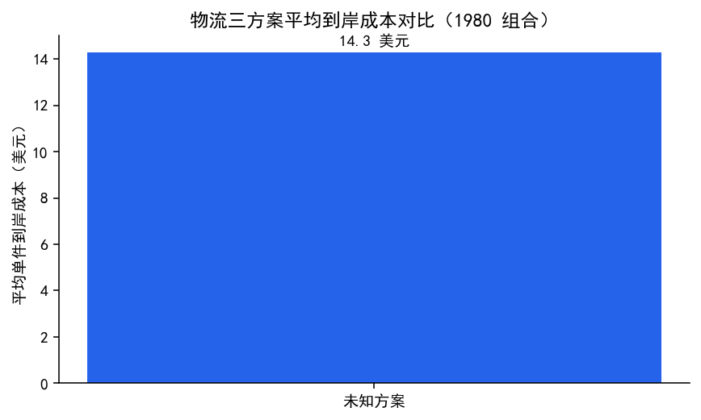

物流三方案平均单件到岸成本：未知方案 14.3 美元。

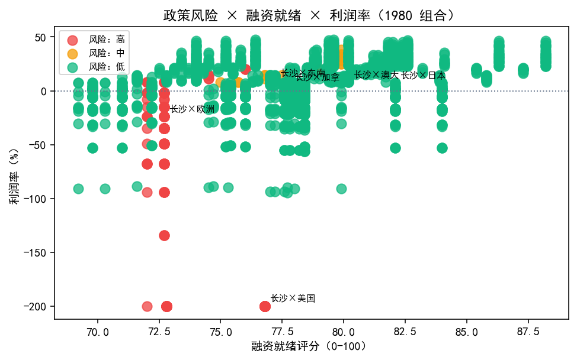

1980 组合中高风险 242 个、中风险 16 个；平均利润冲击
-8.5%，平均融资就绪评分 77.8，冲突高风险组合
1686 个。政策冲击最大的组合集中在小额包裹清关口径（美 / 欧等目的地），
验证了“政策风险量化 → 到岸成本 → 融资就绪”的决策闭环。

## 八、真实爬虫信号

每日与按需爬虫快照作为独立证据层，来自 Wikimedia 公开搜索与页面浏览量，不改动模型训练数据。
| 状态 | 组合数 | 来源数 | 回退 |
| --- | ---: | ---: | --- |
| ready | 10 | 82 | True |

Top 组合：
| 品类 | 市场 | 关键词 | 浏览量趋势 | 来源数 |
| --- | --- | --- | ---: | ---: |
| 太阳能设备 | 加拿大 | solar panel kit | +0.0% | 6 |
| 母婴用品 | 东南亚 | baby bottle warmer | +0.0% | 6 |
| 文具 | 墨西哥 | stationery supplies | +0.0% | 6 |
| 3D打印机 | 越南 | 3d printer | +0.0% | 4 |
| 3D打印机 | 东南亚 | 3d printer | +0.0% | 12 |
| 3D打印机 | 加拿大 | 3d printer | +0.0% | 9 |
| 桌游 | 墨西哥 | board game | +0.0% | 6 |
| 太阳能设备 | 东南亚 | solar panel kit | +0.0% | 9 |
| 手工DIY | 东南亚 | art and craft supplies | +0.0% | 12 |
| 玩具 | 东南亚 | educational toys | +0.0% | 12 |

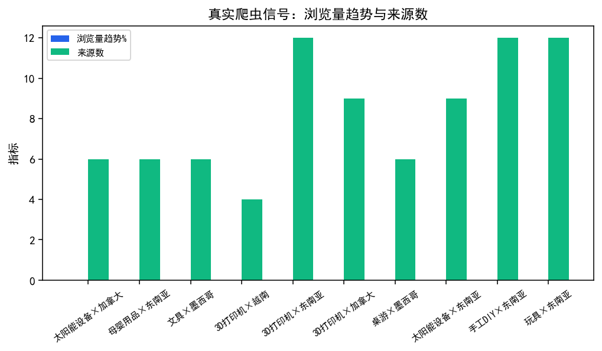

## 八点五、证据闸与解释分层

> 模型与统计数值和 AI 解释严格分层：数值来自预测、成本、政策与合规模型，
> AI 只负责解释与建议，不生成数值。

## 证据闸

本报告明确区分模型/统计数值与 AI 解释。

| 事实 | 来源 | 抓取时间 | 生效日 | 有效期 | 人工复核 | 状态 |
|---|---|---|---|---|---|---|
| 2025 年中国跨境电商进出口规模 | 国新办（SCIO）2026-01-28 发布会实录 | - | - | 长期 | - | 已检索 |
| 跨境电商企业数量 | 商务部（gov.cn 转载）与海关总署（青岛海关转载） | - | - | 长期 | - | 已检索 |
| 美国对华小额包裹政策 | 白宫行政命令 EO 14256 / EO 14257（Federal Register） | - | - | 长期 | - | 已检索 |
| 美国全面取消小额包裹免税 | 白宫 / GovInfo / Federal Register | - | - | 长期 | - | 已检索 |
| 欧盟低价值包裹关税减免 | 欧盟委员会税务与海关总司 / EUR-Lex（Regulation (EU) 2026/382） | - | - | 长期 | - | 已检索 |
| Temu 用 AI 监测关税变化 | 项目既有材料 | - | - | 长期 | - | 待核实 |
| AI 实时监控目标国法规成为 SaaS 核心趋势 | 项目既有材料 | - | - | 长期 | - | 待核实 |

存在未通过校验的事实条目，AI 结论不得引用这些条目：

- temu_ai：缺少日期或可核验链接
- saas_trend：缺少日期或可核验链接


## 八点六、业务指标（预测校准 / 方向命中 / Top-N 后验收益 / 库存损失）

> 口径：校准度/方向命中率基于回测逐点预测（来源 `rolling_backtest:seasonal_naive`，种子 42）；Top-N 后验收益与库存损失公式与假设见 metrics.json「口径」。

### 8.6.1 预测校准度

| 指标 | 数值 |
| --- | ---: |
| 系统性偏差 bias（预测-实际均值比） | -2.91% |
| 平均百分比误差 MPE | -1.78% |
| 平均绝对百分比误差 MAPE | 11.34% |
| 预测-实际秩相关 Spearman ρ | 0.80 |
| 80% 区间覆盖率 | 40.62%（名义 80%，偏差 -39.38pp） |
| 误差分位 P10/P25/P50/P75/P90 | -18.95% / -12.80% / -2.19% / 8.10% / 15.83% |
| 样本数 | 96 |

### 8.6.2 方向命中率（预测环比涨/跌 vs 实际）

| 指标 | 数值 |
| --- | ---: |
| 方向命中率 | 57.89% |
| 上涨周命中率 | 50.00% |
| 下跌周命中率 | 66.67% |
| 有效样本（环比非持平） | 95 |
| 持平周（不计入分母） | 0 |

### 8.6.3 Top-N 后验收益（实际销量 × 价格 × 毛利率，90 天）

Top10 合计后验毛利贡献 **$74607.59**，组合平均 $7460.76；实际环比增长平均 14.93%，正向确认率 100.00%；相对全组合基准提升 381.70%（预测增长与实际增长秩相关 0.41）。

| 排名 | 品类 | 市场 | 近12周均销量 | 实际环比增长 | 价格($) | 毛利率 | 90天后验收益($) |
| ---: | --- | --- | ---: | ---: | ---: | ---: | ---: |
| 1 | 阿胶糕 | 东南亚 | 47.23 | +17.91% | 30.0 | 45.8% | 8334.26 |
| 2 | 松子 | 英国 | 73.67 | +13.38% | 28.0 | 40.1% | 10639.7 |
| 3 | 西湖龙井 | 东南亚 | 52.5 | +15.40% | 28.0 | 44.0% | 8319.65 |
| 4 | 胶原蛋白粉 | 东南亚 | 45.19 | +14.80% | 26.0 | 43.5% | 6575.02 |
| 5 | 松子 | 加拿大 | 83.76 | +8.05% | 28.0 | 40.1% | 12097.99 |
| 6 | 铁观音 | 越南 | 49.69 | +16.19% | 24.0 | 41.4% | 6352.96 |
| 7 | 清酒 | 东南亚 | 49.34 | +20.50% | 18.0 | 35.4% | 4043.02 |
| 8 | 铁观音 | 东南亚 | 52.46 | +15.68% | 24.0 | 41.4% | 6707.08 |
| 9 | 抹茶粉 | 越南 | 57.91 | +12.83% | 20.0 | 37.8% | 5631.51 |
| 10 | 抹茶粉 | 东南亚 | 60.73 | +14.52% | 20.0 | 37.8% | 5906.4 |

### 8.6.4 库存损失估算

_暂缺基线 MAE，未计算。_


## 九、结论与建议

1. 模型路线有效：多源特征融合使 MAPE 从 nan% 降至
   2.33%，可作为“AI 数据驱动选品”的核心证据。
2. 推荐引擎与市场结构一致：东南亚 × 阿胶糕
   组合是当前数据下的高潜力方向，但需用真实平台数据验证泛化性。
3. 政策风险已量化：美国 de minimis 取消、欧盟低值包裹免税取消直接压利润，系统输出
   “转正式清关 / 海外仓 / 切换市场”等可执行动作，是商业计划书差异化的关键论据。
4. 报告与 demo 联动：本报告结论已同步写入商业计划书、技术文档、项目大纲、路演大纲、
   数据与模型说明和申报书；HTML / Streamlit demo 新增“数据分析”页签与联网搜索。

## 十、局限说明

- 项目统计基于合成演示数据快照，不代表真实市场；真实数据接入后需重跑本报告。
- 行业数据中“Temu AI 监测”“SaaS 法规监控趋势”等条目仍未定位官方原文，已标注待核实，
  答辩引用前必须回填来源；其余条目均已登记官方来源。
- 相关性分析用于解释信号结构，不构成因果推断；预测区间为模型不确定性估计，非业务承诺。

## 十一、待办 / 待核实清单

- [ ] 为“Temu 用 AI 监测关税”和“SaaS 法规监控趋势”补充公开报道或行业报告出处。
- [ ] 用真实 Google Trends / 平台榜单 / 海关出口数据回填对照组结果并复核图表口径。

## 附录 A：行业数据来源表

| 条目 | 数值 / 内容 | 口径说明 | 来源 | 链接 | 状态 |
| --- | --- | --- | --- | --- | --- |
| 2025 年中国跨境电商进出口规模 | 2.75 万亿元 | 海关初步统计；较 2020 年增长 69.7%（国新办发布会口径）。项目既有材料写作“同比增长 69.7%”，口径建议修正为“较 2020 年增长”。 | 国新办（SCIO）2026-01-28 发布会实录 | http://english.scio.gov.cn/m/pressroom/2026-01/28/content_118304543_10.html | 已检索 |
| 跨境电商企业数量 | 超过 12 万家 | 商务部口径（2024-08 国新办发布会：根据各地初步统计，全国跨境电商主体已超 12 万家）：https://www.gov.cn/yaowen/liebiao/202408/content_6965858.htm 。海关总署口径（2025-06 综试区文章：跨境电商综合试验区内企业已超 12 万家）：http://qingdao.customs.gov.cn/qingdao_customs/406496/ztlm/4744412/4744416/6563929/index.html 。 | 商务部（gov.cn 转载）与海关总署（青岛海关转载） | https://www.gov.cn/yaowen/liebiao/202408/content_6965858.htm | 已检索 |
| 美国对华小额包裹政策 | 2025-05-02 起不再适用 de minimis | EO 14256（2025-04-02，对华芬太尼关税）与 EO 14257（2025-04-02，对等关税）取消中国原产低值包裹 de minimis 免税，2025-05-02 12:01 a.m. EDT 生效；对华 120% 或最低 100 美元关税为相关行政命令与解读口径，具体按 Federal Register 原文核对。 | 白宫行政命令 EO 14256 / EO 14257（Federal Register） | https://www.whitehouse.gov/presidential-actions/2025/04/regulating-imports-with-a-reciprocal-tariff-to-rectify-trade-practices-that-contribute-to-large-and-persistent-annual-united-states-goods-trade-deficits/ | 已检索 |
| 美国全面取消小额包裹免税 | 2025-08-29 起全面生效 | 行政命令 EO 14324（2025-07-30 签署）；DHS 于 2025-08-29 实施。 | 白宫 / GovInfo / Federal Register | https://www.federalregister.gov/documents/2025/09/02/2025-16802/notice-of-implementation-of-the-presidents-executive-order-14324-suspending-duty-free-de-minimis | 已检索 |
| 欧盟低价值包裹关税减免 | 2026-07-01 起取消 150 欧元免税额度 | 欧盟委员会 2025-11-13 公告取消 150 欧元海关免税额度；最终立法文本为 Council Regulation (EU) 2026/382（2026-02-11 通过）与 Commission Delegated Regulation (EU) 2026/1022（2026-07-01 起对不超过 150 欧元包裹适用临时 3 欧元关税）；IOSS / VAT 落地细节需按成员国口径核验。 | 欧盟委员会税务与海关总司 / EUR-Lex（Regulation (EU) 2026/382） | https://taxation-customs.ec.europa.eu/news/e-commerce-150-eur-customs-duty-exemption-threshold-be-removed-2026-2025-11-13_en | 已检索 |
| Temu 用 AI 监测关税变化 | 行业验证案例 | 项目既有材料引用，尚未找到公开原文出处。 | 项目既有材料 | — | 待核实 |
| AI 实时监控目标国法规成为 SaaS 核心趋势 | 行业趋势 | 项目既有材料引用，尚未定位到具体报告原文。 | 项目既有材料 | — | 待核实 |

## 附录 B：图表清单


## 附录 C：复现步骤

```powershell
python scripts\run_data_analysis.py
python scripts\build_data_analysis_pdf.py
```
